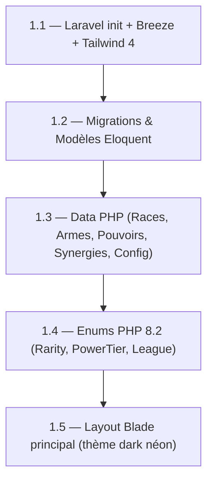
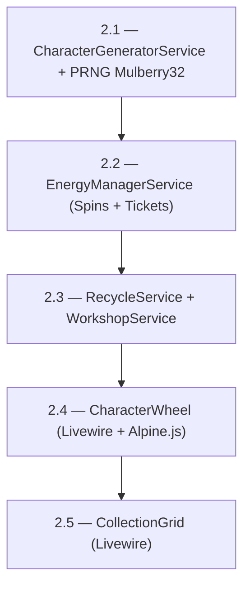
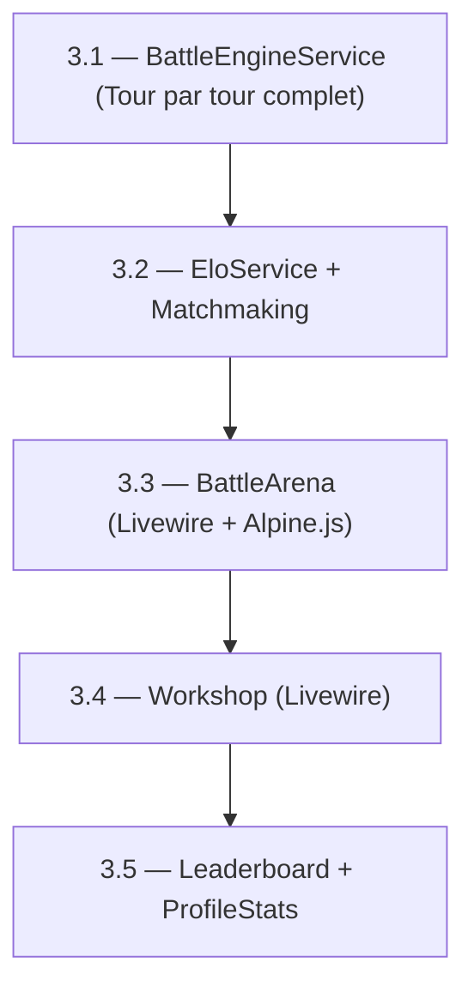
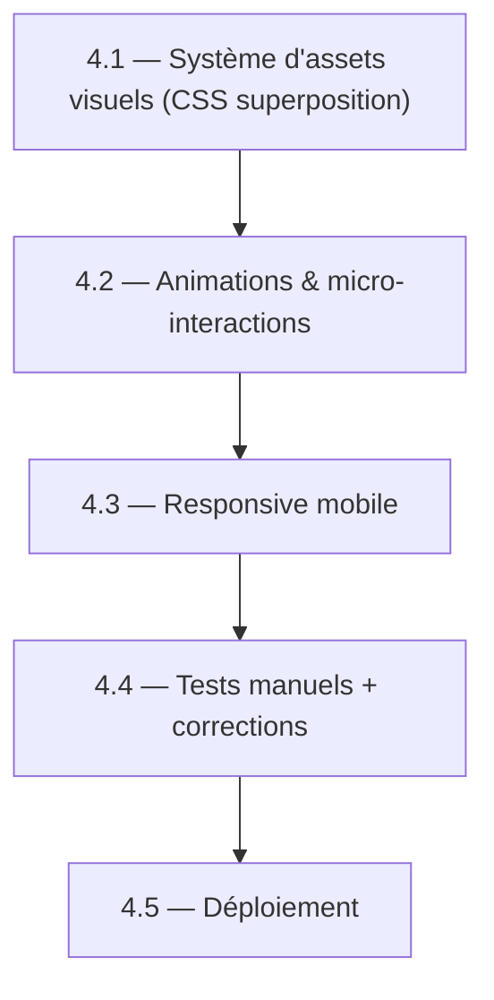

# 🎯 Analyse de Faisabilité — WHEELBORN (RNGboy)

## Verdict Global

> [!IMPORTANT]
> **Le projet est parfaitement faisable** pour un projet étudiant. La documentation est exceptionnellement bien structurée, le prototype JS est fonctionnel, et le plan de portage Laravel est réaliste. Cependant, il y a des **pièges de scope creep** à éviter et des **priorités à clarifier**.

---

## 1. Ce qui est Excellent (Points Forts)

| Aspect | Évaluation | Détail |
|:---|:---:|:---|
| **Documentation** | ⭐⭐⭐⭐⭐ | 4 documents couvrant GDD, architecture, boucle gameplay et plan de portage. Très rare pour un projet étudiant. |
| **Prototype JS fonctionnel** | ⭐⭐⭐⭐⭐ | Le prototype Vite/JS existe et valide les mécaniques. C'est un énorme avantage : vous ne codez pas "dans le vide". |
| **Architecture modulaire** | ⭐⭐⭐⭐⭐ | La séparation `data/`, `services/`, `ui/`, `combat/` est propre et se mappe directement vers Laravel. |
| **Game Design cohérent** | ⭐⭐⭐⭐ | Boucle de gameplay fermée, économie circulaire, pity system — tout s'emboîte logiquement. |
| **Plan de portage détaillé** | ⭐⭐⭐⭐ | Correspondance fichier par fichier JS → PHP, modèles Eloquent prêts, services déjà esquissés. |

---

## 2. Évaluation de Faisabilité par Module

### 🟢 Faisable sans difficulté majeure

| Module | Complexité | Temps estimé | Notes |
|:---|:---:|:---:|:---|
| Setup Laravel + Breeze + Tailwind | Faible | 2-3h | Scaffolding standard, très bien documenté |
| Migrations & Modèles Eloquent | Faible | 3-4h | Le schéma SQL est déjà écrit dans la doc |
| Fichiers de Data PHP (Races, Armes, Pouvoirs) | Faible | 2-3h | Conversion directe des `.js` en tableaux PHP |
| `CharacterGeneratorService` | Moyen | 4-6h | Conversion JS → PHP quasi mécanique |
| `EnergyManagerService` | Moyen | 2-3h | Logique de timestamps claire |
| `EloService` | Faible | 1h | Formule mathématique simple, déjà codée |
| `CollectionGrid` (Livewire) | Moyen | 4-5h | Filtres `wire:model.live`, pagination standard |
| `Workshop` (Livewire) | Moyen | 3-4h | CRUD simple avec vérification de solde |
| `Leaderboard` (Livewire) | Faible | 2-3h | Query Eloquent + pagination |
| Authentification (Breeze) | Faible | 1-2h | Package officiel, clé en main |

### 🟡 Faisable mais demande plus d'attention

| Module | Complexité | Temps estimé | Points d'attention |
|:---|:---:|:---:|:---|
| `CharacterWheel` (Livewire + Alpine.js) | **Élevé** | 6-10h | L'animation des 3 rouleaux nécessite un bon couplage Livewire ↔ Alpine.js. C'est la pièce maîtresse UI. |
| `BattleEngineService` (PHP) | **Élevé** | 8-12h | C'est le module le plus complexe : tour par tour, DoT, esquives, synergies, étourdissements. Tester rigoureusement. |
| `BattleArena` (Livewire) | **Élevé** | 6-8h | Animation séquentielle des rounds + barres de PV réactives côté Alpine.js |
| Système de Pity 10/10 | Moyen | 2-3h | Bien gérer l'état serveur + feedback visuel client |
| Anti-triche & sécurité | Moyen | 3-4h | Rate limiting, transactions, validation côté serveur |

### 🔴 Fonctionnalités à reporter (Post-MVP)

| Module | Raison du report |
|:---|:---|
| **Système d'assets visuels (Paper Doll)** | Nécessite des assets graphiques + pipeline d'assemblage. Peut être ajouté après le MVP. |
| Mode Boss Hebdomadaire (Raid) | Feature avancée, pas nécessaire pour valider le gameplay |
| Guildes / Clans | Complexité relationnelle M:N, multijoueur avancé |
| Postures Pré-Combat | Enrichissement gameplay post-lancement |
| Objets / Reliques Équipables | Extension de l'économie, pas critique pour la V1 |
| Chat en Temps Réel | WebSockets = complexité serveur significative |

---

## 3. Le Système d'Assemblage d'Images (Paper Doll) — Analyse Spécifique

> [!NOTE]
> Tu mentionnes vouloir un système de construction d'image par superposition de PNG. C'est documenté dans la section 3 de [DOCUMENTATION_DU_JEU.md](file:///c:/Users/natha/Documents/PROJET/RNGboy/DOCUMENTATION_DU_JEU.md#L301-L349), mais effectivement **pas reflété dans le schéma de BDD**.

### Ce qu'il faut ajouter à la BDD

```sql
-- Table optionnelle pour référencer les assets graphiques
CREATE TABLE character_assets (
    id              BIGINT UNSIGNED AUTO_INCREMENT PRIMARY KEY,
    layer_type      ENUM('background', 'body', 'equipment', 'weapon', 'power_aura', 'frame') NOT NULL,
    reference_id    VARCHAR(50) NOT NULL,       -- 'demon', 'sword', 'fire', 'legendary', etc.
    file_path       VARCHAR(255) NOT NULL,       -- 'assets/races/demon.webp'
    z_index         TINYINT UNSIGNED NOT NULL,    -- Ordre d'empilement
    created_at      TIMESTAMP DEFAULT CURRENT_TIMESTAMP,
    
    UNIQUE KEY uq_layer_ref (layer_type, reference_id)
);
```

### Recommandation pour l'implémentation

| Option | Complexité | Performance | Recommandation |
|:---|:---:|:---:|:---|
| **Option A : Superposition CSS** | ⭐ Faible | ⭐⭐⭐⭐⭐ Excellent | ✅ **Recommandée** — Pas besoin de table BDD supplémentaire. Le chemin de l'asset est calculé à la volée (`/assets/races/{$race_id}.webp`). Rendu instantané côté client. |
| **Option B : Canvas JS** | ⭐⭐ Moyen | ⭐⭐⭐⭐ Bon | Utile si tu veux permettre le téléchargement de la carte en PNG |
| **Option C : Serveur PHP (Intervention Image)** | ⭐⭐⭐ Élevé | ⭐⭐ Moyen | Trop lourd pour un projet étudiant. Nécessite un serveur avec GD/Imagick. |

### Workflow recommandé pour les assets

```
1. Créer un gabarit de 600×800px (ou 400×600 pour le web)
2. Dessiner/trouver 8 silhouettes de races (PNG transparent)
3. Dessiner/trouver 8 armes (positionnées sur le gabarit)
4. Créer 8 effets de pouvoir (auras, particules)
5. Créer 4 cadres de rareté (gris, bleu, violet, doré)
6. Créer 4 fonds thématiques par rareté
   
Total : ~35 assets pour 2048 combinaisons visuelles uniques
```

> [!TIP]
> Pour un projet étudiant, tu peux commencer avec des **emojis/icônes SVG stylisés** comme dans le prototype actuel, et ajouter les vrais assets PNG progressivement. Ne bloque pas le développement backend en attendant les illustrations !

---

## 4. Ordre de Développement Recommandé (Roadmap Pragmatique)

### Phase 1 — Fondations (1-2 semaines)



### Phase 2 — Cœur du Jeu (2-3 semaines)



### Phase 3 — Combat & Compétition (2-3 semaines)



### Phase 4 — Polish & Déploiement (1-2 semaines)



> [!IMPORTANT]
> **Estimation totale : 6 à 10 semaines** en travaillant régulièrement (10-15h/semaine). C'est réaliste pour un projet étudiant.

---

## 5. Pièges à Éviter

### ❌ Les erreurs classiques

| Piège | Pourquoi c'est dangereux | Solution |
|:---|:---|:---|
| **Vouloir tout faire d'un coup** | Le scope est large (12 modules). Essayer de tout livrer = ne rien finir. | MVP d'abord : Spin + Collection + Combat. Le reste après. |
| **Passer trop de temps sur les animations** | Les animations Alpine.js des rouleaux peuvent consommer des jours entiers. | Faire une V1 simple (fade-in avec délai), embellir après. |
| **Attendre les assets graphiques** | Si tu conditionnes le développement aux illustrations, tu bloques tout. | Utiliser des emojis/icônes SVG en placeholder. |
| **Négliger les tests du BattleEngine** | C'est le module le plus complexe avec plein de cas limites. | Écrire des tests unitaires PHP pour le combat (PHPUnit). |
| **Complexifier la BDD trop tôt** | Ajouter des tables pour guildes, reliques, etc. dès le début. | Coller au schéma actuel. Les extensions viendront naturellement. |

### ✅ Ce qui fera la différence

| Bonne pratique | Impact |
|:---|:---|
| **Tester le BattleEngine avec des seeds fixes** | Garantit la reproductibilité et facilite le debug |
| **Utiliser les Enums PHP 8.2** | Code propre, IDE-friendly, impossible de passer une valeur invalide |
| **Séparer Services / Livewire / Data** | Facilite les tests et les modifications futures |
| **Commencer par le `CharacterWheel`** | C'est la pièce maîtresse UX. Si le spin est satisfaisant, le jeu fonctionne. |

---

## 6. Options d'Hébergement Gratuit 🆓

> [!NOTE]
> Pour un projet étudiant avec peu de trafic, il existe plusieurs options viables. Voici un comparatif honnête.

### Option 1 : 🏆 **Railway.app** (Recommandée)

| Critère | Détail |
|:---|:---|
| **Prix** | Plan gratuit : **5$/mois de crédits offerts** (suffisant pour un petit projet) |
| **Stack** | ✅ PHP 8.2 + MySQL + Redis (tout en un clic) |
| **Déploiement** | Push Git → déploiement automatique |
| **Avantages** | Très simple, bon DX, domaine `.up.railway.app` gratuit, SSL auto |
| **Limites** | 500h d'exécution/mois sur le gratuit (peut être juste si le service tourne 24/7) |
| **Idéal pour** | Projets étudiants Laravel avec BDD |

### Option 2 : **Render.com**

| Critère | Détail |
|:---|:---|
| **Prix** | Plan gratuit disponible |
| **Stack** | ✅ PHP (via Docker), PostgreSQL gratuit (pas MySQL natif) |
| **Déploiement** | Push Git → build automatique |
| **Avantages** | PostgreSQL gratuit et illimité (90 jours puis pause), SSL auto |
| **Limites** | ⚠️ Les services gratuits **s'endorment après 15 min d'inactivité** → premier chargement lent (~30s). Pas de MySQL natif (utiliser PostgreSQL — Laravel le supporte nativement). |
| **Idéal pour** | Projets démo qu'on ne montre pas en continu |

### Option 3 : **PlanetScale / Aiven** (BDD) + **Vercel/Render** (App)

| Critère | Détail |
|:---|:---|
| **Prix** | Gratuit (tiers séparés) |
| **Stack** | ⚠️ Vercel ne supporte pas PHP nativement. Il faut un setup Docker sur Render ou Railway pour Laravel. |
| **Note** | PlanetScale a retiré son plan gratuit. **Aiven** offre MySQL gratuit (limite 1 BDD, 5GB). Bonne option pour la BDD seule. |

### Option 4 : **Fly.io**

| Critère | Détail |
|:---|:---|
| **Prix** | Plan gratuit : 3 VMs partagées, 1GB stockage |
| **Stack** | ✅ Docker → PHP/Laravel + MySQL/SQLite |
| **Déploiement** | `fly launch` depuis le terminal |
| **Avantages** | Très performant, pas de cold start, multi-régions |
| **Limites** | Setup initial un peu plus technique (Dockerfile nécessaire) |
| **Idéal pour** | Développeurs à l'aise avec Docker |

### Option 5 : **SQLite + Hébergement statique simplifié**

| Critère | Détail |
|:---|:---|
| **Concept** | Remplacer MySQL par **SQLite** (fichier local). Laravel le supporte nativement depuis la v11 (c'est même le driver par défaut). |
| **Avantage** | Élimine le besoin d'un serveur MySQL séparé. Simplifie drastiquement l'hébergement. |
| **Limites** | ⚠️ Ne supporte pas bien les écritures concurrentes (mais pour un projet étudiant avec peu d'utilisateurs, c'est largement suffisant). |
| **Verdict** | ✅ **Fortement recommandé** pour réduire les coûts et la complexité. |

### 📊 Tableau Comparatif Final

| Plateforme | Gratuit réel | MySQL | Cold Start | Setup | Recommandation |
|:---|:---:|:---:|:---:|:---:|:---:|
| **Railway** | ✅ (5$/mois crédits) | ✅ | ❌ Non | ⭐ Facile | 🏆 **1er choix** |
| **Fly.io** | ✅ (3 VMs) | ✅ (via Docker) | ❌ Non | ⭐⭐ Moyen | 🥈 **2ème choix** |
| **Render** | ✅ | ⚠️ PostgreSQL | ⚠️ 30s | ⭐ Facile | 🥉 Si PostgreSQL OK |
| **Hébergeur mutualisé gratuit** | ✅ | ✅ | ❌ Non | ⭐ Facile | ⚠️ Souvent PHP 7.x, pas Laravel 11 |

> [!TIP]
> **Ma recommandation concrète :**
> 
> 1. **Développement** : utiliser **SQLite** localement (zéro config BDD)
> 2. **Déploiement** : **Railway.app** avec MySQL (les 5$ de crédits gratuits suffisent pour un projet étudiant)
> 3. **Alternative budget zéro absolu** : **Fly.io** avec SQLite embarqué (un seul fichier, pas de serveur BDD séparé)

---

## 7. Éléments Manquants dans la Documentation Actuelle

| Élément manquant | Impact | Priorité |
|:---|:---|:---:|
| **Table BDD pour le système d'assets visuels** | Pas bloquant si Option CSS (pas besoin de table). Documenter le dossier `public/assets/` et la convention de nommage. | 🟡 Moyen |
| **Gestion des bots d'arène** | Le `BotOpponentSeeder` est mentionné mais pas détaillé. Combien de bots ? Quelles stats ? Distribution par ligue ? | 🟡 Moyen |
| **Stratégie de cache** | Pas de mention de cache Laravel pour les données statiques (races, armes, config). Recommandé pour la perf. | 🟢 Faible |
| **Tests unitaires** | Aucune stratégie de test mentionnée. Au minimum, tester `CharacterGeneratorService` et `BattleEngineService`. | 🔴 Important |
| **Gestion des erreurs UX** | Que se passe-t-il si le joueur perd sa connexion en plein spin ? Gestion des états incohérents. | 🟡 Moyen |
| **Migration des données du prototype** | Comment importer les personnages localStorage vers MySQL ? (Probablement pas nécessaire, mais à décider.) | 🟢 Faible |

---

## 8. Conclusion & Plan d'Action

### Le projet est-il faisable ? **OUI, absolument.** ✅

Le ratio documentation/complexité est excellent. Le prototype JS valide déjà les mécaniques. Le plan de portage est méthodique. Pour un projet étudiant, c'est un scope ambitieux mais réaliste en 6-10 semaines.

### Les 5 actions immédiates

1. **Initialiser le projet Laravel 11** (`laravel new wheelborn`) avec Breeze + Tailwind
2. **Créer les migrations** en copiant le SQL déjà écrit dans [PLAN_PORTAGE_LARAVEL.md](file:///c:/Users/natha/Documents/PROJET/RNGboy/PLAN_PORTAGE_LARAVEL.md)
3. **Porter les fichiers `Data/`** (races, armes, pouvoirs) — c'est la partie la plus mécanique
4. **Implémenter le `CharacterGeneratorService`** — c'est le cœur du jeu
5. **Construire le `CharacterWheel` Livewire** — c'est la pièce maîtresse UX

### Pour le système d'images Paper Doll

Commencer avec la **superposition CSS pure** (Option A). C'est la plus simple, la plus performante, et elle ne nécessite aucune modification de BDD. Tu peux ajouter les vrais assets PNG progressivement sans toucher au code backend.
