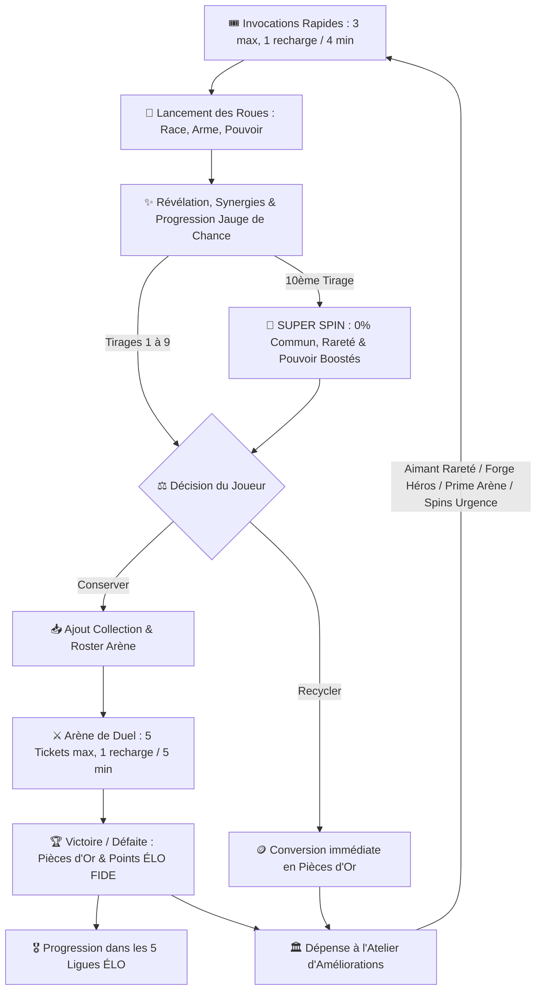
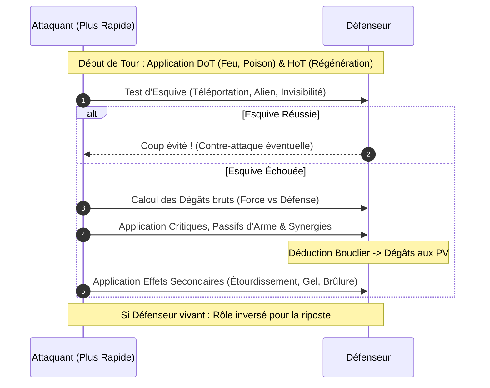

# 📜 WHEELBORN (RNGboy) — Document de Game Design & Spécifications Techniques

> **Version :** 2.0.0 (Évolution Gameplay : Micro-sessions, Jauge de Chance, Recyclage & Atelier)  
> **Statut :** Prototype de validation gameplay (Vite/JS) en vue d'un portage **Laravel 11 + Livewire 3 + Tailwind CSS**  
> **Auteur :** Équipe de conception & Développement  

---

## Sommaire

1. [Vision Globale & Objectifs](#1-vision-globale--objectifs)
2. [Game Design Document (GDD)](#2-game-design-document-gdd)
   - [2.1. Boucle de Jeu Principale (Core Loop V2)](#21-boucle-de-jeu-principale-core-loop-v2)
   - [2.2. Les Piliers de la Génération : Roues & Caractéristiques](#22-les-piliers-de-la-génération--roues--caractéristiques)
   - [2.3. Formules Mathématiques des Statistiques & Score Power](#23-formules-mathématiques-des-statistiques--score-power)
   - [2.4. Système de Rareté, Tiers de Pouvoirs & Super Spin](#24-système-de-rareté-tiers-de-pouvoirs--super-spin)
   - [2.5. Catalogue des Synergies & Combinaisons Instables](#25-catalogue-des-synergies--combinaisons-instables)
   - [2.6. Régulation des Invocations, Jauge de Chance (10/10) & Recyclage](#26-régulation-des-invocations-jauge-de-chance-1010--recyclage)
   - [2.7. Moteur de Combat Tour par Tour](#27-moteur-de-combat-tour-par-tour)
   - [2.8. Tickets d'Arène, Matchmaking & Formule ÉLO FIDE](#28-tickets-darène-matchmaking--formule-élo-fide)
   - [2.9. Les 5 Ligues Compétitives & Récompenses](#29-les-5-ligues-compétitives--récompenses)
   - [2.10. L'Atelier (Workshop) & Économie Circulaire des Pièces](#210-latelier-workshop--économie-circulaire-des-pièces)
3. [Système Visuel Futur : Moteur d'Assemblage Modulaire d'Assets](#3-système-visuel-futur--moteur-dassemblage-modulaire-dassets)
   - [3.1. Approche "Paper Doll" / Calques d'Assets](#31-approche-paper-doll--calques-dassets)
   - [3.2. Hiérarchie des Couches Graphiques](#32-hiérarchie-des-couches-graphiques)
   - [3.3. Pipeline d'Intégration](#33-pipeline-dintégration)
4. [Architecture Technique du Prototype Actuel (JavaScript)](#4-architecture-technique-du-prototype-actuel-javascript)
   - [4.1. Cartographie des Fichiers & Rôles](#41-cartographie-des-fichiers--rôles)
   - [4.2. Schéma de Données (JSON Models V2)](#42-schéma-de-données-json-models-v2)
   - [4.3. Déterminisme & Reproductibilité (PRNG)](#43-déterminisme--reproductibilité-prng)
5. [Spécifications pour le Portage Laravel + Livewire + Tailwind](#5-spécifications-pour-le-portage-laravel--livewire--tailwind)
   - [5.1. Schéma de Base de Données (Migrations & Modèles Eloquent V2)](#51-schéma-de-base-de-données-migrations--modèles-eloquent-v2)
   - [5.2. Services Métiers PHP Purs](#52-services-métiers-php-purs)
   - [5.3. Découpage des Composants Livewire 3 + Alpine.js](#53-découpage-des-composants-livewire-3--alpinejs)
   - [5.4. Charte Graphique & Tokens Tailwind CSS](#54-charte-graphique--tokens-tailwind-css)
6. [Audit Critique & Pistes d'Amélioration Gameplay](#6-audit-critique--pistes-damélioration-gameplay)
   - [6.1. Bilan des Améliorations de la V2](#61-bilan-des-améliorations-de-la-v2)
   - [6.2. Axes Futurs de Rétention & Équilibrage](#62-axes-futurs-de-rétention--équilibrage)

---

## 1. Vision Globale & Objectifs

### 1.1. Philosophie du Projet
**WHEELBORN** est calibré pour des **micro-sessions intenses et gratifiantes de 5 à 10 minutes** :
- **L'excitation de la génération aléatoire** : Le tirage des rouleaux (Race, Arme, Pouvoir) est le cœur battant du jeu, conçu pour susciter une curiosité permanente sur les synergies et les statistiques.
- **Régulation naturelle et envie de revenir** : Un stock rapide de 3 invocations se rechargeant en quelques minutes (1 charge / 4 min) évite le clic compulsif infini et maximise le plaisir de chaque session.
- **Jauge de Chance (Pity System 10/10)** : Chaque 10ème tirage garantit un *Super Spin* d'élite, remplaçant avantageusement l'ancien spin quotidien par un objectif continu et mesurable.
- **Économie circulaire fermée** : Tout personnage indésirable est recyclé en Pièces d'Or 🪙. Ces pièces sont ensuite réinvesties dans l'**Atelier** pour débloquer des améliorations permanentes.
- **Compétition équilibrée** : Des tickets d'arène (5 max, 1 / 5 min) canalisent le farm, et un classement officiel fondé sur la formule **Élo FIDE** répartit les joueurs en 5 Ligues de prestige.

### 1.2. Rôle du Prototype Actuel
Ce projet en JavaScript natif (avec Vite) sert de **bac à sable fonctionnel**. Son rôle est de valider mathématiquement et ludiquement :
1. La sensation de tirage des roues (satisfaction, suspense, lisibilité, impact du Super Spin) ;
2. La viabilité de l'équilibrage des statistiques, des tiers de pouvoirs et du score Power ;
3. La pertinence tactique des synergies en combat et le calibrage de l'Élo ;
4. Le cycle de rétention du joueur (sessions de 5-10 min, recyclage, dépenses à l'Atelier).

Une fois validé et ajusté, l'ensemble des règles sera migré vers une application web robuste sous **Laravel 11 + Livewire 3 + Tailwind CSS**, avec persistance en base relationnelle, multijoueur asynchrone réel et moteur de rendu visuel par assets superposés.

---

## 2. Game Design Document (GDD)

### 2.1. Boucle de Jeu Principale (Core Loop V2)



### 2.2. Les Piliers de la Génération : Roues & Caractéristiques

Chaque personnage est forgé à partir de **trois composantes fondamentales**, complétées par des jets de statistiques.

#### A. Les 8 Races
Chaque race définit l'identité corporelle, oriente les statistiques et confère un passif distinct :

| Race | Icône | Modificateurs Stats | Passif Thématique | Pondération |
| :--- | :---: | :--- | :--- | :---: |
| **Humain** | 👤 | +5 PV, +5 Force, +5 Vitesse, +5 Défense | *Adaptabilité* : Bonus universel équilibré. | 20 |
| **Elfe** | 🧝 | -2 PV, +2 Force, +18 Vitesse, -10 Défense | *Grâce Sylvestre* : Initiative et vélocité extrêmes. | 15 |
| **Démon** | 😈 | +4 PV, +20 Force, +6 Vitesse, -12 Défense | *Fureur Infernale* : Frappe massive, défense vulnérable. | 12 |
| **Robot** | 🤖 | +12 PV, +6 Force, -14 Vitesse, +22 Défense | *Châssis Titane* : Blindage lourd, pénalité de vitesse. | 12 |
| **Mutant** | ☣️ | 0 partout (Base) + Variance [-12, +20] | *Génome Chaotique* : Tirages imprévisibles par stat. | 10 |
| **Golem** | 🗿 | +25 PV, +12 Force, -22 Vitesse, +25 Défense | *Écorce Rocheuse* : Sac de PV et armure colossale. | 10 |
| **Vampire** | 🧛 | -4 PV, +14 Force, +10 Vitesse, -6 Défense | *Soif de Sang* : Vole 12% des dégâts infligés en PV. | 11 |
| **Alien** | 👽 | +6 PV, +8 Force, +8 Vitesse, +6 Défense | *Biologie Stellaire* : +8% d'esquive innée et synergies cosmiques. | 10 |

#### B. Les 8 Armes
L'arme modifie les statistiques d'attaque et apporte un effet tactique en combat :

| Arme | Icône | Type | Modificateurs Stats | Effet Passif en Combat | Poids |
| :--- | :---: | :--- | :--- | :--- | :---: |
| **Épée** | ⚔️ | Mêlée | +12 Force, +4 Vitesse, +6 Défense | Équilibrée et robuste. | 15 |
| **Arc** | 🏹 | Distance | +6 Force, +16 Vitesse, -2 Défense | Maximise les chances d'initiative. | 15 |
| **Marteau** | 🔨 | Lourd | +5 PV, +24 Force, -12 Vitesse, +8 Défense | 25% de chance d'étourdir l'adversaire (passe son tour). | 12 |
| **Lance** | 🔱 | Allonge | +2 PV, +10 Force, +10 Vitesse, +4 Défense | *Estoc fulgurant* : +25% de dégâts au tout 1er coup porté. | 14 |
| **Dague** | 🗡️ | Furtif | -2 PV, +8 Force, +20 Vitesse, -4 Défense | *Opportunisme* : +30% de dégâts si plus rapide que la cible. | 12 |
| **Bâton** | 🪄 | Magie | +8 PV, +6 Force, +6 Vitesse, +6 Défense | Amplifie les soins et boucliers arcaniques (+25%). | 12 |
| **Pistolet** | 🔫 | Balistique | +14 Force, +12 Vitesse, -4 Défense | *Précision* : 25% de coup critique (dégâts ×1.75). | 11 |
| **Grimoire**| 📖 | Incantation| +16 Force, +2 Vitesse, +2 Défense | *Magie Primordiale* : +35% sur les effets élémentaires. | 11 |

#### C. Les 8 Pouvoirs
Le pouvoir octroie une capacité spéciale active déclenchée pendant le combat :

| Pouvoir | Icône | Type | Effet de Combat | Poids |
| :--- | :---: | :--- | :--- | :---: |
| **Feu** | 🔥 | Élémentaire | DoT de Brûlure : 8 dégâts continus par tour pendant 3 tours. | 15 |
| **Glace** | ❄️ | Élémentaire | Ralentit la vitesse ennemie de 35% + 15% de chance de gel total. | 14 |
| **Poison** | 🧪 | Toxique | DoT progressif : inflige 5, puis 10, puis 15 dégâts sur 3 tours. | 14 |
| **Foudre** | ⚡ | Élémentaire | Surtension : +35% de chance de critique (dégâts ×1.8). | 13 |
| **Gravité** | 🌌 | Cosmique | Écrase la cible : -45% de vitesse adverse et -15% de ses dégâts. | 11 |
| **Téléportation** | 🌀 | Spatial | *Saut Dimensionnel* : 28% de chance d'esquiver complètement un coup. | 11 |
| **Régénération** | 💖 | Vital | Restaure automatiquement +12 PV au début de chaque tour. | 12 |
| **Invisibilité** | 👁️‍🗨️| Furtif | Dissimulation : esquive 100% garantie du tout premier coup reçu. | 10 |

---

### 2.3. Formules Mathématiques des Statistiques & Score Power

#### 1. Tirage de Base (Base Stats)
Avant tout modificateur, chaque statistique est générée dans une fourchette aléatoire uniforme :
- **PV de base :** $[55 ; 75]$
- **Force de base :** $[45 ; 70]$
- **Vitesse de base :** $[40 ; 68]$
- **Défense de base :** $[42 ; 68]$

#### 2. Calcul des Statistiques Finales
$$\text{Stat Finale} = \text{Base} + \text{Mod Race} + \text{Mod Arme} + \text{Bonus Synergies} + \text{Variance Mutant}$$
*Bornes de sécurité appliquées :*
- $\text{PV} \in [30 ; 130]$
- $\text{Force} \in [15 ; 100]$
- $\text{Vitesse} \in [10 ; 100]$
- $\text{Défense} \in [10 ; 100]$

#### 3. Calcul du Score Global (POWER)
Le score Power résume l'efficacité martiale du personnage sur une échelle normalisée (environ 40 à 98) :
$$\text{Power} = \text{Arrondi}\Big((\text{Force} \times 0.32) + (\text{PV} \times 0.24) + (\text{Défense} \times 0.24) + (\text{Vitesse} \times 0.20) + (\text{Nb Synergies} \times 3) + (\text{Bonus Instable } ?\ 2 : 0)\Big)$$

#### 4. Recyclage Systématique en Pièces d'Or (Économie V2)
Tout personnage rejeté ou libéré de la collection est immédiatement converti en **Pièces d'Or 🪙** :
$$\text{Pièces de Recyclage} = \max\Big(35,\ \text{Arrondi}\Big(\big((\text{Power} \times 1.2) + (\text{Nb Synergies} \times 25)\big) \times \text{Multiplicateur Rareté}\Big)\Big)$$

---

### 2.4. Système de Rareté, Tiers de Pouvoirs & Super Spin

#### A. Hiérarchisation des Pouvoirs par Tiers de Rareté
Les 8 pouvoirs sont classés en trois tiers d'accès distincts pour créer un gradient d'excitation :
- **Pouvoirs Communs (~60% d'apparition)** : Feu 🔥, Glace ❄️, Poison 🧪, Régénération 🌿
- **Pouvoirs Rares (~28% d'apparition)** : Foudre ⚡, Invisibilité 👤
- **Pouvoirs Mythiques (~12% d'apparition)** : Gravité 🌌, Téléportation 🌀

#### B. Table des Probabilités : Tirage Standard vs Super Spin (Pity 10/10)
La rareté suit une véritable rareté pyramidale, magnifiée tous les 10 tirages par le **Super Spin garanti** :

| Rareté | Étoiles | Couleur | Mult. Recyclage | Tirage Standard | Super Spin (10ème tirage) |
| :--- | :---: | :---: | :---: | :---: | :---: |
| **Commun** | ★☆☆☆☆ | Gris ardoise (`#94a3b8`) | $\times 1.00$ | **72 %** | **0 % (Garanti exclu)** |
| **Rare** | ★★☆☆☆ | Bleu cyan (`#38bdf8`) | $\times 1.15$ | **21 %** | **60 %** |
| **Épique** | ★★★☆☆ | Violet mystique (`#c084fc`)| $\times 1.30$ | **6 %** | **30 %** |
| **Légendaire** | ★★★★★ | Or incandescent (`#fbbf24`)| $\times 1.50$ | **1.0 %** | **10.0 % ($\times 10$ !)** |
| *Pouvoir garanti* | — | — | — | Tout pouvoir | **Rare ou Mythique garanti** |

*Règle d'ajustement de cohérence :* Si un personnage génère un Power $\ge 86$ avec au moins 2 synergies mais a tiré un ticket Commun, il est promu automatiquement au rang *Rare* (et au rang *Épique* si Power $\ge 95$).

---

### 2.5. Catalogue des Synergies & Combinaisons Instables

Le jeu intègre **16 synergies uniques** qui récompensent les associations cohérentes ou insolites :

#### Synergies Harmoniques (12)
1. **Démon + Feu** (*Affinité Démoniaque*) : +18% Dégâts globaux, DoT de Brûlure amplifié de +50%.
2. **Elfe + Arc** (*Archer Naturel*) : +16 Vitesse, +20% chance de coup critique.
3. **Robot + Foudre** (*Supraconducteur*) : +15 Défense, chaque frappe électrique ennemie recharge 6 PV au lieu de nuire.
4. **Vampire + Régénération** (*Sangsue Immortelle*) : Soin passif doublé (+12 PV/tour) et vol de vie élevé à 25%.
5. **Golem + Marteau** (*Impact Tellurique*) : +25 Force, 40% de chance d'étourdissement lourd.
6. **Grimoire + Magie Élémentaire** (*Incantation Arcanique*) : +25% d'efficacité magique et +1 tour de durée sur les DoT.
7. **Humain + Épée** (*Maître d'Armes*) : +12 Force, +12 Défense, parade réduisant de 10% tous les dégâts reçus.
8. **Alien + Téléportation** (*Distorsion Spatiale*) : +30% d'esquive globale et contre-attaque spatiale automatique à chaque esquive réussie.
9. **Dague + Invisibilité** (*Assassin Fantôme*) : +12 Vitesse, premier coup critique garanti à $\times 2.2$ de dégâts.
10. **Bâton + Régénération** (*Harmonie Sylvestre*) : Bouclier arcanique de 25 PV offert en début de duel et +8 PV soignés par tour.
11. **Pistolet + Foudre** (*Tir Électro-Magnétique*) : +25% critique, multiplicateur critique porté à $\times 2.0$.
12. **Lance + Gravité** (*Pointe Gravitationnelle*) : Cloue l'ennemi au sol (l'adversaire ne peut jamais esquiver) et +15% dégâts.

#### Combinaisons Instables (4)
13. **Démon + Glace** (*Combustion Glacée*) : Choc thermique imprévisible. Dégâts variant sauvagement entre 50% et 220% à chaque coup, et inflige à la fois Brûlure et Gel.
14. **Robot + Poison** (*Infection Artificielle*) : Liquide de refroidissement toxique qui ronge la défense ennemie (-30%), mais le robot subit une corrosion interne de 4 PV/tour.
15. **Golem + Téléportation** (*Masse Déplacée*) : +20% d'esquive par disparition. À sa réapparition, le colosse de 10 tonnes retombe et écrase l'ennemi en infligeant 30 dégâts bonus nets.
16. **Mutant + Gravité** (*Singularité Vivante*) : Anomalie biologique. La force et la vitesse du personnage mutent de façon aléatoire à chaque tour de combat ($-10$ à $+20$).

---

### 2.6. Régulation des Invocations, Jauge de Chance (10/10) & Recyclage

Pour rythmer l'expérience en sessions courtes (5 à 10 minutes) sans frustration :
1. **Invocations Rapides (Micro-sessions) :** Réserve limitée à **3 charges maximum**. Une charge se régénère automatiquement toutes les **4 minutes** (240 secondes).
2. **Jauge de Chance (Pity System 10/10) :**
   - Chaque tirage standard ($< 10$) génère une carte standard puis ajoute $+1$ à la jauge ($0 \to 10$).
   - Lorsque la jauge atteint **10/10**, le bouton s'illumine en or (`🌟 LANCER LE SUPER SPIN`).
   - Au lancement du tirage à 10/10, l'effet **Super Spin garanti** est appliqué (0% commun, rareté boostée, pouvoir rare ou mythique obligatoire).
   - Dès la carte Super Spin reçue et révélée, la jauge est réinitialisée à **0/10**.
   - Cette jauge remplace définitivement l'ancien bonus journalier par un sentiment de progression permanent et prévisible.
3. **Recyclage Immédiat :** Le bouton "Jeter / Supprimer" est banni. Tout personnage non retenu est converti en Pièces d'Or pour alimenter l'Atelier.

---

### 2.7. Moteur de Combat Tour par Tour

Le combat oppose deux combattants en 1 contre 1, résolu automatiquement en tours successifs (plafond à 30 tours pour éviter tout blocage).



#### Formule de Dégâts de Base
$$\text{Dégâts Bruts} = \max\Big(5,\ (0.75 \times \text{Force}_{\text{attaquant}} - 0.38 \times \text{Défense}_{\text{défenseur}}) + \text{Aléatoire}(-3, +3)\Big) \times \text{Multiplicateurs}$$

- **Initiative :** Calculée dynamiquement à chaque tour en comparant la vitesse actuelle.
- **Boucliers :** Absorbent les dégâts avant que les PV ne soient entamés.
- **Contrôles de foule :** L'étourdissement du Marteau ou le gel complet neutralisent l'action du tour.

---

### 2.8. Tickets d'Arène, Matchmaking & Formule ÉLO FIDE

#### A. Tickets d'Arène (Régulation anti-farm)
- Stock limité à **5 tickets maximum**.
- Recharge automatique de **1 ticket toutes les 5 minutes** (300 secondes).
- Cela canalise les sessions et pousse le joueur à alterner entre invocations, tri de cartes et duels.

#### B. Véritable Formule Élo Officielle (FIDE)
Pour un classement mathématiquement équitable et compétitif, le système applique la formule internationale :
$$E_{\text{joueur}} = \frac{1}{1 + 10^{(R_{\text{adversaire}} - R_{\text{joueur}}) / 400}}$$
$$\Delta \text{Élo} = \text{Arrondi}\Big(K \times (S - E_{\text{joueur}})\Big) \quad \text{avec } K = 32 \text{ et } S \in \{1 \text{ (Victoire)}, 0 \text{ (Défaite)}\}$$

- Si un joueur à 1000 Élo bat un Boss à 1200 Élo, il gagne $+24$ Élo.
- S'il perd contre un adversaire à 800 Élo, il perd $-24$ Élo.

---

### 2.9. Les 5 Ligues Compétitives & Récompenses

Tous les joueurs et bots d'arène sont répartis dans **5 Ligues officielles** :

| Ligue | Badge | Tranche ÉLO | Rôle & Prestige |
| :--- | :---: | :---: | :--- |
| **Bronze** | 🥉 | 0 – 999 | Débutants et nouveaux guerriers |
| **Argent** | 🥈 | 1 000 – 1 399 | Rang de départ officiel (1 000 Élo) |
| **Or** | 🥇 | 1 400 – 1 799 | Combattants aguerris aux synergies rodées |
| **Platine** | 💎 | 1 800 – 2 199 | Élite de l'Arène |
| **Maître** | 👑 | 2 200+ | Légendes incontestées de Wheelborn |

#### Récompenses de Duel :
- **Victoire :** $+75$ Pièces de base (amplifié par l'Atelier) + bonus contre adversaire à Élo supérieur + $50$ XP.
- **Défaite :** $+20$ Pièces d'encouragement + $15$ XP.

---

### 2.10. L'Atelier (Workshop) & Économie Circulaire des Pièces

L'Atelier remplace l'ancien onglet journalier et boucle l'économie du jeu en permettant de réinvestir ses Pièces d'Or dans des bonus permanents :

| Amélioration | Niveaux | Coûts (Pièces 🪙) | Effet Permanent |
| :--- | :---: | :---: | :--- |
| **Aimant à Rareté** | 5 | 250 / 600 / 1200 / 2500 / 5000 | Augmente les chances de base d'obtenir des cartes Rares (+3% à +15%), Épiques et Légendaires (+0.2% à +1.0%). |
| **Forge des Héros** | 5 | 300 / 750 / 1500 / 3000 / 6000 | Rehausse le plancher de statistiques de base de tous les personnages générés (+2 à +12 min stats). |
| **Prime d'Arène** | 4 | 200 / 500 / 1000 / 2000 | Multiplicateur sur les gains de pièces en arène ($\times 1.15$, $\times 1.30$, $\times 1.50$, $\times 1.75$). |
| **Invocation d'Urgence** | Journalier | 150 pièces / invocation | Recharge immédiate d'1 charge de spin (limité à 2 achats par jour). |

---

## 3. Système Visuel Futur : Moteur d'Assemblage Modulaire d'Assets

Comme indiqué dans vos spécifications, les cartes n'ont pas encore d'illustrations définitives. L'objectif est d'utiliser un **système de génération visuelle modulaire 2D par calques (Paper Doll)**.

### 3.1. Approche "Paper Doll" / Calques d'Assets

Plutôt que de dessiner des centaines d'illustrations complètes, vous dessinerez des **éléments isolés sur fond transparent (PNG / WebP / SVG)** calibrés sur un gabarit (canvas) standardisé (ex: $600 \times 800$ px).

```text
Nombre de combinaisons possibles = 
  8 (Races) × 8 (Armes) × 8 (Pouvoirs) × 4 (Raretés) = 2 048 visuels uniques
... réalisables avec seulement ~35 assets dessinés !
```

### 3.2. Hiérarchie des Couches Graphiques (Z-Index)

```
[Couche 6 - Premier Plan] : Bordure & Cadre de Rareté (Doré, Violet, Bleu, Gris)
[Couche 5 - Effets]       : Aura / Particules de Pouvoir (Flammes, Éclairs, Particules de Glace)
[Couche 4 - Main / Arme]  : Arme équipée (Arc bandé, Épée levée, Bâton lumineux)
[Couche 3 - Équipement]   : Vêtements, Armure ou Accessoires spécifiques
[Couche 2 - Corps / Race] : Silhouette de base de la Race (Humain, Golem de pierre, Robot, Démon ailé)
[Couche 1 - Arrière-Plan] : Fond thématique (Arène, Forêt elfique, Crypte, Cosmos)
```

### 3.3. Pipeline d'Intégration

Trois méthodes sont envisageables pour la version Livewire :

1. **Option A : Superposition CSS pure (Recommandée pour Livewire + Tailwind)**
   - Le composant Blade affiche un conteneur relatif contenant plusieurs `` absolus superposés :
   ```html
   <div class="relative w-64 h-96 rounded-xl overflow-hidden shadow-2xl">
       rarity }}.webp" class="absolute inset-0 z-0">
       raceId }}.webp" class="absolute inset-0 z-10">
       weaponId }}.webp" class="absolute inset-0 z-20">
       powerId }}.webp" class="absolute inset-0 z-30">
       rarity }}.webp" class="absolute inset-0 z-40 pointer-events-none">
   </div>
   ```
   *Avantages :* Zéro calcul serveur, rendu instantané, animations CSS/Tailwind indépendantes sur chaque calque (ex: aura qui pulse).

2. **Option B : Rendu HTML5 Canvas Client**
   - Fusionne les images en une seule texture via un canvas JavaScript et permet le téléchargement de la carte par le joueur en PNG.

3. **Option C : Génération Serveur (Intervention Image en PHP)**
   - Fusionne les calques côté serveur lors de la sauvegarde du personnage et stocke une miniature unique sur S3/Local Storage.

---

## 4. Architecture Technique du Prototype Actuel (JavaScript)

### 4.1. Cartographie des Fichiers & Rôles

```
c:\Users\natha\Documents\PROJET\RNGboy\
├── index.html                   # Shell applicatif sémantique et conteneurs de vues
├── package.json                 # Environnement Vite
└── src/
    ├── main.js                  # Point d'entrée, cycle de vie, routage par onglets
    ├── style.css                # Design system complet (thème sombre, néon, animations)
    ├── data/
    │   ├── config.js            # Configuration V2 : énergies, pity, tiers de pouvoirs, ligues Élo, atelier
    │   ├── races.js             # Objets des 8 races et modificateurs
    │   ├── weapons.js           # Objets des 8 armes et effets tactiques
    │   ├── powers.js            # Objets des 8 pouvoirs, tiers (commun/rare/mythique) et DoT/HoT
    │   ├── synergies.js         # Conditions et bonus des 16 synergies
    │   └── names.js             # Générateur procédural de noms
    ├── utils/
    │   ├── random.js            # Algorithme PRNG Mulberry32 et choix pondérés
    │   └── sound.js             # Synthétiseur audio pur Web Audio API (sans fichiers MP3)
    ├── generation/
    │   ├── characterGenerator.js# Génération V2, Super Spin, passifs Atelier et valeur de recyclage
    │   └── massSimulator.js     # Outil de test sur 1 000 tirages consécutifs
    ├── combat/
    │   ├── battleEngine.js      # Moteur de combat tour par tour autonome
    │   └── opponentsPool.js     # Pool d'adversaires avec ratings ÉLO calibrés et challengers
    ├── collection/
    │   └── collectionManager.js # CRUD de collection et persistance localStorage
    ├── progression/
    │   └── progressionManager.js# Moteur V2 : énergies (spins/tickets), jauge pity, Élo FIDE, recyclage et atelier
    └── ui/
        ├── wheelUI.js           # Rouleaux, jauge de chance 10/10, Super Spin et recyclage immédiat
        ├── characterCardUI.js   # Rendu réutilisable des fiches de cartes (badges Super Spin, recyclage)
        ├── collectionUI.js      # Grille, filtres, modale de détail et recyclage en pièces
        ├── battleUI.js          # Arène de combat régulée par tickets, ratings ÉLO et ligues
        ├── devUI.js             # Panneau de test Dev Mode V2 (+1000 pièces, pity 9/10, refill énergies)
        ├── extrasUI.js          # Atelier d'améliorations, Classement par Ligues Élo et Statistiques
        └── notifications.js     # Système de toasts d'information
```

### 4.2. Schéma de Données (JSON Models V2)

#### Modèle `Character`
```json
{
  "id": "char_m7x2q9_k3p0a",
  "name": "Ignis le Brûlant",
  "owner_id": "player_1",
  "creatorName": "NathOof",
  "isPlayerCreated": true,
  "created_at": "2026-10-11T14:30:00.000Z",
  "isLuckySpin": false,
  "isUnstable": false,
  "race": "Démon",
  "raceId": "demon",
  "raceIcon": "😈",
  "weapon": "Épée",
  "weaponId": "sword",
  "weaponIcon": "⚔️",
  "power": "Feu",
  "powerId": "fire",
  "powerIcon": "🔥",
  "powerTier": "common",
  "hp": 78,
  "maxHp": 78,
  "strength": 77,
  "speed": 55,
  "defense": 49,
  "power": 74,
  "rarity": "rare",
  "synergies": [
    {
      "id": "demon_fire",
      "name": "Affinité Démoniaque",
      "icon": "🔥😈",
      "description": "+18% Dégâts globaux et DoT de Brûlure amplifié de +50%.",
      "isUnstable": false,
      "effects": { "damageMultiplier": 1.18, "burnDamageBoost": 1.5 }
    }
  ],
  "battlesCount": 4,
  "wins": 3,
  "losses": 1,
  "value": 720,
  "recycleValue": 132
}
```

#### Modèle `ProgressionState` (V2)
```json
{
  "coins": 850,
  "elo": 1084,
  "pityCounter": 4,
  "xp": 340,
  "level": 2,
  "spinEnergy": {
    "available": 2,
    "lastRegenTimestamp": 1791645600000
  },
  "arenaEnergy": {
    "available": 4,
    "lastRegenTimestamp": 1791645800000
  },
  "workshopUpgrades": {
    "rare_magnet": 1,
    "hero_forge": 0,
    "arena_bonus": 1,
    "emergency_count_today": 0,
    "last_emergency_date": "Sun Oct 11 2026"
  },
  "stats": {
    "totalGenerations": 14,
    "totalBattles": 9,
    "wins": 7,
    "losses": 2,
    "legendariesCount": 1,
    "highestPower": 88,
    "totalRecycled": 6,
    "discoveredSynergies": ["demon_fire", "robot_lightning"]
  },
  "unlockedAchievements": {
    "first_blood": true,
    "first_synergy": true
  }
}
```

### 4.3. Déterminisme & Reproductibilité (PRNG)

Le moteur s'appuie sur l'algorithme **Mulberry32** (`src/utils/random.js`). Lorsqu'une `seed` numérique est fournie à `simulateBattle()`, l'intégralité du combat (initiatives, coups critiques, DoT, esquives) produit exactement le même résultat et les mêmes logs mot pour mot. Cela permet la relecture de combats côté serveur sans stocker d'énormes fichiers journaux.

---

## 5. Spécifications pour le Portage Laravel + Livewire + Tailwind

La transition du prototype vers **Laravel 11**, **Livewire 3** et **Tailwind CSS** s'effectuera avec une correspondence directe des couches.

### 5.1. Schéma de Base de Données (Migrations & Modèles Eloquent V2)

```sql
-- Table des Utilisateurs (Économie V2 & Élo)
CREATE TABLE users (
    id BIGINT PRIMARY KEY AUTO_INCREMENT,
    name VARCHAR(255) NOT NULL,
    email VARCHAR(255) UNIQUE NOT NULL,
    coins INT DEFAULT 150,
    elo INT DEFAULT 1000,
    pity_counter INT DEFAULT 0,
    xp INT DEFAULT 0,
    level INT DEFAULT 1,
    spin_charges INT DEFAULT 3,
    last_spin_regen_at TIMESTAMP NULL,
    arena_tickets INT DEFAULT 5,
    last_ticket_regen_at TIMESTAMP NULL,
    workshop_upgrades JSON NULL,
    created_at TIMESTAMP,
    updated_at TIMESTAMP
);

-- Table des Personnages
CREATE TABLE characters (
    id VARCHAR(36) PRIMARY KEY,
    user_id BIGINT NOT NULL,
    name VARCHAR(255) NOT NULL,
    race_id VARCHAR(50) NOT NULL,
    weapon_id VARCHAR(50) NOT NULL,
    power_id VARCHAR(50) NOT NULL,
    power_tier ENUM('common', 'rare', 'mythic') NOT NULL,
    hp INT NOT NULL,
    strength INT NOT NULL,
    speed INT NOT NULL,
    defense INT NOT NULL,
    power_score INT NOT NULL,
    rarity ENUM('common', 'rare', 'epic', 'legendary') NOT NULL,
    is_lucky_spin BOOLEAN DEFAULT FALSE,
    is_unstable BOOLEAN DEFAULT FALSE,
    synergies_data JSON NULL,
    recycle_value INT NOT NULL,
    battles_count INT DEFAULT 0,
    wins INT DEFAULT 0,
    losses INT DEFAULT 0,
    is_active_fighter BOOLEAN DEFAULT FALSE,
    created_at TIMESTAMP,
    updated_at TIMESTAMP,
    FOREIGN KEY (user_id) REFERENCES users(id) ON DELETE CASCADE
);

-- Table des Combats (Historique & Évolution ÉLO)
CREATE TABLE battles (
    id BIGINT PRIMARY KEY AUTO_INCREMENT,
    challenger_id VARCHAR(36) NOT NULL,
    opponent_id VARCHAR(36) NOT NULL,
    winner_id VARCHAR(36) NOT NULL,
    seed BIGINT NOT NULL,
    turns_count INT NOT NULL,
    player_old_elo INT NOT NULL,
    player_new_elo INT NOT NULL,
    elo_delta INT NOT NULL,
    coins_awarded INT NOT NULL,
    xp_awarded INT NOT NULL,
    created_at TIMESTAMP
);
```

### 5.2. Services Métiers PHP Purs

Pour conserver la propreté du code, la logique ne résidera pas dans les contrôleurs ni dans les composants Livewire, mais dans des services injectables :

1. `App\Services\CharacterGeneratorService` :
   - `generate(User $user, array $options = []): Character`
   - Détection de la condition `isLuckySpin` ($10^{\text{ème}}$ tirage ou flag).
   - Application des passifs d'atelier (`rare_magnet`, `hero_forge`).
   - Calcul de la valeur de recyclage (`calculateRecycleValue`).
2. `App\Services\BattleEngineService` (moteur de combat pur, aucun accès BDD) :
   - `simulate(Character|array $challenger, Character|array $opponent, ?int $seed = null): array`
   - Résout le duel tour par tour (initiative, dégâts, critiques, esquives, effets, synergies, double K.O. = match nul) et renvoie le vainqueur, la seed et le journal complet.
   - Déterministe : mêmes combattants + même seed = combat strictement identique.
3. `App\Services\ArenaService` (arène : vrais joueurs ou Fantômes d'Arène) :
   - `availableFighters(User $user)` : combattants du joueur pouvant combattre.
   - `findOpponent(User $user, Character $fighter)` : adversaire de la carte choisie. D'abord un vrai joueur via `EloService::findOpponent()`, sinon un Fantôme d'Arène généré par `BotGeneratorService`.
   - `fight(User $user, Character $fighter, array $opponent)` : lance le duel via `BattleEngineService`, puis enregistre le combat (`seed`, `turns_log`, `fighters_snapshot`, `opponent_id` si vrai joueur) et met à jour l'Élo, les pièces, l'XP et le palmarès du joueur. Le propriétaire de la carte adverse n'est jamais modifié.
   - Calcul de l'Élo délégué à `EloService`.
   - Anti-triche : `replay(Battle $battle)` recalcule un combat enregistré, `isAuthentic(Battle $battle)` vérifie qu'il n'a pas été modifié.
   - `describeFighter(...)` : données d'affichage d'un combattant (fiche du face-à-face).
4. `App\Services\BotGeneratorService` (anti « cold start ») :
   - `generateGhost(User $user): array` : Fantôme d'Arène généré à la volée quand aucun vrai joueur n'est dans la plage d'Élo. Stats ajustées selon la ligue du joueur, Élo à ±100 sans sortir de sa ligue, nom procédural (« Gladiateur de l'Ombre », « Garde de Fer »…). Jamais enregistré en base.
5. `App\Services\EloService` (formule officielle FIDE, K = 32) :
   - `expectedScore(int $playerElo, int $opponentElo): float` : probabilité de victoire attendue.
   - `calculateDelta(int $playerElo, int $opponentElo, bool $isWin): int` : variation d'Élo du duel.
   - `newRating(int $playerElo, int $opponentElo, bool $isWin): int` : nouvel Élo, avec plancher à 0.
   - `findOpponent(User $user, Character $attackerCard): ?Character` : matchmaking. Cherche un autre joueur à ±100 Élo (élargi progressivement jusqu'à ±250), puis prend dans sa collection la carte de puissance la plus proche de celle de l'attaquant ; `null` si personne (repli sur un bot). L'Élo du joueur affronté ne change pas.
6. `App\Services\LeaderboardService` (classement de l'arène) :
   - `top(?League $league = null): array` : 50 meilleurs joueurs (tous ou d'une ligue) avec rang, Élo, ligue et nombre de combats. Mis en cache 60 secondes par onglet. Les admins ne sont pas classés.
   - `playerStanding(User $user): ?array` : rang, Élo et ligue du joueur connecté, recalculés à chaque affichage.
7. `App\Services\BattleHistoryService` (historique des duels) :
   - `recent(User $user): array` : 10 derniers combats (V/D/N, adversaire, delta d'Élo, date relative « il y a 5 min »).
   - `replayData(User $user, int $battleId): ?array` : journal (`turns_log`), cartes et bilan d'un combat du joueur, pour le revoir dans l'arène sans recalcul ni coût.
8. `App\Services\EnergyManagerService` :
   - `checkAndRegenSpins(User $user): void` (3 max, 1 / 4 min).
   - `checkAndRegenTickets(User $user): void` (5 max, 1 / 5 min).

### 5.3. Découpage des Composants Livewire 3 + Alpine.js

| Composant Livewire | Rôle Principal | Synergie avec Alpine.js |
| :--- | :--- | :--- |
| `Livewire\CharacterWheel` | Déclenche le spin, gère la jauge de chance (Pity 10/10) | Alpine anime les 3 rouleaux pendant 1.6s et gère le compte à rebours dynamique de recharge (4 min) |
| `Livewire\CollectionGrid` | Grille, filtres multi-critères, modale de recyclage | Modale instantanée avec confirmation de recyclage en pièces |
| `Livewire\BattleArena` | Consomme 1 ticket (5 max), matchmaking par Élo | Défilement séquentiel des rounds avec barres de PV réactives |
| `Livewire\Workshop` | Boutique d'améliorations passives permanentes | Achat instantané et feedback visuel des paliers débloqués |
| `Livewire\Leaderboard` | Classement compétitif par Ligues (Bronze $\to$ Maître) | Filtrage par ligue et positionnement de l'utilisateur |

### 5.4. Charte Graphique & Tokens Tailwind CSS

Pour Tailwind, nous définissons une palette thématique inspirée du prototype :
- **Dark Background :** `bg-slate-950` et surfaces `bg-slate-900/90` avec effet glassmorphism `backdrop-blur-md border border-slate-800`.
- **Raretés :**
  - Commun : `border-slate-500 text-slate-400 bg-slate-500/10`
  - Rare : `border-sky-500 text-sky-400 bg-sky-500/10 shadow-sky-500/20 shadow-lg`
  - Épique : `border-purple-500 text-purple-400 bg-purple-500/10 shadow-purple-500/30 shadow-lg`
  - Légendaire : `border-amber-400 text-amber-300 bg-amber-400/10 shadow-amber-400/40 shadow-xl animate-pulse`
- **Ligues ÉLO :**
  - Bronze : `text-amber-700 bg-amber-900/20 border-amber-800`
  - Argent : `text-slate-300 bg-slate-700/20 border-slate-600`
  - Or : `text-amber-400 bg-amber-500/20 border-amber-500`
  - Platine : `text-cyan-300 bg-cyan-500/20 border-cyan-500`
  - Maître : `text-purple-300 bg-purple-500/20 border-purple-500`
- **Statistiques :**
  - PV : `bg-rose-500`
  - Force : `bg-amber-500`
  - Vitesse : `bg-cyan-500`
  - Défense : `bg-emerald-500`

---

## 6. Audit Critique & Pistes d'Amélioration Gameplay

### 6.1. Bilan des Améliorations de la V2
- **Rétention ciblée (5-10 min) :** Les 3 invocations rapides et 5 tickets d'arène permettent de jouer une session complète, satisfaisante et sans temps mort.
- **La Jauge de Chance (10/10) :** Remplace avec succès le Daily : chaque tirage (même faible) rapproche le joueur d'un Super Spin garanti, créant une vraie motivation à vider ses charges.
- **Économie Circulaire :** Le recyclage systématique élimine la frustration des tirages ratés et donne un objectif à long terme via l'Atelier.
- **Compétition équitable :** L'Élo FIDE et les 5 ligues apportent une véritable identité e-sport et un ladder gratifiant.

### 6.2. Axes Futurs de Rétention & Équilibrage
1. **Postures Tactiques Pré-Combat :**
   - Avant de lancer le combat, le joueur choisit une posture : *Offensive* (+15% Force, -10% Défense), *Défensive* (+20% Défense, -10% Vitesse) ou *Fourbe* (+20% Vitesse, critiques accrus).
2. **Objets / Reliques Équipables :**
   - 1 emplacement d'accessoire (ex: Amulette de régénération, Anneau de précision) déblocable à l'Atelier ou en ligue Platine/Maître.
3. **Mode Boss d'Arène Hebdomadaire (Raid Asynchrone) :**
   - Un colosse mondial avec une barre de PV collective où chaque joueur peut envoyer son meilleur héros 1 fois par jour.

---

*Document de Game Design & Spécifications Techniques — Version 2.0.0 — WHEELBORN (RNGboy).*
