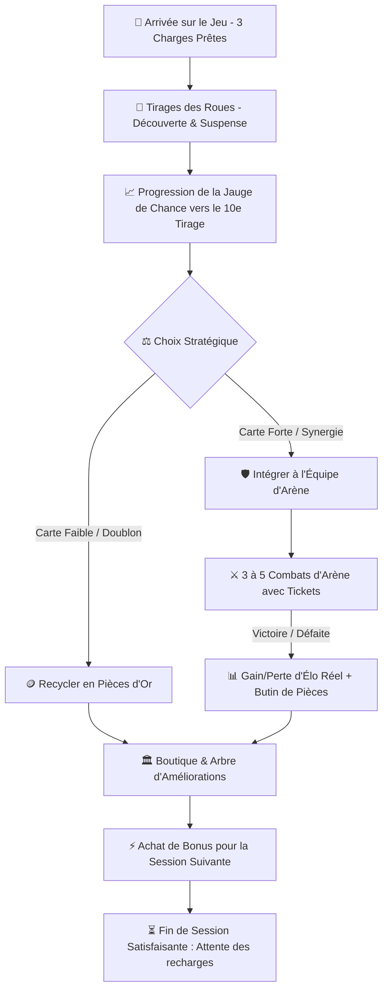
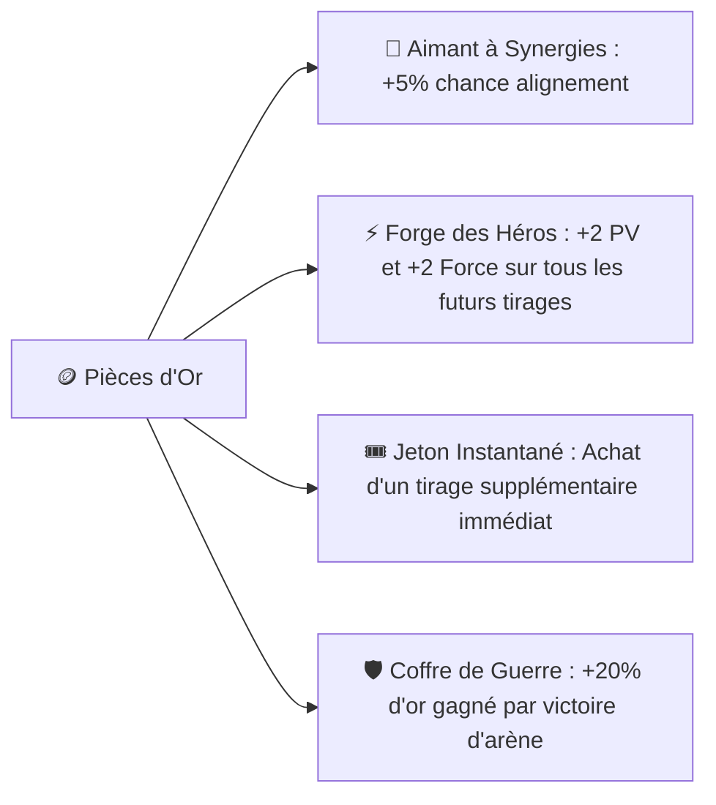

# 🔄 Refonte Complète de la Boucle de Gameplay (Session 5-10 Min)

> **Document de Conception & Spécifications (GDD v2)**  
> **Projet :** WHEELBORN (RNGboy)  
> **Objectif :** Concevoir une boucle de jeu ultra-dynamique, hautement rétentive, pensée pour des sessions courtes de **5 à 10 minutes**, où chaque action alimente obligatoirement la suivante.

---

## 1. Diagnostic de l'Ancienne Boucle & Nouvelle Vision

### 1.1. Les 4 blocages identifiés dans l'ancien modèle

| Ancien Modèle (V1) | Problème Constaté | Solution Nouvelle Boucle (V2) |
| :--- | :--- | :--- |
| **1 tirage par heure (Max 2)** | Trop espacé. Le joueur vient, clique 1 fois, n'a rien à faire et s'ennuie. | **Stock de 3 charges (1 recharge toutes les 4-5 min)** : session de tirage complète disponible à chaque visite. |
| **Bouton "Jeter" / Poubelle** | Psychologiquement frustrant. Personne n'aime jeter le fruit d'une invocation. | **Système de Recyclage en Pièces** : chaque carte non conservée rapporte de l'or selon son niveau. |
| **Personnage Quotidien (Daily)** | Passif, décorrélé de l'effort du joueur et crée une visite unique de 30 secondes. | **Remplacé par la Jauge de Chance (Lucky Spin au 10ème tirage)** : incite à jouer activement pour déclencher le boost. |
| **Combats infinis sans économie** | Risque d'AFK farm, pas de vrai enjeu de pièces, Elo arbitraire. | **Tickets d'Arène limités + Vrai calcul Élo mathématique + Pièces gagnées réinvestissables**. |

---

### 1.2. La Philosophie de la Session "Coffee Break" (5 à 10 minutes)

Le jeu ne doit pas retenir le joueur de force pendant 1 heure. Il doit lui donner un **sentiment intense d'accomplissement en 7 minutes**, puis lui donner **envie irrésistible de revenir 2 à 3 heures plus tard**.



---

## 2. Déroulement Chronologique d'une Session Type (7 Minutes)

```text
[00:00 - 01:00]  ACCUEIL & COLLECTE
                - Le joueur ouvre l'appli. 
                - Ses 3 charges de tirage sont pleines (3/3).
                - Sa jauge de Pity affiche par exemple 7/10.

[01:00 - 03:30]  PHASE DE GÉNÉRATION & FRISSON DU HASARD
                - Tirage 1 : Elfe + Arc + Poison (Synergie découverte !). Le joueur la GARDE. (Pity: 8/10).
                - Tirage 2 : Humain + Marteau commun (stats moyennes). Le joueur RECYCLE en +75 Pièces. (Pity: 9/10).
                - Tirage 3 : BOOM ! 10ème tirage atteint -> SUPER ROUE DU DESTIN activée !
                  Le tirage est doré : Démon + Épée + Foudre Légendaire ! (Pity reset à 0/10).

[03:30 - 06:30]  PHASE D'ARÈNE & COMBATS ÉLO
                - Le joueur a 4 Tickets de combat.
                - Il aligne son nouveau Démon Légendaire contre un adversaire à Élo équivalent.
                - Résolution de 3 combats tactiques rapides : 2 Victoires (+38 Élo, +180 Pièces), 1 Défaite (-14 Élo, +30 Pièces).
                - Son rang grimpe de "Argent III" à "Argent II".

[06:30 - 08:00]  PHASE D'INVESTISSEMENT (LE "HOOK" DE RETOUR)
                - Avec ses ~350 Pièces accumulées, le joueur achète dans l'Atelier :
                  "Aimant à Pouvoirs Rares Niv. 2" (+5% de chance d'avoir des pouvoirs de haut rang).
                - Plus de tickets ni de charges : session terminée.
                - Notification/Compteur : "Prochaine charge de roue prête dans 4 min 30 s".
```

---

## 3. Mécaniques de Génération Revues : Suspense & Pity System

### 3.1. Cadence d'Énergie de Tirage
* **Capacité maximale du stock :** **3 charges** (évite d'accumuler 20 tirages et d'annihiler la valeur de chaque clic).
* **Vitesse de recharge :** **1 charge toutes les 4 minutes**.
  * En 12 minutes d'absence, le joueur a régénéré son stock complet.
  * Il peut faire une micro-session de 3 tirages plusieurs fois par jour (pause café, transports, pause déjeuner).

### 3.2. Hiérarchie des Pouvoirs : Rareté & Drops Pondérés
Actuellement dans le prototype, tous les pouvoirs ont quasiment le même poids (~12 à 15%). C'est une erreur pour la rétention : **certains pouvoirs doivent être légendaires et rarissimes** pour que les joueurs rêvent de les obtenir.

| Palier de Pouvoir | Pouvoirs Concernés | Effet & Impact | Poids de Base |
| :--- | :--- | :--- | :---: |
| **Communs** (60%) | **Feu**, **Poison**, **Épée Énergétique** | DoT constants, dégâts directs accessibles. | 60 % |
| **Rares** (28%) | **Glace** (Slow/Gel), **Foudre** (Critique), **Régénération** (Soin) | Contrôle et survie supérieure. | 28 % |
| **Mythiques / Épiques** (12%) | **Téléportation** (Esquive 28%), **Gravité** (Double débuff), **Invisibilité** | Capacités spatiales qui renversent les combats. | 12 % |

### 3.3. Remplacement du Daily par la "Jauge de Chance" (Lucky Spin 10/10)
* **Problème du Daily supprimé :** Le daily est une récompense passive qui n'encourage pas à jouer.
* **Nouveau système : Jauge de Chance (Pity System) :**
  * À chaque tirage normal, un compteur visible progresse : `1/10`, `2/10`, `...`, `9/10`.
  * **Au 10ème tirage exact : Le tirage devient un "SUPER SPIN" garanti :**
    - Commun exclu (0% de chance).
    - 60% Rare, 30% Épique, **10% Légendaire** !
    - Garanti d'avoir un Pouvoir Rare ou Mythique.
  * Le compteur retombe à 0 après le 10ème tirage.
  * **Effet psychologique :** Si un joueur a tiré 2 fois et se retrouve à `8/10`, il a hâte que sa charge revienne pour atteindre ce fameux 10ème tirage.

---

## 4. Économie Circulaire : Fin du "Jeter", Place au Recyclage

### 4.1. Pourquoi le bouton "Jeter" est une hérésie de Game Design
Dans un jeu de tirage, jeter un personnage sans compensation génère de la frustration ("J'ai attendu ma charge pour rien").  
En remplaçant "Jeter" par **"Recycler en Pièces"**, même un tirage médiocre procure une récompense concrète et mesurable.

### 4.2. Formule de Recyclage en Pièces d'Or
Le gain en or dépend du **Score Power** et de la **Rareté** :

$$\text{Or de Recyclage} = \text{Arrondi}\Big(\big(\text{Power} \times 1.2\big) + \big(\text{Nb Synergies} \times 25\big)\Big) \times \text{Multiplicateur Rareté}$$

* **Carte Commune (Power 55) :** $\approx 65 \text{ à } 80 \text{ Pièces}$
* **Carte Rare (Power 72) :** $\approx 150 \text{ à } 200 \text{ Pièces}$
* **Carte Épique (Power 85) :** $\approx 350 \text{ à } 450 \text{ Pièces}$
* **Carte Légendaire :** $\approx 1 000 \text{ Pièces}$ (si doublon)

---

## 5. Nouveau Système de Combat & Vrai Calcul d'Élo

### 5.1. Simplification & Dynamisme des Combats
Le combat ne doit pas être un roman de 30 lignes de logs que personne ne lit. Il doit être **rapide, percutant (10 à 15 secondes d'animation ou instantané)**, tout en restant tactique :
1. **Affichage Face-à-Face :** Carte Joueur vs Carte Ennemie (tirée de la future BDD parmi les vrais joueurs de même rang).
2. **Phase 1 - L'Initiative :** Qui frappe en premier selon la vitesse.
3. **Phase 2 - L'Affrontement (3 à 5 chocs visuels) :** Déclenchement des synergies visibles (icône qui clignote), coups critiques, déduction claire des PV.
4. **Phase 3 - Bilan Immédiat :**
   - Résultat : Victoire / Défaite.
   - Variation d'Élo : $\pm \text{Points}$.
   - Butin de pièces d'or.

### 5.2. Régulation : Les Tickets d'Arène (Anti-AFK Farm)
* Le joueur dispose de **5 Tickets d'Arène maximum**.
* 1 ticket se recharge toutes les **5 minutes** (ou 1 ticket offert par carte recyclée).
* Empêche de lancer 100 combats d'affilée en boucle automatique.

### 5.3. Formule Mathématique d'Élo Réel (Standard FIDE)
L'Élo ne doit **ni monter à l'infini, ni chuter sans raison**. Il doit refléter le niveau relatif de la carte et du joueur.

Soit $R_A$ l'Élo du joueur et $R_B$ l'Élo de l'adversaire :

$$\text{Probabilité de victoire attendue } E_A = \frac{1}{1 + 10^{(R_B - R_A) / 400}}$$

Variation d'Élo après combat ($S = 1$ en cas de victoire, $S = 0$ en cas de défaite, coefficient de volatilité $K = 32$) :
$$\Delta \text{Élo} = \text{Arrondi}\big(K \times (S - E_A)\big)$$

#### Exemples concrets :
* **Cas 1 : Match équilibré (1 000 Élo vs 1 000 Élo) :**
  - Victoire : $+16 \text{ Élo}$
  - Défaite : $-16 \text{ Élo}$
* **Cas 2 : Tu bats un adversaire plus fort (1 000 Élo vs 1 150 Élo) :**
  - Victoire : $+23 \text{ Élo}$ (Gros exploit récompensé !)
  - Défaite : $-9 \text{ Élo}$ (Défaite prévisible, peu pénalisante).
* **Cas 3 : Tu perds contre un adversaire plus faible (1 150 Élo vs 1 000 Élo) :**
  - Défaite : $-23 \text{ Élo}$ (Sanction pour avoir mal choisi son combat).

#### Système de Ligues par Paliers d'Élo :
* 🥉 **Bronze :** $0 - 999$ Élo
* 🥈 **Argent :** $1 000 - 1 399$ Élo
* 🥇 **Or :** $1 400 - 1 799$ Élo
* 💎 **Platine :** $1 800 - 2 199$ Élo
* 👑 **Maître des Roues :** $2 200+$ Élo

---

## 6. L'Étape Manquante : À quoi servent les Pièces ? (L'Atelier)

Pour que chaque étape donne envie de jouer à la suivante, les pièces gagnées par le recyclage et les victoires en arène doivent pouvoir être investies dans **l'Atelier de Destin** :



### Arbre d'Améliorations Permanentes (Gold Sinks)

| Amélioration | Coût en Or | Effet Direct sur le Prochain Tirage / Combat |
| :--- | :---: | :--- |
| **Aimant à Pouvoirs Rares (Niv. 1 à 5)** | $200 \rightarrow 1 500$ | Augmente de $+3\%$ par niveau la chance de tomber sur des pouvoirs Épiques. |
| **Forge des Statistiques (Niv. 1 à 5)** | $150 \rightarrow 1 200$ | Ajoute un modificateur passif permanent de $+2$ Force et $+3$ PV à toute future carte. |
| **Prime de Victoire (Niv. 1 à 3)** | $300 \rightarrow 900$ | Augmente l'or gagné lors des victoires en arène ($+25\%$, $+50\%$, $+100\%$). |
| **Ticket d'Urgence (Achat Unique)** | $120$ Pièces | Permet d'acheter 1 tirage immédiatement si la jauge est vide (coût croissant / jour). |

---

## 7. Tableau de Cohérence de la Nouvelle Boucle

| Étape de Jeu | Ce que fait le joueur | Ce qu'il gagne | Vers quelle étape cela le propulse |
| :--- | :--- | :--- | :--- |
| **1. Roues (Tirage)** | Lance ses 3 charges disponibles. | 1 à 3 nouveaux personnages + progression Pity $10/10$. | $\rightarrow$ **Étape 2 (Tri)** |
| **2. Tri & Recyclage** | Conserve les pépites, convertit les faibles. | De l'or frais immédiat ($70-200$ pièces / carte). | $\rightarrow$ **Étape 3 (Combat)** et **Étape 4 (Atelier)** |
| **3. Arène (Combats)** | Lance ses 3-5 combats avec ses meilleures cartes. | Points d'Élo (montée de ligue) + Or de victoire. | $\rightarrow$ **Étape 4 (Atelier)** |
| **4. Atelier (Upgrades)** | Dépense son or dans les améliorations de compte. | Meilleures stats et meilleures chances pour la suite. | $\rightarrow$ **Étape 1 (Prochaine session de tirages)** |
| **5. Déconnexion (Attente)** | Quitte l'application satisfait après 7 minutes. | Recharge passive des charges de tirage et tickets. | $\rightarrow$ **Retour 2 à 3 heures plus tard** |

---

## 8. Synthèse des Modifications Immédiates pour le Prototype

Pour tester cette formule dans le prototype JavaScript actuel avant de la coder en Livewire :

1. **Supprimer l'écran Daily** $\rightarrow$ Le remplacer par une jauge bien visible **"Prochain tirage béni : X / 10"**.
2. **Remplacer le bouton "Rejeter" par "Recycler (+XX 🪙)"** dans la modale de révélation de carte.
3. **Rééquilibrer l'énergie horaire** $\rightarrow$ Passer à 3 charges maximum avec recharge de 4 minutes.
4. **Intégrer le système d'Élo FIDE** dans le calcul des résultats de combat avec affichage des ligues (Bronze, Argent, Or).
5. **Ajouter un onglet "Atelier / Upgrades"** permettant de dépenser les pièces d'or dans 3 ou 4 améliorations passives réelles.

Ce rapport constitue la base officielle de refonte. Il transforme un générateur isolé en un **véritable jeu en boucle fermée, addictif et équilibré**.
