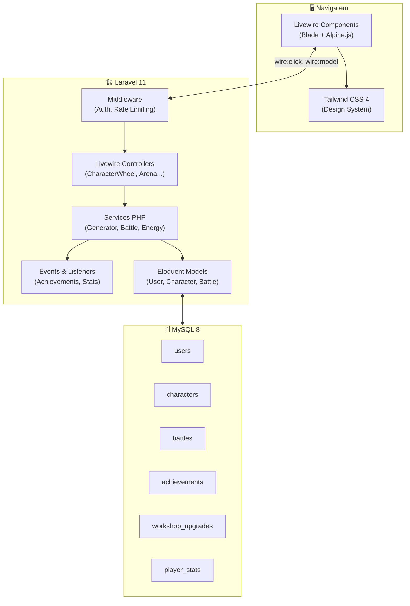
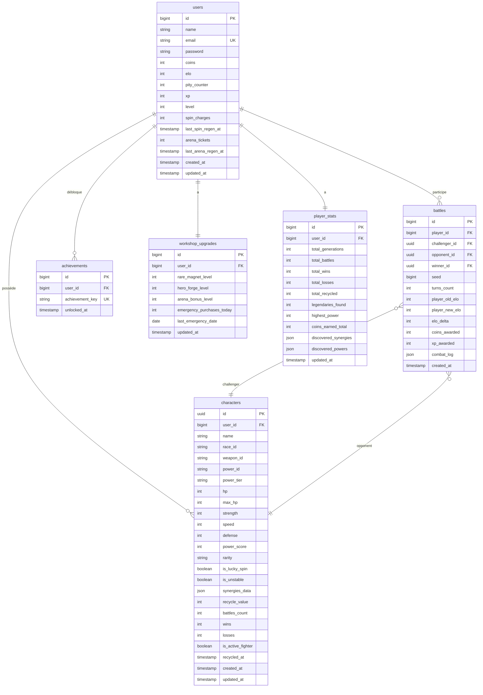
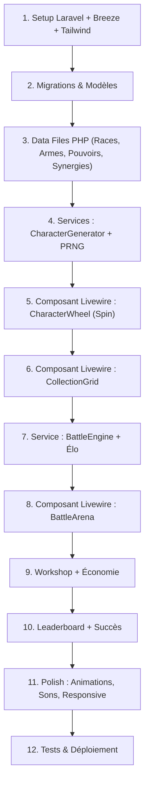

# 🏗️ WHEELBORN — Plan de Portage Laravel / Livewire

> **Projet Universitaire** — Portage du prototype JavaScript vers une application web full-stack  
> **Stack cible :** Laravel 11 + Livewire 3 + Tailwind CSS 4  
> **Auteur :** NathOof  
> **Version :** 1.0.0

---

## Sommaire

1. [Choix Technologiques & Justifications](#1-choix-technologiques--justifications)
2. [Architecture Applicative](#2-architecture-applicative)
3. [Schéma de Base de Données (Complet & Extensible)](#3-schéma-de-base-de-données-complet--extensible)
4. [Modèles Eloquent & Relations](#4-modèles-eloquent--relations)
5. [Services Métier (Logique PHP Pure)](#5-services-métier-logique-php-pure)
6. [Composants Livewire 3 & Alpine.js](#6-composants-livewire-3--alpinejs)
7. [Authentification & Gestion des Comptes](#7-authentification--gestion-des-comptes)
8. [Sécurité & Anti-Triche](#8-sécurité--anti-triche)
9. [Plan de Migration depuis le Prototype JS](#9-plan-de-migration-depuis-le-prototype-js)
10. [Axes d'Extension Futurs](#10-axes-dextension-futurs)

---

## 1. Choix Technologiques & Justifications

### 1.1. Stack Obligatoire (Contrainte Universitaire)

| Technologie | Version | Rôle | Justification |
| :--- | :---: | :--- | :--- |
| **Laravel** | 11.x | Framework PHP backend | Contrainte projet. Écosystème mature, migrations, ORM Eloquent, middleware, queues. |
| **Livewire** | 3.x | Composants réactifs full-stack | Contrainte projet. Réactivité sans SPA, couplé nativement à Laravel. |
| **PHP** | 8.2+ | Langage serveur | Requis par Laravel 11. Typage strict, enums, fibers. |

### 1.2. Stack Recommandée (CSS & Outils)

| Technologie | Version | Rôle | Justification |
| :--- | :---: | :--- | :--- |
| **Tailwind CSS** | 4.x | Framework CSS utility-first | **Recommandé.** Synergie native avec Laravel (via Vite). Design system rapide, purge automatique, thématisation par tokens CSS natifs. |
| **Alpine.js** | 3.x | Micro-interactivité JS | Inclus avec Livewire 3. Gère les animations côté client (rouleaux, timers, modales). |
| **Vite** | 6.x | Bundler frontend | Inclus par défaut dans Laravel 11. HMR, compilation Tailwind. |
| **MySQL / MariaDB** | 8.0+ / 10.6+ | Base de données relationnelle | Standard universitaire. Performant, bien supporté par Eloquent. |
| **Laravel Breeze** | 2.x | Kit d'authentification | Authentification légère avec Blade + Tailwind. Pas de lourdeur Jetstream. |

### 1.3. Pourquoi Tailwind CSS plutôt qu'une autre solution ?

| Critère | Tailwind CSS 4 | Bootstrap 5 | CSS Pur / SCSS |
| :--- | :--- | :--- | :--- |
| **Rapidité de dev** | ✅ Excellent (classes utilitaires) | ✅ Bon (composants préfaits) | ❌ Lent (tout écrire) |
| **Personnalisation** | ✅ Totale via `@theme` | ⚠️ Override complexe | ✅ Totale mais verbeux |
| **Taille bundle prod** | ✅ ~8 KB (purge auto) | ❌ ~50-80 KB | ✅ Variable |
| **Intégration Laravel** | ✅ Natif (scaffolding Vite) | ⚠️ Manuel | ⚠️ Manuel |
| **Responsive** | ✅ `sm:`, `md:`, `lg:` | ✅ Grid 12 colonnes | ⚠️ Media queries manuelles |
| **Dark mode** | ✅ `dark:` natif | ❌ Néant | ⚠️ Variables CSS |
| **Animations** | ✅ `animate-*`, transitions | ⚠️ Limité | ✅ Total mais verbeux |

**Verdict :** Tailwind CSS 4 est le choix optimal pour un projet Laravel universitaire. Il est nativement supporté, ultra-léger en production, et permet de reproduire rapidement le design sombre néon du prototype.

---

## 2. Architecture Applicative

### 2.1. Structure du Projet Laravel

```
app/
├── Http/
│   ├── Controllers/           # Contrôleurs classiques (pages statiques, API)
│   └── Middleware/
│       └── EnsureHasCharacter.php  # Middleware custom si nécessaire
├── Livewire/                  # Composants Livewire (UI réactive)
│   ├── CharacterWheel.php     # Roue de génération + Pity 10/10
│   ├── CollectionGrid.php     # Grille de collection + recyclage
│   ├── BattleArena.php        # Arène de combat + tickets
│   ├── Workshop.php           # Atelier d'améliorations
│   ├── Leaderboard.php        # Classement Élo par ligues
│   └── ProfileStats.php       # Profil joueur + succès
├── Models/                    # Modèles Eloquent
│   ├── User.php
│   ├── Character.php
│   ├── Battle.php
│   ├── Achievement.php
│   └── WorkshopUpgrade.php
├── Services/                  # Logique métier pure (AUCUNE dépendance UI)
│   ├── CharacterGeneratorService.php
│   ├── BattleEngineService.php    # Moteur de combat pur (simulation déterministe)
│   ├── ArenaService.php           # Arène : choix de l'adversaire, enregistrement des duels, Élo, récompenses, anti-triche
│   ├── BotGeneratorService.php    # Fantômes d'Arène générés à la volée (anti cold start)
│   ├── EnergyManagerService.php
│   ├── EloService.php
│   ├── RecycleService.php
│   └── WorkshopService.php
├── Enums/                     # PHP 8.2 Enums
│   ├── Rarity.php             # common, rare, epic, legendary
│   ├── PowerTier.php          # common, rare, mythic
│   ├── League.php             # bronze, silver, gold, platinum, master
│   └── UpgradeType.php        # rare_magnet, hero_forge, arena_bonus
├── Data/                      # Données statiques (remplace src/data/*.js)
│   ├── RaceData.php           # Les 8 races (Config PHP)
│   ├── WeaponData.php         # Les 8 armes
│   ├── PowerData.php          # Les 8 pouvoirs + tiers
│   ├── SynergyData.php        # Les 16 synergies
│   └── GameConfig.php         # Config centrale (probabilités, seuils, XP)
├── Events/                    # Événements Laravel
│   ├── CharacterGenerated.php
│   ├── CharacterRecycled.php
│   ├── BattleCompleted.php
│   └── AchievementUnlocked.php
└── Listeners/                 # Listeners pour les succès, XP, etc.
    ├── ProcessAchievements.php
    └── UpdatePlayerStats.php

database/
├── migrations/
│   ├── 0001_create_users_table.php
│   ├── 0002_create_characters_table.php
│   ├── 0003_create_battles_table.php
│   ├── 0004_create_achievements_table.php
│   ├── 0005_create_workshop_upgrades_table.php
│   └── 0006_create_player_stats_table.php
└── seeders/
    ├── DatabaseSeeder.php
    └── BotOpponentSeeder.php  # Adversaires virtuels pour les ligues basses

resources/
├── views/
│   ├── layouts/
│   │   └── app.blade.php      # Layout principal (nav, sidebar, footer)
│   ├── livewire/
│   │   ├── character-wheel.blade.php
│   │   ├── collection-grid.blade.php
│   │   ├── battle-arena.blade.php
│   │   ├── workshop.blade.php
│   │   ├── leaderboard.blade.php
│   │   └── profile-stats.blade.php
│   ├── components/
│   │   ├── character-card.blade.php   # Composant Blade réutilisable
│   │   ├── rarity-badge.blade.php
│   │   ├── stat-bar.blade.php
│   │   └── energy-counter.blade.php
│   └── pages/
│       ├── welcome.blade.php  # Landing page
│       └── dashboard.blade.php
└── css/
    └── app.css                # Tailwind + customs (@theme overrides)
```

### 2.2. Diagramme d'Architecture (Flux de Données)



---

## 3. Schéma de Base de Données (Complet & Extensible)

### 3.1. Diagramme Entité-Relation



### 3.2. Migrations Détaillées (SQL Lisible)

#### Table `users` — Compte Joueur & Économie

```sql
CREATE TABLE users (
    id              BIGINT UNSIGNED AUTO_INCREMENT PRIMARY KEY,
    name            VARCHAR(255) NOT NULL,
    email           VARCHAR(255) NOT NULL UNIQUE,
    email_verified_at TIMESTAMP NULL,
    password        VARCHAR(255) NOT NULL,
    remember_token  VARCHAR(100) NULL,

    -- Économie du joueur
    coins           INT UNSIGNED DEFAULT 250,       -- Pièces d'Or 🪙 (monnaie unique)
    elo             INT UNSIGNED DEFAULT 1000,       -- Rating Élo FIDE (départ Argent)
    pity_counter    TINYINT UNSIGNED DEFAULT 0,      -- Jauge de Chance 0 à 10
    xp              INT UNSIGNED DEFAULT 0,          -- Points d'expérience
    level           TINYINT UNSIGNED DEFAULT 1,      -- Niveau joueur (1 à 7+)

    -- Énergies (calculées côté serveur avec timestamps)
    spin_charges        TINYINT UNSIGNED DEFAULT 3,  -- 0 à 3 (+ overflow via urgence)
    last_spin_regen_at  TIMESTAMP NULL,              -- Dernier tick de recharge spin
    arena_tickets       TINYINT UNSIGNED DEFAULT 5,  -- 0 à 5
    last_arena_regen_at TIMESTAMP NULL,              -- Dernier tick de recharge arène

    created_at TIMESTAMP DEFAULT CURRENT_TIMESTAMP,
    updated_at TIMESTAMP DEFAULT CURRENT_TIMESTAMP ON UPDATE CURRENT_TIMESTAMP,

    -- Index pour le classement
    INDEX idx_users_elo (elo DESC),
    INDEX idx_users_level (level DESC)
);
```

> **Décision de design :** Les champs `coins`, `elo`, `pity_counter`, `spin_charges`, `arena_tickets` sont directement sur `users` car ils sont lus/écrits à chaque action du joueur. Séparer dans une table annexe ajouterait des JOIN inutiles sur la requête la plus fréquente.

#### Table `characters` — Personnages Générés

```sql
CREATE TABLE characters (
    id              CHAR(36) PRIMARY KEY,            -- UUID v4 (ex: "char_m7x2q9_k3p0a")
    user_id         BIGINT UNSIGNED NOT NULL,

    -- Identité
    name            VARCHAR(255) NOT NULL,            -- Nom procédural généré
    race_id         VARCHAR(50) NOT NULL,             -- 'human', 'elf', 'demon', etc.
    weapon_id       VARCHAR(50) NOT NULL,             -- 'sword', 'bow', 'hammer', etc.
    power_id        VARCHAR(50) NOT NULL,             -- 'fire', 'ice', 'gravity', etc.
    power_tier      ENUM('common','rare','mythic') NOT NULL,

    -- Statistiques
    hp              SMALLINT UNSIGNED NOT NULL,       -- PV finaux [30-130]
    max_hp          SMALLINT UNSIGNED NOT NULL,       -- PV max (= hp à la création)
    strength        SMALLINT UNSIGNED NOT NULL,       -- Force [15-100]
    speed           SMALLINT UNSIGNED NOT NULL,       -- Vitesse [10-100]
    defense         SMALLINT UNSIGNED NOT NULL,       -- Défense [10-100]
    power_score     SMALLINT UNSIGNED NOT NULL,       -- Score Power calculé [40-98]

    -- Rareté & Flags
    rarity          ENUM('common','rare','epic','legendary') NOT NULL,
    is_lucky_spin   BOOLEAN DEFAULT FALSE,            -- Issu d'un Super Spin 10/10
    is_unstable     BOOLEAN DEFAULT FALSE,            -- Possède une synergie instable

    -- Données complexes (JSON)
    synergies_data  JSON NULL,                        -- [{id, name, icon, effects...}]
    recycle_value   SMALLINT UNSIGNED NOT NULL,        -- Valeur en pièces si recyclé

    -- Statistiques de combat
    battles_count   SMALLINT UNSIGNED DEFAULT 0,
    wins            SMALLINT UNSIGNED DEFAULT 0,
    losses          SMALLINT UNSIGNED DEFAULT 0,

    -- Statut
    is_active_fighter BOOLEAN DEFAULT FALSE,          -- Sélectionné pour l'arène
    recycled_at     TIMESTAMP NULL,                   -- NULL = en collection, NOT NULL = recyclé (soft delete)

    created_at TIMESTAMP DEFAULT CURRENT_TIMESTAMP,
    updated_at TIMESTAMP DEFAULT CURRENT_TIMESTAMP ON UPDATE CURRENT_TIMESTAMP,

    FOREIGN KEY (user_id) REFERENCES users(id) ON DELETE CASCADE,

    -- Index pour les requêtes courantes
    INDEX idx_chars_user_active (user_id, recycled_at, is_active_fighter),
    INDEX idx_chars_user_rarity (user_id, rarity),
    INDEX idx_chars_power_score (power_score DESC),
    INDEX idx_chars_race (race_id),
    INDEX idx_chars_weapon (weapon_id),
    INDEX idx_chars_power (power_id)
);
```

> **Soft delete via `recycled_at` :** Au lieu de supprimer physiquement les personnages recyclés, on les marque avec un timestamp. Cela permet de garder l'historique (stats, nombre total recyclé, etc.) et d'implémenter un éventuel "historique de recyclage" dans une future version.

#### Table `battles` — Historique des Combats

```sql
CREATE TABLE battles (
    id              BIGINT UNSIGNED AUTO_INCREMENT PRIMARY KEY,
    player_id       BIGINT UNSIGNED NOT NULL,         -- Le joueur humain

    -- Participants
    challenger_id   CHAR(36) NOT NULL,                -- Personnage du joueur
    opponent_id     CHAR(36) NULL,                    -- Personnage adverse (NULL si bot pur)
    opponent_name   VARCHAR(255) NULL,                -- Nom de l'adversaire (pour bots)
    opponent_elo    INT UNSIGNED NULL,                 -- Élo de l'adversaire au moment du combat
    winner_id       CHAR(36) NOT NULL,                -- UUID du personnage gagnant

    -- Moteur de combat
    seed            BIGINT NOT NULL,                  -- Seed PRNG pour reproductibilité
    turns_count     TINYINT UNSIGNED NOT NULL,         -- Nombre de tours effectués

    -- Progression Élo
    player_old_elo  INT UNSIGNED NOT NULL,
    player_new_elo  INT UNSIGNED NOT NULL,
    elo_delta       SMALLINT NOT NULL,                -- Peut être négatif

    -- Récompenses
    coins_awarded   SMALLINT UNSIGNED NOT NULL DEFAULT 0,
    xp_awarded      SMALLINT UNSIGNED NOT NULL DEFAULT 0,

    -- Log optionnel (pour replay)
    combat_log      JSON NULL,                        -- Résumé du combat pour affichage ultérieur

    created_at      TIMESTAMP DEFAULT CURRENT_TIMESTAMP,

    FOREIGN KEY (player_id) REFERENCES users(id) ON DELETE CASCADE,

    INDEX idx_battles_player (player_id, created_at DESC),
    INDEX idx_battles_challenger (challenger_id)
);
```

> **Pourquoi stocker la `seed` ?** Le moteur de combat PRNG (Mulberry32) est déterministe. Avec la seed + les stats des deux combattants, on peut **rejouer n'importe quel combat** sans stocker de logs volumineux. Le champ `combat_log` est optionnel et sert uniquement à l'affichage rapide d'un résumé.

#### Table `achievements` — Succès Débloqués

```sql
CREATE TABLE achievements (
    id              BIGINT UNSIGNED AUTO_INCREMENT PRIMARY KEY,
    user_id         BIGINT UNSIGNED NOT NULL,
    achievement_key VARCHAR(100) NOT NULL,             -- 'first_win', 'first_legendary', etc.
    unlocked_at     TIMESTAMP DEFAULT CURRENT_TIMESTAMP,

    FOREIGN KEY (user_id) REFERENCES users(id) ON DELETE CASCADE,
    UNIQUE KEY uq_user_achievement (user_id, achievement_key)
);
```

> **Note :** La définition des succès (titre, description, condition) reste dans le code PHP (`AchievementData.php`), seul le fait qu'un joueur l'ait débloqué est en BDD.

#### Table `workshop_upgrades` — Améliorations de l'Atelier

```sql
CREATE TABLE workshop_upgrades (
    id                      BIGINT UNSIGNED AUTO_INCREMENT PRIMARY KEY,
    user_id                 BIGINT UNSIGNED NOT NULL UNIQUE,

    -- Niveaux d'améliorations permanentes
    rare_magnet_level       TINYINT UNSIGNED DEFAULT 0,  -- 0 à 5
    hero_forge_level        TINYINT UNSIGNED DEFAULT 0,  -- 0 à 5
    arena_bonus_level       TINYINT UNSIGNED DEFAULT 0,  -- 0 à 3

    -- Achats journaliers éphémères
    emergency_purchases_today TINYINT UNSIGNED DEFAULT 0, -- 0 à 2 par jour
    last_emergency_date     DATE NULL,

    updated_at TIMESTAMP DEFAULT CURRENT_TIMESTAMP ON UPDATE CURRENT_TIMESTAMP,

    FOREIGN KEY (user_id) REFERENCES users(id) ON DELETE CASCADE
);
```

#### Table `player_stats` — Statistiques Globales

```sql
CREATE TABLE player_stats (
    id                  BIGINT UNSIGNED AUTO_INCREMENT PRIMARY KEY,
    user_id             BIGINT UNSIGNED NOT NULL UNIQUE,

    total_generations   INT UNSIGNED DEFAULT 0,
    total_battles       INT UNSIGNED DEFAULT 0,
    total_wins          INT UNSIGNED DEFAULT 0,
    total_losses        INT UNSIGNED DEFAULT 0,
    total_recycled      INT UNSIGNED DEFAULT 0,
    legendaries_found   INT UNSIGNED DEFAULT 0,
    highest_power       SMALLINT UNSIGNED DEFAULT 0,
    coins_earned_total  INT UNSIGNED DEFAULT 0,

    -- Découvertes (pour les succès de type "explorer X pouvoirs")
    discovered_synergies JSON NULL,   -- ["demon_fire", "elf_bow", ...]
    discovered_powers    JSON NULL,   -- ["fire", "ice", "gravity", ...]

    updated_at TIMESTAMP DEFAULT CURRENT_TIMESTAMP ON UPDATE CURRENT_TIMESTAMP,

    FOREIGN KEY (user_id) REFERENCES users(id) ON DELETE CASCADE
);
```

### 3.3. Justification des Choix de Conception

| Décision | Raison |
| :--- | :--- |
| **`coins`, `elo`, `pity_counter` sur `users`** | Données lues/écrites à chaque interaction. Évite un JOIN systématique. |
| **`workshop_upgrades` et `player_stats` en tables séparées** | Données moins fréquemment accédées. Séparation propre (SRP). Permet d'ajouter des colonnes sans modifier `users`. |
| **`synergies_data` en JSON** | Les synergies sont calculées à la génération et n'ont pas besoin d'être indexées. Le JSON évite une table de liaison complexe pour 0-4 synergies max. |
| **`recycled_at` soft delete** | Permet de garder l'historique sans table séparée `recycled_characters`. |
| **UUID pour `characters.id`** | Empêche l'énumération séquentielle, prépare une éventuelle API publique. |
| **`seed` dans `battles`** | Permet la reproductibilité du combat sans stocker des logs volumineux. |
| **`combat_log` en JSON optionnel** | Facilite l'affichage rapide d'un résumé sans re-simuler. |

---

## 4. Modèles Eloquent & Relations

### 4.1. `User.php`

```php
<?php

namespace App\Models;

use Illuminate\Foundation\Auth\User as Authenticatable;
use Illuminate\Database\Eloquent\Relations\HasMany;
use Illuminate\Database\Eloquent\Relations\HasOne;
use App\Enums\League;

class User extends Authenticatable
{
    protected $fillable = [
        'name', 'email', 'password',
        'coins', 'elo', 'pity_counter', 'xp', 'level',
        'spin_charges', 'last_spin_regen_at',
        'arena_tickets', 'last_arena_regen_at',
    ];

    protected $casts = [
        'last_spin_regen_at'  => 'datetime',
        'last_arena_regen_at' => 'datetime',
    ];

    // --- RELATIONS ---

    public function characters(): HasMany
    {
        return $this->hasMany(Character::class)
                    ->whereNull('recycled_at'); // Exclure les recyclés par défaut
    }

    public function allCharacters(): HasMany
    {
        return $this->hasMany(Character::class); // Inclut recyclés
    }

    public function battles(): HasMany
    {
        return $this->hasMany(Battle::class, 'player_id');
    }

    public function achievements(): HasMany
    {
        return $this->hasMany(Achievement::class);
    }

    public function workshopUpgrades(): HasOne
    {
        return $this->hasOne(WorkshopUpgrade::class);
    }

    public function playerStats(): HasOne
    {
        return $this->hasOne(PlayerStat::class);
    }

    // --- HELPERS ---

    public function getLeague(): League
    {
        return League::fromElo($this->elo);
    }

    public function activeFighter(): ?Character
    {
        return $this->characters()
                    ->where('is_active_fighter', true)
                    ->first();
    }
}
```

### 4.2. `Character.php`

```php
<?php

namespace App\Models;

use Illuminate\Database\Eloquent\Model;
use Illuminate\Database\Eloquent\Relations\BelongsTo;
use Illuminate\Database\Eloquent\Concerns\HasUuids;
use App\Enums\Rarity;
use App\Enums\PowerTier;

class Character extends Model
{
    use HasUuids;

    protected $keyType = 'string';
    public $incrementing = false;

    protected $fillable = [
        'user_id', 'name', 'race_id', 'weapon_id', 'power_id', 'power_tier',
        'hp', 'max_hp', 'strength', 'speed', 'defense', 'power_score',
        'rarity', 'is_lucky_spin', 'is_unstable', 'synergies_data',
        'recycle_value', 'is_active_fighter', 'recycled_at',
    ];

    protected $casts = [
        'rarity'        => Rarity::class,
        'power_tier'    => PowerTier::class,
        'synergies_data'=> 'array',
        'is_lucky_spin' => 'boolean',
        'is_unstable'   => 'boolean',
        'is_active_fighter' => 'boolean',
        'recycled_at'   => 'datetime',
    ];

    public function user(): BelongsTo
    {
        return $this->belongsTo(User::class);
    }

    // Scope pour exclure les personnages recyclés
    public function scopeActive($query)
    {
        return $query->whereNull('recycled_at');
    }

    public function isRecycled(): bool
    {
        return $this->recycled_at !== null;
    }
}
```

### 4.3. Enums PHP 8.2

```php
<?php
// App\Enums\Rarity.php

namespace App\Enums;

enum Rarity: string
{
    case Common    = 'common';
    case Rare      = 'rare';
    case Epic      = 'epic';
    case Legendary = 'legendary';

    public function label(): string
    {
        return match($this) {
            self::Common    => 'Commun',
            self::Rare      => 'Rare',
            self::Epic      => 'Épique',
            self::Legendary => 'Légendaire',
        };
    }

    public function color(): string
    {
        return match($this) {
            self::Common    => '#94a3b8',
            self::Rare      => '#38bdf8',
            self::Epic      => '#c084fc',
            self::Legendary => '#fbbf24',
        };
    }

    public function recycleMultiplier(): float
    {
        return match($this) {
            self::Common    => 1.00,
            self::Rare      => 1.15,
            self::Epic      => 1.30,
            self::Legendary => 1.50,
        };
    }

    public function stars(): int
    {
        return match($this) {
            self::Common    => 1,
            self::Rare      => 2,
            self::Epic      => 3,
            self::Legendary => 5,
        };
    }
}
```

```php
<?php
// App\Enums\League.php

namespace App\Enums;

enum League: string
{
    case Bronze   = 'bronze';
    case Silver   = 'silver';
    case Gold     = 'gold';
    case Platinum = 'platinum';
    case Master   = 'master';

    public static function fromElo(int $elo): self
    {
        return match(true) {
            $elo >= 1600 => self::Master,
            $elo >= 1400 => self::Platinum,
            $elo >= 1200 => self::Gold,
            $elo >= 1000 => self::Silver,
            default      => self::Bronze,
        };
    }

    public function label(): string
    {
        return match($this) {
            self::Bronze   => 'Bronze',
            self::Silver   => 'Argent',
            self::Gold     => 'Or',
            self::Platinum => 'Platine',
            self::Master   => 'Maître',
        };
    }

    public function icon(): string
    {
        return match($this) {
            self::Bronze   => '🥉',
            self::Silver   => '🥈',
            self::Gold     => '🥇',
            self::Platinum => '💎',
            self::Master   => '👑',
        };
    }

    public function minElo(): int
    {
        return match($this) {
            self::Bronze   => 0,
            self::Silver   => 1000,
            self::Gold     => 1200,
            self::Platinum => 1400,
            self::Master   => 1600,
        };
    }
}
```

---

## 5. Services Métier (Logique PHP Pure)

### 5.1. `CharacterGeneratorService`

Conversion directe de `src/generation/characterGenerator.js` :

```php
<?php

namespace App\Services;

use App\Models\User;
use App\Models\Character;
use App\Data\GameConfig;
use App\Data\RaceData;
use App\Data\WeaponData;
use App\Data\PowerData;
use App\Data\SynergyData;

class CharacterGeneratorService
{
    /**
     * Génère un personnage complet pour un utilisateur.
     * Gère le Super Spin si isLuckyReady est true.
     */
    public function generate(User $user, bool $isLuckySpin = false): Character
    {
        $race   = $this->weightedChoice(RaceData::all());
        $weapon = $this->weightedChoice(WeaponData::all());
        $power  = $this->selectPower($user, $isLuckySpin);

        $stats  = $this->rollStats($race, $weapon, $user);
        $synergies = SynergyData::detect($race['id'], $weapon['id'], $power['id']);
        $rarity = $this->determineRarity($isLuckySpin, $user);
        $powerScore = $this->calculatePowerScore($stats, $synergies);

        // Auto-promotion si Power >= 86 avec 2+ synergies
        $rarity = $this->checkAutoPromotion($rarity, $powerScore, count($synergies));

        return Character::create([
            'user_id'     => $user->id,
            'name'        => $this->generateName(),
            'race_id'     => $race['id'],
            'weapon_id'   => $weapon['id'],
            'power_id'    => $power['id'],
            'power_tier'  => $power['tier'],
            'hp'          => $stats['hp'],
            'max_hp'      => $stats['hp'],
            'strength'    => $stats['strength'],
            'speed'       => $stats['speed'],
            'defense'     => $stats['defense'],
            'power_score' => $powerScore,
            'rarity'      => $rarity,
            'is_lucky_spin' => $isLuckySpin,
            'is_unstable' => collect($synergies)->contains('isUnstable', true),
            'synergies_data' => $synergies,
            'recycle_value' => $this->calculateRecycleValue($powerScore, count($synergies), $rarity),
        ]);
    }

    // ... méthodes privées (weightedChoice, rollStats, etc.)
}
```

### 5.2. `EnergyManagerService`

Conversion de la régénération temporelle des charges côté serveur :

```php
<?php

namespace App\Services;

use App\Models\User;
use App\Data\GameConfig;
use Carbon\Carbon;

class EnergyManagerService
{
    /**
     * Régénère les charges de spin du joueur
     * en fonction du temps écoulé depuis la dernière recharge.
     * DOIT être appelé AVANT chaque action de spin.
     */
    public function regenSpins(User $user): void
    {
        $config = GameConfig::spinEnergy();

        if ($user->spin_charges >= $config['max']) {
            return;
        }

        $lastRegen = $user->last_spin_regen_at ?? now();
        $elapsed   = now()->diffInSeconds($lastRegen);
        $regenInterval = $config['regen_interval_seconds']; // 240s

        if ($elapsed >= $regenInterval) {
            $recharged = intdiv($elapsed, $regenInterval);
            $newCharges = min($config['max'], $user->spin_charges + $recharged);

            $user->update([
                'spin_charges'       => $newCharges,
                'last_spin_regen_at' => $newCharges >= $config['max']
                    ? now()
                    : $lastRegen->addSeconds($recharged * $regenInterval),
            ]);
        }
    }

    /**
     * Même logique pour les tickets d'arène.
     */
    public function regenArenaTickets(User $user): void
    {
        // ... identique avec $config = GameConfig::arenaEnergy() et 300s
    }

    /**
     * Consomme 1 charge de spin.
     * Retourne false si aucune charge disponible.
     */
    public function consumeSpin(User $user): bool
    {
        $this->regenSpins($user);

        if ($user->spin_charges <= 0) {
            return false;
        }

        $wasMax = $user->spin_charges >= GameConfig::spinEnergy()['max'];

        $user->decrement('spin_charges');

        if ($wasMax) {
            $user->update(['last_spin_regen_at' => now()]);
        }

        return true;
    }
}
```

### 5.3. `EloService`

```php
<?php

namespace App\Services;

class EloService
{
    private const K_FACTOR = 32;

    /**
     * Calcul FIDE standard.
     * E_A = 1 / (1 + 10^((R_B - R_A) / 400))
     * Delta = round(K * (S - E_A))
     */
    public function calculateDelta(int $playerElo, int $opponentElo, bool $isWin): int
    {
        $expected = 1 / (1 + pow(10, ($opponentElo - $playerElo) / 400));
        $score = $isWin ? 1 : 0;
        return (int) round(self::K_FACTOR * ($score - $expected));
    }
}
```

---

## 6. Composants Livewire 3 & Alpine.js

### 6.1. Mapping JS → Livewire

| Fichier JS (Prototype) | Composant Livewire | Rôle |
| :--- | :--- | :--- |
| `wheelUI.js` | `Livewire\CharacterWheel` | Spin, animation rouleaux (Alpine.js), Pity 10/10, recyclage immédiat |
| `collectionUI.js` | `Livewire\CollectionGrid` | Grille de cartes, filtres `wire:model.live`, recyclage depuis modale |
| `battleUI.js` | `Livewire\BattleArena` | Matchmaking Élo, tickets, animation combat (Alpine.js) |
| `extrasUI.js` (Atelier) | `Livewire\Workshop` | Achats d'améliorations, feedback temps réel |
| `extrasUI.js` (Leaderboard) | `Livewire\Leaderboard` | Classement par ligues avec vrais joueurs |
| `extrasUI.js` (Profil) | `Livewire\ProfileStats` | Stats, succès, progression XP |
| `devUI.js` | Panneau Debug (env local) | Accessible via `@env('local')` uniquement |

### 6.2. Exemple : `CharacterWheel.php`

```php
<?php

namespace App\Livewire;

use Livewire\Component;
use App\Services\CharacterGeneratorService;
use App\Services\EnergyManagerService;
use App\Services\RecycleService;

class CharacterWheel extends Component
{
    public int $spinCharges;
    public int $maxCharges;
    public int $pityCounter;
    public int $pityMax = 10;
    public bool $isSpinning = false;
    public ?array $revealedCharacter = null;

    public function mount(): void
    {
        $this->refreshEnergy();
    }

    public function spin(): void
    {
        $user = auth()->user();
        $energy = app(EnergyManagerService::class);

        if (!$energy->consumeSpin($user)) {
            $this->dispatch('notify', message: 'Aucune charge disponible !', type: 'error');
            return;
        }

        $isLucky = $user->pity_counter >= $this->pityMax;
        $character = app(CharacterGeneratorService::class)->generate($user, $isLucky);

        if ($isLucky) {
            $user->update(['pity_counter' => 0]);
        } else {
            $user->increment('pity_counter');
        }

        $this->revealedCharacter = $character->toArray();
        $this->refreshEnergy();
    }

    public function keepCharacter(): void
    {
        // Le personnage est déjà en BDD, on ferme simplement la modale
        $this->revealedCharacter = null;
    }

    public function recycleCharacter(): void
    {
        if (!$this->revealedCharacter) return;

        $coins = app(RecycleService::class)->recycle(
            auth()->user(),
            $this->revealedCharacter['id']
        );

        $this->dispatch('notify', message: "+{$coins} 🪙 récupérées !", type: 'success');
        $this->revealedCharacter = null;
        $this->refreshEnergy();
    }

    private function refreshEnergy(): void
    {
        $user = auth()->user()->fresh();
        $this->spinCharges = $user->spin_charges;
        $this->maxCharges = 3;
        $this->pityCounter = $user->pity_counter;
    }

    public function render()
    {
        return view('livewire.character-wheel');
    }
}
```

### 6.3. Synergie Livewire + Alpine.js

**Livewire** gère la logique serveur (validation, BDD, sécurité).  
**Alpine.js** gère les micro-animations client (rouleaux qui tournent, countdown timers, modales).

```html
<!-- Exemple : Animation du timer de recharge avec Alpine.js -->
<div
    x-data="{ 
        remaining: @entangle('timeRemainingMs'),
        interval: null,
        get formatted() {
            const m = Math.floor(this.remaining / 60000);
            const s = Math.floor((this.remaining % 60000) / 1000);
            return `${m}m ${String(s).padStart(2, '0')}s`;
        }
    }"
    x-init="interval = setInterval(() => { 
        if (remaining > 0) remaining -= 1000;
        else { clearInterval(interval); $wire.$refresh(); }
    }, 1000)"
>
    <span x-text="formatted"></span>
</div>
```

---

## 7. Authentification & Gestion des Comptes

### 7.1. Solution Recommandée : Laravel Breeze

```bash
# 1. Installation de Livewire 3 (moteur réactif obligatoire)
composer require livewire/livewire

# 2. Installation de Breeze (authentification)
composer require laravel/breeze --dev
php artisan breeze:install blade
```

**Pourquoi Breeze plutôt que Jetstream ?**
- Plus léger (pas de Fortify, pas d'équipes, pas de tokens API)
- Suffisant pour un projet universitaire
- Scaffolding Blade + Tailwind déjà inclus
- Facile à personnaliser (thème dark, etc.)

### 7.2. Fonctionnalités d'Authentification

| Fonctionnalité | Incluse avec Breeze | Notes |
| :--- | :---: | :--- |
| Inscription | ✅ | + création automatique de `player_stats` et `workshop_upgrades` |
| Connexion | ✅ | |
| Déconnexion | ✅ | |
| Mot de passe oublié | ✅ | |
| Vérification email | ✅ | Optionnel |
| Profil (modifier nom/email) | ✅ | |

### 7.3. Hook à l'Inscription : Initialisation du Joueur

```php
// App\Listeners\InitializeNewPlayer.php
// Écouté sur l'événement Registered

public function handle(Registered $event): void
{
    $user = $event->user;

    // Créer les tables liées
    $user->workshopUpgrades()->create();
    $user->playerStats()->create([
        'coins_earned_total' => 250, // Pièces de départ
    ]);
}
```

---

## 8. Sécurité & Anti-Triche

### 8.1. Principes Fondamentaux

| Risque | Solution |
| :--- | :--- |
| **Modification de pièces côté client** | Toute modification de `coins`, `elo`, etc. passe par les Services PHP. Aucune valeur sensible n'est envoyée depuis le client. |
| **Spam de spins** | `EnergyManagerService` vérifie les timestamps serveur. Rate limiting via middleware `throttle:spin,3,1`. |
| **Résultats de combat falsifiés** | Le moteur de combat tourne **intégralement côté serveur**. La seed est stockée pour audit. |
| **Recyclage en double** | Transaction Eloquent + vérification `recycled_at IS NULL` avant recyclage. |
| **Élo farming** | Matchmaking forcé par tranche d'Élo ± 200. Pas de choix d'adversaire libre. |

### 8.2. Middleware de Rate Limiting

```php
// routes/web.php
Route::middleware(['auth', 'throttle:spin'])->group(function () {
    // Les routes Livewire sont automatiquement protégées
});

// App\Providers\RouteServiceProvider.php
RateLimiter::for('spin', function (Request $request) {
    return Limit::perMinute(10)->by($request->user()->id);
});
```

---

## 9. Plan de Migration depuis le Prototype JS

### 9.1. Correspondance Fichier par Fichier

| Fichier JS (Prototype) | Destination Laravel | Type |
| :--- | :--- | :--- |
| `src/data/config.js` | `app/Data/GameConfig.php` | Config PHP (constantes) |
| `src/data/races.js` | `app/Data/RaceData.php` | Config PHP (tableau) |
| `src/data/weapons.js` | `app/Data/WeaponData.php` | Config PHP (tableau) |
| `src/data/powers.js` | `app/Data/PowerData.php` | Config PHP (tableau) |
| `src/data/synergies.js` | `app/Data/SynergyData.php` | Config PHP (détection) |
| `src/data/names.js` | `app/Data/NameGenerator.php` | Service PHP |
| `src/utils/random.js` | `app/Utils/Mulberry32.php` | Classe utilitaire PRNG |
| `src/generation/characterGenerator.js` | `app/Services/CharacterGeneratorService.php` | Service injectable |
| `src/combat/battleEngine.js` | `app/Services/BattleEngineService.php` | Service injectable |
| `src/combat/opponentsPool.js` | `app/Services/MatchmakingService.php` + Seeder | Service + BDD |
| `src/progression/progressionManager.js` | `app/Services/EnergyManagerService.php` + `EloService.php` + `RecycleService.php` + `WorkshopService.php` | Services multiples |
| `src/collection/collectionManager.js` | Eloquent `Character::where('user_id', ...)` | Modèle ORM |
| `src/ui/wheelUI.js` | `app/Livewire/CharacterWheel.php` + Alpine.js | Composant Livewire |
| `src/ui/collectionUI.js` | `app/Livewire/CollectionGrid.php` | Composant Livewire |
| `src/ui/battleUI.js` | `app/Livewire/BattleArena.php` | Composant Livewire |
| `src/ui/extrasUI.js` | `app/Livewire/Workshop.php` + `Leaderboard.php` | Composants Livewire |
| `src/style.css` | `resources/css/app.css` (Tailwind) | CSS |
| `localStorage` | MySQL (via Eloquent) | Persistence |

### 9.2. Ordre de Développement Recommandé



---

## 10. Axes d'Extension Futurs

La structure de BDD est conçue pour supporter ces extensions sans restructuration majeure :

| Extension | Tables à ajouter / modifier | Impact |
| :--- | :--- | :--- |
| **Système de Guildes / Clans** | `guilds`, `guild_members`, `guild_wars` | Nouveau module, relations M:N |
| **Objets / Reliques Équipables** | `items`, `character_items` | Relation M:N avec `characters` |
| **Mode Boss Hebdo (Raid)** | `weekly_bosses`, `raid_attempts` | Événements planifiés Laravel |
| **Postures Pré-Combat** | Colonne `stance` sur `battles` | Modification mineure |
| **Saisons Compétitives** | `seasons`, `season_rankings` | Archivage d'Élo par saison |
| **Cosmétiques / Skins** | `cosmetics`, `user_cosmetics` | Économie secondaire |
| **Chat en Temps Réel** | `messages` + Laravel Broadcasting | WebSockets / Pusher |
| **Système d'Assets Visuels** | `assets`, `asset_layers` | Pipeline de rendu d'images |

---

> **Ce document sert de plan directeur pour le portage.** Chaque section peut être implémentée indépendamment grâce à l'architecture modulaire en Services. Le schéma de BDD est volontairement extensible avec des champs JSON pour les données semi-structurées et des tables normalisées pour les données relationnelles critiques.

*Plan de Portage Laravel — Version 1.0.0 — WHEELBORN (RNGboy)*
