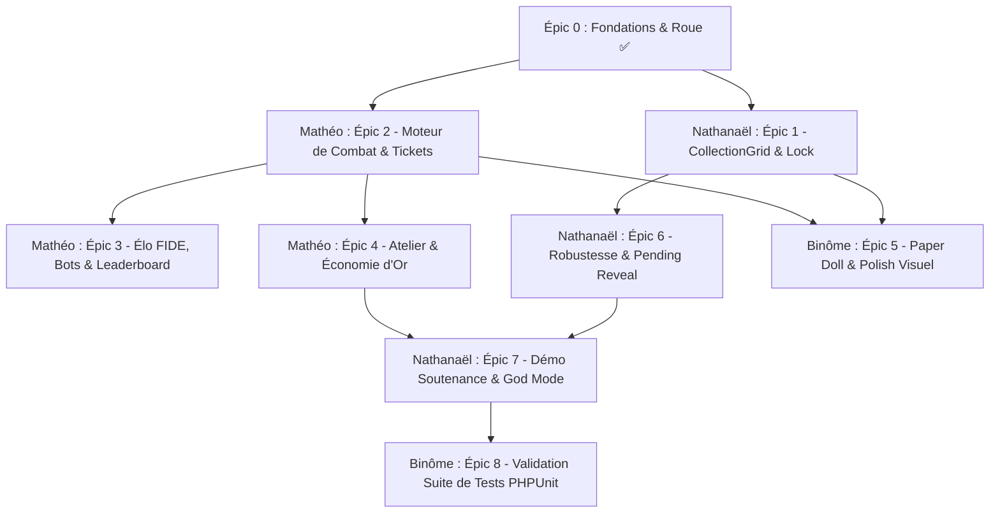

# 🎫 WHEELBORN — Carnet de Bord des Tickets & Backlog de Développement

> **Projet Universitaire Full-Stack** : Laravel 11 • Livewire 3 • Tailwind CSS • Alpine.js • SQLite  
> **Équipe de développement :** Nathanaël & Mathéo  
> **Dernière mise à jour :** Octobre 2026  
> 
> **Légende des priorités :**
> - 🔴 **P0 (Bloquant / MVP)** : Indispensable au fonctionnement du jeu ou exigé par la soutenance.
> - 🟡 **P1 (Majeur)** : Fonctionnalité clé de la boucle de gameplay (rétention, équilibrage).
> - 🟢 **P2 (Confort & Polish)** : Finitions visuelles, animations avancées, QoL (Quality of Life).
> 
> **Répartition générale des rôles :**
> - 🧑‍💻 **Nathanaël** : Collection, Inventaire, Sécurité/Concurrence BDD, Outils Admin & Démo soutenance.
> - 🧑‍💻 **Mathéo** : Moteur de Combat, Système d'Élo FIDE, Matchmaking/Bots, Atelier & Économie d'or.
> - 👥 **Binôme** : Rendu graphique (Paper Doll), Game Feel, Codex & Intégration globale.

---

## 📊 Tableau Récapitulatif de l'Avancement

| Épic / Jalon | Priorité | Responsable Principal | Tickets | Statut |
| :--- | :---: | :---: | :---: | :---: |
| **Épic 0 : Fondations, Roue & Équilibrage** | 🔴 P0 | 👥 Binôme | 5 | ⏳ En cours (4/5) |
| **Épic 1 : Collection & Gestion d'Inventaire** | 🔴 P0 | 🧑‍💻 Nathanaël | 5 | ✅ Terminé (100%) |
| **Épic 2 : Moteur de Combat & Arène 1v1** | 🔴 P0 | 🧑‍💻 Mathéo | 6 | ✅ Terminé (100%) |
| **Épic 3 : Système d'Élo FIDE & Classement** | 🔴 P0 | 🧑‍💻 Mathéo | 6 | ⏳ À démarrer (0/6) |
| **Épic 4 : Atelier & Économie Circulaire** | 🟡 P1 | 🧑‍💻 Mathéo | 5 | ⏳ À démarrer (0/5) |
| **Épic 5 : Game Feel, Rendu Visuel & Paper Doll** | 🟡 P1 | 👥 Binôme | 4 | ⏳ En cours (1/4 - Paper Doll V1 ✅) |
| **Épic 6 : Robustesse, Concurrence & Edge Cases** | 🔴 P0 | 🧑‍💻 Nathanaël | 5 | ✅ Terminé (100%) |
| **Épic 7 : Outils Soutenance, Admin & Démo** | 🔴 P0 | 🧑‍💻 Nathanaël | 3 | ⏳ Partiel (2/3 - God Mode & Seeder ✅) |
| **Épic 8 : Tests Automatisés & QA** | 🟡 P1 | 👥 Binôme (réparti) | 5 | ⏳ Partiel (4/5 - 78 tests ✅) |

---

## ✅ Épic 0 — Fondations & Roue de Tirage (Déjà réalisé)

- [x] **T0.1 [Architecture] Mise en place des fondations Laravel 11 + Livewire 3 + Breeze**
  - *Responsable :* 👥 Binôme
  - *Fichiers :* `composer.json`, `routes/web.php`, `resources/views/layouts/app.blade.php`
  - *Détails :* Auth fonctionnelle, layout sombre néon, support Livewire 3 et Alpine.js.
- [x] **T0.2 [Données & Modèles] Schéma BDD, Enums et Données Statiques**
  - *Responsable :* 👥 Binôme
  - *Fichiers :* `app/Models/*`, `app/Enums/*`, `app/Data/*`, `database/migrations/*`
  - *Détails :* 8 races, 8 armes, 8 pouvoirs, 16 synergies, raretés, tables `characters`, `battles`, etc.
- [x] **T0.3 [Génération] Services de génération procédurale et de recyclage**
  - *Responsable :* 👥 Binôme
  - *Fichiers :* `app/Services/CharacterGeneratorService.php`, `app/Services/RecycleService.php`, `app/Services/EnergyManagerService.php`
  - *Détails :* Tirage pondéré, stats dérivées, calcul de la valeur de recyclage en or.
- [x] **T0.4 [UI] Composant Livewire `CharacterWheel` et Jauge de Pity 10/10**
  - *Responsable :* 👥 Binôme
  - *Fichiers :* `app/Livewire/CharacterWheel.php`, `resources/views/livewire/character-wheel.blade.php`
  - *Détails :* Animation de spin, modale de révélation avec boutons Garder/Recycler, outils Admin de test.
- [ ] **T0.5 [Équilibrage & Game Design] Élimination du Paradoxe "Commun > Légendaire" & Scaling Réel de la Rareté**
  - *Priorité :* 🟡 P1 (Cohérence Gameplay & Rétention)
  - *Responsable :* 👥 Binôme
  - *Fichiers :* `docs/COMPENDIUM_GAME_DESIGN_ARMES_ET_SYNERGIES.md`, `app/Services/CharacterGeneratorService.php`, `app/Data/GameConfig.php`, `tests/Feature/CharacterGenerationTest.php`
  - *Problématique constatée :* Les statistiques brutes sont actuellement tirées avant la rareté. Un tirage chanceux sur un héros Commun peut ainsi générer un Power Score supérieur à une carte Légendaire (1% de drop ou Super Spin 10/10), créant une incompréhension et une déception chez le joueur.
  - *Critères d'acceptation :*
    - [ ] Déplacement de la décision de rareté en amont ou application d'un coefficient multiplicateur martial de stats par rareté (ex: Commun ×1.0, Rare ×1.10, Épique ×1.22, Légendaire ×1.35).
    - [ ] Définition de planchers minimaux garantis (Stat Floors) selon la rareté (ex: carte Légendaire = toutes stats $\ge 65$ et au moins une stat $\ge 85$).
    - [ ] Garantie mathématique qu'une carte Légendaire dépasse systématiquement la moyenne d'une carte Commune.
    - [ ] Mise à jour du calcul du Power Score et des tests automatisés pour valider les fourchettes cibles.

---

## 🗃️ Épic 1 — Collection & Inventaire (`CollectionGrid`)
> **Responsable principal :** 🧑‍💻 Nathanaël

### [x] T1.1 — Création du composant Livewire `CollectionGrid`
- **Priorité :** 🔴 P0 (MVP)
- **Attribué à :** 🧑‍💻 Nathanaël
- **Cible :** `app/Livewire/CollectionGrid.php`, `resources/views/livewire/collection-grid.blade.php`, `routes/web.php`
- **Description :** Permettre au joueur connecté de consulter l'ensemble de ses cartes de combattants sous forme d'une grille réactive (cartes néon).
- **Critères d'acceptation :**
  - [x] Affichage en grille responsive (1 col mobile, 2 cols tablette, 3-4 cols desktop).
  - [x] Pagination propre (ex: 12 cartes par page) pour éviter de saturer le DOM.
  - [x] Compteur total de cartes possédées et indicateur de capacité.
  - [x] État vide élégant ("Aucun combattant — Fais tourner la Roue !").

### [x] T1.2 — Filtres multi-critères et Tri dynamique
- **Priorité :** 🟡 P1
- **Attribué à :** 🧑‍💻 Nathanaël
- **Cible :** `app/Livewire/CollectionGrid.php`, `resources/views/livewire/collection-grid.blade.php`, `tests/Feature/CollectionGridTest.php`
- **Description :** Ajouter une barre d'outils réactive permettant de filtrer et trier rapidement les cartes de sa collection.
- **Critères d'acceptation :**
  - [x] Recherche textuelle en direct (`wire:model.live.debounce`) par nom de héros avec bouton d'effacement rapide.
  - [x] Filtre rapide par rareté (badges cliquables du HUD & boutons de filtrage pour Commune, Rare, Épique, Légendaire).
  - [x] Filtre déroulant par race (8 races) et par arme principale (8 armes).
  - [x] Filtre rapide "Avec Synergie active uniquement" avec indicateur visuel pulsé.
  - [x] Tri dynamique par : Score Power (décroissant/croissant), Rareté (Légendaire -> Commun), Date d'obtention, Victoires en Arène.
  - [x] Mise à jour instantanée sans rechargement de page (Livewire `wire:model.live` + réinitialisation automatique de la pagination).
  - [x] Bouton d'action "Effacer les filtres" et état vide informatif en cas de recherche sans résultat.

### [x] T1.3 — Système de Verrouillage de Carte (Favori / Lock)
- **Priorité :** 🔴 P0 (Sécurité Joueur)
- **Attribué à :** 🧑‍💻 Nathanaël
- **Cible :** `database/migrations/2026_10_19_140000_add_is_locked_to_characters_table.php`, `app/Models/Character.php`, `app/Services/RecycleService.php`, `app/Livewire/CollectionGrid.php`, `resources/views/livewire/collection-grid.blade.php`, `tests/Feature/CollectionGridTest.php`
- **Description :** Empêcher la destruction accidentelle d'une carte précieuse lors des sessions de recyclage.
- **Critères d'acceptation :**
  - [x] Champ booléen `is_locked` (défaut `false`) avec index SQL sur le modèle `Character`.
  - [x] Icône de cadenas interactive (🔒/🔓) sur chaque carte pour basculer l'état verrouillé en un clic avec notification.
  - [x] Le bouton "Recycler" individuel est désactivé et transformé en badge sécurisé "🔒 Protégé" si la carte est verrouillée.
  - [x] Le `RecycleService` bloque avec une exception (`DomainException`) toute tentative de recyclage d'une carte verrouillée (sécurité backend).
  - [x] Filtre rapide "🔒 Verrouillés uniquement" dans la barre d'outils de collection.

### [x] T1.4 — Recyclage en Masse Avancé (Multi-critères & Modale Dédiée)
- **Priorité :** 🟡 P1 (Confort de jeu / Économie circulaire)
- **Attribué à :** 🧑‍💻 Nathanaël
- **Cible :** `app/Services/RecycleService.php`, `app/Livewire/CollectionGrid.php`, `resources/views/livewire/collection-grid.blade.php`, `tests/Feature/CollectionGridTest.php`
- **Description :** Modale de suppression de masse ultra-complète permettant de filtrer les combattants à recycler par rareté, score de puissance, race, arme et préservation des synergies.
- **Critères d'acceptation :**
  - [x] Bouton d'action "♻️ Recyclage en masse" dans le bandeau de collection.
  - [x] Filtrage modulaire par raretés (cases à cocher Communs, Rares, Épiques, Légendaires).
  - [x] Filtrage par plafond de score de puissance (Power Score Max : saisie libre ou raccourcis ≤ 50, ≤ 65, ≤ 80).
  - [x] Ciblage par race spécifique (8 races au choix ou toutes) et arme spécifique (8 armes au choix ou toutes).
  - [x] Protection des synergies : toggle pour exclure automatiquement les héros dotés d'une synergie élémentaire active.
  - [x] Aperçu visuel en direct : liste scrollable affichant chaque héros ciblé (icône de race, nom, rareté, puissance, valeur en or).
  - [x] Calcul prévisionnel instantané du total de pièces d'or 🪙 et du nombre de héros sélectionnés.
  - [x] Protection absolue : exclusion inviolable des héros verrouillés (`is_locked`) et des combattants déployés en arène.
  - [x] Transaction SQL atomique (`DB::transaction` avec `lockForUpdate`) et mise à jour dynamique du solde dans le HUD (`stats-updated`).

### [x] T1.5 — Cartes Recto/Verso (3D Card Flip) & Modale Inspecteur « Fiche Détaillée Épurée »
- **Priorité :** 🟢 P2 (Game Feel & Immersion Collection)
- **Attribué à :** 🧑‍💻 Nathanaël
- **Cible :** `app/Livewire/CollectionGrid.php`, `resources/views/livewire/collection-grid.blade.php`, `resources/css/app.css`, `app/Models/Character.php`, `tests/Feature/CollectionGridTest.php`
- **Description :** Cartes double-face immersives dotées d'une véritable animation de retournement 3D (`preserve-3d` / card flip physique) déclenchée **au clic sur la grille** (pour un confort visuel optimal sans tempête d'animations au passage de souris) et **au survol sur la modale d'inspection**, avec bouton "Fiche détaillée & Passifs" dédié ouvrant la modale technique grand format.
- **Critères d'acceptation :**
  - [x] **Animation de Retournement 3D (Physical Card Flip) :**
    - Conteneur avec perspective 3D (`perspective: 1000px;` `.perspective-1000`) et flipper interne (`transform-style: preserve-3d;` `.preserve-3d`).
    - Rotation fluide sur l'axe Y (`transform: rotateY(180deg);`) avec courbe d'accélération naturelle `cubic-bezier(0.23, 1, 0.32, 1)` pour un rendu physique et tactile.
    - Occultation naturelle des faces opposées (`backface-visibility: hidden;` `.backface-hidden`).
    - **Ergonomie Grille vs Modale :**
      - Sur la **grille de collection**, le flip se déclenche **au clic sur la carte** (mention "🔄 Cliquer pour les stats"), avec retour au recto par clic sur le fond du verso ou bouton `🔄`.
      - Sur la **modale d'inspection**, le flip reste fluide **au survol (hover)**.
    - Isolation stricte des événements pointeur (`pointer-events-none` sur la face cachée, `pointer-events-auto` sur la face active) pour garantir l'interactivité 100% fiable des boutons du verso (cadenas, recyclage, inspection) sans fausse sélection.
  - [x] **Parité Dimensionnelle Recto/Verso :** Hauteur et largeur strictement identiques (`height: 490px; min-height: 490px; w-full`) éliminant tout décalage vertical ou écrasement.
  - [x] **Face Recto (Par défaut) :** Carte collector graphique avec portrait Paper Doll composite dynamique `<x-character-avatar>`, étoiles de rareté, score de puissance, rareté et titre.
  - [x] **Face Verso (Révélée au Flip) :** Tri-slot des composants avec icônes, 4 barres de stats colorées, badges de synergies actives (ou mention d'absence), palmarès d'arène et boutons d'action rapide.
  - [x] **Modale d'Inspection Grand Format Épurée & Compacte :**
    - [x] Résolution de l'asymétrie de hauteur : recalibrage de la colonne technique (~450px) pour correspondre parfaitement à la carte de gauche, supprimant le grand vide noir et les débordements d'écran.
    - [x] En-tête dédié intégrant le titre du héros, son badge de rareté, son archétype, son Power Score et un bouton de fermeture `✕` sans collision graphique avec les titres de section.
    - [x] Barre de statistiques de combat compacte en 4 colonnes (`sm:grid-cols-4` : PV, Force, Vitesse, Défense) avec micro-jauges.
    - [x] Grille 3 colonnes responsive (`sm:grid-cols-3`) pour les 3 composants (Race, Arme, Pouvoir) affichant leurs passifs innés et effets élémentaires de façon équilibrée et lisible.
    - [x] Bandeau de synergies actives compact avec alerte visuelle pour les synergies instables.
    - [x] Barre inférieure unifiée regroupant l'historique d'arène (V/D, winrate) et les boutons d'actions (Verrouiller, Recycler, Fermer la fiche).
  - [x] Suite de tests automatisés validant l'ouverture/fermeture de l'inspecteur, le recyclage et les actions associées.

---

## ⚔️ Épic 2 — Moteur de Combat & Arène 1v1 (`BattleArena`)
> **Responsable principal :** 🧑‍💻 Mathéo

### [x] T2.1 — Implémentation du moteur de combat `BattleEngineService`
- **Priorité :** 🔴 P0 (Cœur de jeu)
- **Attribué à :** 🧑‍💻 Mathéo
- **Cible :** `app/Services/BattleEngineService.php`, `tests/Unit/BattleEngineServiceTest.php`
- **Description :** Développer le service PHP pur simulant l'affrontement tour par tour entre deux combattants de manière déterministe.
- **Critères d'acceptation :**
  - [x] Phase 1 (Initiative) : Le combattant avec la plus haute Vitesse frappe en premier (avec tirage au sort si égalité).
  - [x] Phase 2 (Échange de coups) : Calcul des dégâts bruts atténués par la défense ennemie.
  - [x] Prise en compte des effets d'armes (saignement, coup contondant) et des pouvoirs (brûlure DoT, gel, régénération).
  - [x] Application des synergies (ex: Pyro-Lame, Tempête Électrique, Instabilités).
  - [x] Calcul des coups critiques et esquives basés sur la stat Chance.
  - [x] Sécurité anti-boucle infinie (limite fixée à 25 tours max avec décision aux points).

### [x] T2.2 — Déterminisme, Seed aléatoire et Audit Log (`turns_log`)
- **Priorité :** 🔴 P0 (Anti-triche & Replay)
- **Attribué à :** 🧑‍💻 Mathéo
- **Cible :** `app/Models/Battle.php`, `database/migrations/2026_10_20_104207_rename_combat_log_to_turns_log_in_battles_table.php`, `app/Services/ArenaService.php`
- **Description :** Assurer la reproductibilité absolue de chaque combat pour permettre le replay et éliminer toute triche côté client.
- **Critères d'acceptation :**
  - [x] Utilisation d'un générateur pseudo-aléatoire seedé (`Mt19937` isolé).
  - [x] Enregistrement du déroulement complet dans un champ JSON `turns_log` (qui a frappé, dégâts, PV restants, effet déclenché) et figé dans `fighters_snapshot`.
  - [x] Possibilité de recalculer le combat à partir de la seed et d'obtenir un résultat 100% identique (`ArenaService::replay()` & `ArenaService::isAuthentic()`).

### [x] T2.3 — Gestion des Tickets d'Arène & Régénération
- **Priorité :** 🔴 P0 (Économie & Cadence de session)
- **Attribué à :** 🧑‍💻 Mathéo
- **Cible :** `app/Services/EnergyManagerService.php`, `app/Models/User.php`, `app/Data/GameConfig.php`
- **Description :** Réguler les combats via un stock limité de tickets (anti-farm compulsif).
- **Critères d'acceptation :**
  - [x] Stock maximum : 5 tickets d'arène.
  - [x] Vitesse de recharge : 1 ticket toutes les 5 minutes (avec calcul de rattrapage hors-ligne).
  - [x] Déduction atomique d'un ticket au lancement d'un duel (`decrement` conditionnel dans transaction SQL).
  - [x] Message explicite si tentative de combat avec 0 ticket et désactivation propre du bouton côté front.
  - [x] Timer de rechargement en temps réel seconde par seconde via composant Alpine.js (`+1 dans mm:ss`) synchronisé avec actualisation automatique Livewire à `00:00`.

### [x] T2.4 — Interface de Combat Face-à-Face Livewire (`BattleArena`)
- **Priorité :** 🔴 P0 (Expérience Utilisateur)
- **Attribué à :** 🧑‍💻 Mathéo
- **Cible :** `app/Livewire/BattleArena.php`, `resources/views/livewire/battle-arena.blade.php`
- **Description :** Interface interactive de préparation et de visualisation du combat.
- **Critères d'acceptation :**
  - [x] **Architecture Cockpit Zero-Scroll :**
    - Répartition ergonomique 65% (Arène de duel face-à-face) / 35% (Poste de commande & logs) sans scroll vertical nécessaire.
    - Hauteur synchronisée via `items-stretch` et `h-full` pour un alignement bas net.
  - [x] **Modale de Sélection de Combattant Flottante :**
    - Recherche instantanée par nom, race, arme ou pouvoir (`wire:model.live.debounce`).
    - Filtres par rareté (Tous, Commune, Rare, Épique, Légendaire) et tri dynamique (Puissance, Victoires, Récents).
    - Grille compacte avec avatar Paper Doll et badge de déploiement en arène.
  - [x] **Cartes Officielles WheelBorn & 3D Flip :**
    - Ratio physique collector 270px fixe sans déformation ni étirement.
    - Animation de retournement 3D physique au clic vers le verso (stats détaillées, tri-slot éléments, synergies et palmarès).
    - Épuration visuelle : suppression de la mention superflue "Cliquer pour les stats" dans l'arène et la collection.
  - [x] **Comparatif Dynamique des Forces Pré-combat :**
    - 4 jauges de confrontation horizontales bicolores (Vert 🟢 à gauche ➔ 🔴 Rouge à droite) pour PV, Force, Vitesse et Défense calculant le ratio de force exact entre les deux cartes.
    - Badge d'avantage de puissance globale et indicateur d'initiative explicite (`Tu frappes en 1er` / `Bot frappe en 1er`).
    - Comparatif des synergies élémentaires actives joueur vs bot.
  - [x] **Déroulement du Duel & Bilan :**
    - Défilement tour par tour des échanges avec barres de PV réactives animées via Alpine.js.
    - Bilan final avec delta d'Élo, pièces et XP gagnés.
    - Actions post-combat enrichies : bouton « Revanche » (rejouer contre le même bot) et bouton « Autre adversaire » (générer un nouveau bot).

### [x] T2.5 — Bouton Fast-Forward ("Passer le combat / Résultat direct")
- **Priorité :** 🟡 P1 (QoL)
- **Attribué à :** 🧑‍💻 Mathéo
- **Cible :** `resources/views/livewire/battle-arena.blade.php`, `resources/js/battle-animation.js`
- **Description :** Permettre aux joueurs réguliers de passer l'animation pour aller directement à l'écran de résultat.
- **Critères d'acceptation :**
  - [x] Bouton bien visible "Passer le combat ⏭".
  - [x] Interrompt le timing Alpine.js et affiche instantanément les barres de PV finales et le bilan.
  - [x] Le calcul serveur restant identique, l'issue ne dépend pas de l'animation front.

### [x] T2.6 — Gestion des Cas Limites : Égalités & Double K.O.
- **Priorité :** 🟡 P1 (Edge case)
- **Attribué à :** 🧑‍💻 Mathéo
- **Cible :** `app/Services/BattleEngineService.php`, `app/Services/ArenaService.php`, `resources/views/livewire/battle-arena.blade.php`
- **Description :** Traiter proprement les scénarios où les deux combattants tombent à 0 PV au même tour (ex: dégâts de poison mutuels).
- **Critères d'acceptation :**
  - [x] Règle définie : Si double K.O., match déclaré "Match Nul" (`DRAW`, `winner_id = null`).
  - [x] En cas de Match Nul : aucun gain/perte d'Élo ($\Delta \text{Élo} = 0$), et petit lot de consolation (20 pièces + 20 XP).
  - [x] Feedback visuel adapté ("🩸 ÉGALITÉ SANGLANTE !").

---

## 🏆 Épic 3 — Système d'Élo FIDE & Matchmaking (`Leaderboard`)
> **Responsable principal :** 🧑‍💻 Mathéo

### [ ] T3.1 — Service Mathématique d'Élo Standard FIDE
- **Priorité :** 🔴 P0 (Équilibrage)
- **Attribué à :** 🧑‍💻 Mathéo
- **Cible :** `app/Services/EloService.php`
- **Description :** Implémenter la formule officielle d'Élo d'échecs (FIDE) avec facteur $K=32$.
- **Critères d'acceptation :**
  - [ ] Calcul de la probabilité attendue : $E_A = \frac{1}{1 + 10^{(R_B - R_A)/400}}$.
  - [ ] Calcul du delta : $\Delta = \text{round}(K \times (Score - E_A))$.
  - [ ] Test des cas limites : victoire contre plus fort (+ fort gain), défaite contre plus faible (- forte perte).
  - [ ] Plancher d'Élo fixé à 0 (l'Élo ne peut pas être négatif).

### [ ] T3.2 — Système de Ligues dynamiques par Paliers
- **Priorité :** 🔴 P0 (Visuel & Rétention)
- **Attribué à :** 🧑‍💻 Mathéo
- **Cible :** `app/Enums/League.php`, `app/Models/User.php`
- **Description :** Catégoriser les joueurs selon leur score d'Élo avec badge et couleur associés.
- **Critères d'acceptation :**
  - [ ] Paliers : Bronze (0-999), Argent (1000-1399), Or (1400-1799), Platine (1800-2199), Maître (2200+).
  - [ ] Méthode sur `User` : `$user->getLeague()`.
  - [ ] Déclenchement d'une alerte/notification festive lors d'une promotion de ligue.

### [ ] T3.3 — Matchmaking équilibré par Plage d'Élo
- **Priorité :** 🔴 P0 (Fair-play)
- **Attribué à :** 🧑‍💻 Mathéo
- **Cible :** `app/Services/EloService.php`
- **Description :** Trouver un adversaire réel dont l'Élo est proche de celui du joueur pour des duels équilibrés.
- **Critères d'acceptation :**
  - [ ] Recherche en priorité dans une fenêtre de $\pm 100$ Élo.
  - [ ] Élargissement progressif à $\pm 250$ Élo si aucun joueur disponible.
  - [ ] Exclusion des propres personnages du joueur connecté.

### [ ] T3.4 — Système de Combattants Fantômes / Bots (Anti-Cold Start)
- **Priorité :** 🔴 P0 (Indispensable pour la soutenance)
- **Attribué à :** 🧑‍💻 Mathéo
- **Cible :** `app/Services/BotGeneratorService.php` ou Seeder
- **Description :** Permettre de jouer même si la BDD est vierge de vrais utilisateurs.
- **Critères d'acceptation :**
  - [ ] Si aucun joueur réel n'est trouvé dans la plage d'Élo, génération à la volée d'un "Fantôme d'Arène" adapté à la ligue actuelle.
  - [ ] Nom procédural évocateur ("Gladiateur de l'Ombre", "Garde de Fer", etc.).
  - [ ] Le calcul d'Élo s'applique normalement pour le joueur.

### [ ] T3.5 — Composant Livewire `Leaderboard`
- **Priorité :** 🟡 P1
- **Attribué à :** 🧑‍💻 Mathéo
- **Cible :** `app/Livewire/Leaderboard.php`, `resources/views/livewire/leaderboard.blade.php`
- **Description :** Tableau des meilleurs joueurs de l'arène avec filtres par ligue.
- **Critères d'acceptation :**
  - [ ] Podium stylisé pour le Top 3 (or, argent, bronze néon).
  - [ ] Ligne épinglée indiquant le rang, l'Élo et la ligue du joueur connecté.
  - [ ] Onglets de filtrage par ligue (Tous, Maître, Platine, etc.).
  - [ ] Cache Redis ou Cache Laravel (durée 60 secondes) pour préserver les perfs BDD.

### [ ] T3.6 — Historique & Replay des Duels
- **Priorité :** 🟢 P2
- **Attribué à :** 🧑‍💻 Mathéo
- **Cible :** `resources/views/livewire/battle-history.blade.php`
- **Description :** Historique des 10 derniers combats du joueur avec consultation du journal.
- **Critères d'acceptation :**
  - [ ] Liste des combats récents : V/D, adversaire, delta d'Élo, date relative ("il y a 5 min").
  - [ ] Bouton "Revoir le combat" qui recharge le `turns_log` dans l'arène.

---

## 🏛️ Épic 4 — Économie Circulaire & Atelier (`Workshop`)
> **Responsable principal :** 🧑‍💻 Mathéo

### [ ] T4.1 — Modèle, Migration & Service `WorkshopService`
- **Priorité :** 🔴 P0 (Boucle de rétention V2)
- **Attribué à :** 🧑‍💻 Mathéo
- **Cible :** `app/Services/WorkshopService.php`, `app/Models/WorkshopUpgrade.php`
- **Description :** Logique d'achat d'améliorations passives permanentes financées par l'or du recyclage et des victoires.
- **Critères d'acceptation :**
  - [ ] Définition des améliorations :
    1. *Aimant à Pouvoirs Rares* (Niveaux 1 à 5 : +3% par niveau de chance de pouvoirs épiques/mythiques).
    2. *Forge des Héros* (Niveaux 1 à 5 : +2 Force et +3 PV constants sur les futurs tirages).
    3. *Coffre de Guerre* (Niveaux 1 à 3 : +25%, +50%, +100% d'or par victoire d'arène).
  - [ ] Vérification stricte du solde de pièces avant achat et déduction sécurisée.
  - [ ] Sauvegarde du niveau de chaque amélioration par utilisateur.

### [ ] T4.2 — Intégration des bonus de l'Atelier dans le Moteur de Génération
- **Priorité :** 🔴 P0 (Cohérence Gameplay)
- **Attribué à :** 🧑‍💻 Mathéo
- **Cible :** `app/Services/CharacterGeneratorService.php`
- **Description :** Faire en sorte que les améliorations achetées affectent réellement les prochains tirages de roue.
- **Critères d'acceptation :**
  - [ ] Injection du niveau de l'Aimant à Pouvoirs pour modifier les probabilités de `PowerData`.
  - [ ] Injection du niveau de la Forge des Héros pour ajouter les points de stats bonus lors de la création du personnage.

### [ ] T4.3 — Ticket d'Urgence (Achat de tirage immédiat)
- **Priorité :** 🟡 P1
- **Attribué à :** 🧑‍💻 Mathéo
- **Cible :** `app/Services/WorkshopService.php`, `app/Livewire/CharacterWheel.php`
- **Description :** Donner une utilité immédiate à l'or quand le joueur a vidé ses charges de roue et veut continuer sa session.
- **Critères d'acceptation :**
  - [ ] Achat d'une charge de spin pour 120 pièces d'or.
  - [ ] Limitation : maximum 2 achats par tranche de 24 heures (ou prix croissant 120 🪙 $\rightarrow$ 250 🪙 $\rightarrow$ 500 🪙).

### [ ] T4.4 — Composant Livewire `Workshop`
- **Priorité :** 🟡 P1
- **Attribué à :** 🧑‍💻 Mathéo
- **Cible :** `app/Livewire/Workshop.php`, `resources/views/livewire/workshop.blade.php`
- **Description :** Interface moderne de l'Atelier avec arbre de cartes d'améliorations.
- **Critères d'acceptation :**
  - [ ] Cartes d'améliorations avec barres de progression de niveau (ex: Niv. 2/5).
  - [ ] Bouton d'achat dynamique affichant le coût du niveau suivant.
  - [ ] Feedback visuel en cas de fonds insuffisants.
  - [ ] Animation de déblocage avec notification de succès.

### [ ] T4.5 — Succès & Déblocages Spéciaux (`Achievements`)
- **Priorité :** 🟢 P2
- **Attribué à :** 🧑‍💻 Mathéo
- **Cible :** `app/Models/Achievement.php`, `app/Listeners/ProcessAchievements.php`
- **Description :** Récompenser les accomplissements des joueurs avec des titres et des bourses de pièces.
- **Critères d'acceptation :**
  - [ ] Succès "Premier Sang" (1ère victoire en arène).
  - [ ] Succès "Maître Alchimiste" (Recycler 10 cartes).
  - [ ] Succès "Bénédiction Divine" (Obtenir une carte Légendaire).
  - [ ] Succès "Combinaison Instable" (Tirer une synergie à risque).

---

## 🎨 Épic 5 — Game Feel, Rendu Visuel & Paper Doll
> **Responsables :** 👥 Binôme (Nathanaël & Mathéo)

### [x] T5.1 — Système de Rendu Composite "Paper Doll" (Avatar Procédural V1) & Châssis Responsive
- **Priorité :** 🟡 P1 (Immersion & Note Soutenance)
- **Attribué à :** 👥 Binôme
- **Cible :** `docs/GUIDE_ASSETS_PAPER_DOLL.md`, `app/Services/PaperDollService.php`, `resources/views/components/character-avatar.blade.php`, `resources/views/livewire/collection-grid.blade.php`, `resources/views/livewire/character-wheel.blade.php`, `tests/Feature/PaperDollTest.php`
- **Description :** Générer une représentation graphique unique de chaque héros par superposition de calques WebP sur un portrait carré (512x512), enveloppé dans un châssis de carte réactif (CSS/Tailwind + SVG).
- **Critères d'acceptation :**
  - [x] Spécifications techniques & guide d'export rédigés dans [GUIDE_ASSETS_PAPER_DOLL.md](file:///c:/Users/natha/Documents/PROJET/WHEELBORN_PROJECT/WHEELBORN/docs/GUIDE_ASSETS_PAPER_DOLL.md).
  - [x] Moteur de superposition dynamique `PaperDollService` et composant réutilisable `<x-character-avatar>` avec fallback résilient (affiche uniquement les calques disponibles sans casser le rendu).
  - [x] **Superposition & Ordre des Calques :** Hiérarchie z-index stricte plaçant l'arme (`z-index: 30`) devant le corps humanoïde (`z-index: 10`) pour une tenue d'équipement réaliste.
  - [x] **Respect Strict du Ratio & Élimination des Distorsions :** Gabarit carré 1:1 (`max-w-[270px] aspect-square w-full`) interdisant tout écrasement ou étirement d'image.
  - [x] **Détourage & Transparence :** Suppression des encadrements debug et badges temporaires pour une intégration directe sur le fond néon de la carte.
  - [x] Intégration sur la face recto des cartes de la Collection et dans la modale de révélation de la Roue.
  - [x] Boutons de test direct dans la barre Admin pour forcer un tirage avec n'importe quelle arme disponible (Épée, Bâton, Arc, Dague, Marteau).
  - [x] Calque 1 : Silhouette / Corps selon la Race (intégré pour `human.webp`).
  - [x] Calque 3 : Arme tenue selon le gabarit d'alignement (actifs : `epee.webp`, `baton.webp`, `arc.webp`, `dague.webp`).
  - [ ] Calque 0 : Fond d'aura / Décor de rareté (`backgrounds/` - futur).
  - [ ] Calque 2 : Effet élémentaire / VFX semi-transparent (`elements/` - futur).
  - [x] Châssis de carte responsive (bordure, liserés, halo glow de rareté en pur CSS Tailwind) s'adaptant à n'importe quelle taille de carte sans distorsion.
  - [x] Tests automatisés unitaires & fonctionnels (`tests/Feature/PaperDollTest.php` - 7 tests validés).

### [ ] T5.2 — Ambiance Sonore & Haptique (SFX optionnels)
- **Priorité :** 🟢 P2 (Polish)
- **Attribué à :** 👥 Binôme
- **Cible :** `resources/js/audio-manager.js`
- **Description :** Ajouter des feedbacks sonores discrets et désactivables pour amplifier les moments forts.
- **Critères d'acceptation :**
  - [ ] Bruit de cliquetis mécanique lors de la rotation de la roue.
  - [ ] Fanfare d'impact différente selon la rareté lors de la révélation.
  - [ ] Bruit de pièces métalliques lors du recyclage.
  - [ ] Bouton toggle "Mute / Son On" persistant dans le `localStorage`.

### [ ] T5.3 — Micro-animations Alpine.js (Screen Shake & Confettis)
- **Priorité :** 🟡 P1
- **Attribué à :** 👥 Binôme
- **Cible :** `resources/views/livewire/character-wheel.blade.php`, `resources/views/livewire/battle-arena.blade.php`
- **Description :** Donner du punch à l'interface lors des événements critiques.
- **Critères d'acceptation :**
  - [ ] Secousse d'écran (`screen-shake`) sur les coups critiques en arène.
  - [ ] Éclatement de confettis dorés légers lors du déclenchement du Super Spin 10/10.
  - [ ] Animation de pulsation rouge lors des coups portés.

### [ ] T5.4 — Le Codex / Compendium des Connaissances
- **Priorité :** 🟢 P2 (Clarté académique)
- **Attribué à :** 👥 Binôme
- **Cible :** `resources/views/codex.blade.php`, `routes/web.php`
- **Description :** Une encyclopédie intégrée au jeu listant toutes les règles, races, armes, pouvoirs et combinaisons de synergies.
- **Critères d'acceptation :**
  - [ ] Fiches des 8 races avec modificateurs de stats.
  - [ ] Fiches des 8 armes avec types de dégâts.
  - [ ] Fiches des 8 pouvoirs classés par rareté.
  - [ ] Tableau des 16 synergies (dont les 4 combinaisons instables) avec statut "Découvert" ou "Mystère".

---

## 🛡️ Épic 6 — Robustesse, Concurrence & Edge Cases
> **Responsable principal :** 🧑‍💻 Nathanaël

### [x] T6.1 — Reprise automatique d'un tirage non finalisé (`pending_reveal`)
- **Priorité :** 🔴 P0 (Bug Critique / Expérience Utilisateur)
- **Attribué à :** 🧑‍💻 Nathanaël
- **Cible :** `app/Livewire/CharacterWheel.php`, `resources/views/livewire/character-wheel.blade.php`, `tests/Feature/CharacterWheelTest.php`
- **Description :** Si l'utilisateur quitte la page après avoir cliqué sur "Spin" mais avant d'avoir choisi "Garder" ou "Recycler", le tirage ne doit pas être perdu.
- **Critères d'acceptation :**
  - [x] Lors du `mount()`, vérification en BDD si un personnage de l'utilisateur a `pending_reveal = true` et non recyclé via `checkPendingReveal()`.
  - [x] Si oui, chargement immédiat de ce personnage dans `$revealedCharacter`, notification de reprise et réouverture automatique de la modale.
  - [x] Empêchement strict de relancer un nouveau spin tant que le précédent n'a pas été validé ou recyclé (bouton spin désactivé avec message "⚠️ Finalisez le tirage ci-dessous" et blocage backend).
  - [x] Suite de tests automatisés validant la restauration automatique et le blocage d'un nouveau tirage.

### [x] T6.2 — Transactions Atomiques et Protection Multi-clic
- **Priorité :** 🔴 P0 (Sécurité & Intégrité des données)
- **Attribué à :** 🧑‍💻 Nathanaël
- **Cible :** `app/Services/RecycleService.php`, `app/Livewire/CharacterWheel.php`, `app/Livewire/CollectionGrid.php`, `resources/views/livewire/character-wheel.blade.php`, `resources/views/livewire/collection-grid.blade.php`, `tests/Feature/CharacterWheelTest.php`
- **Description :** Éviter les failles de duplication d'or, de cartes ou de tirages en cas de clics frénétiques ou requêtes concurrentes.
- **Critères d'acceptation :**
  - [x] Encapsuler le spin, le recyclage (unitaire et masse) et le verrouillage dans des transactions `DB::transaction(...)`.
  - [x] Verrouillage pessimiste strict `lockForUpdate()` sur la ligne de l'utilisateur (`User`) pour interdire toute concurrence sur le solde de pièces ou les charges d'énergie.
  - [x] Verrouillage pessimiste `lockForUpdate()` sur les cartes (`Character`) pour interdire tout double recyclage simultané.
  - [x] Contrôle d'appartenance strict (`where('user_id', $user->id)`) et interdiction formelle de recycler un héros déployé dans l'arène (`is_active_fighter`).
  - [x] Attributs Blade `wire:loading.attr="disabled"` et indicateurs visuels animés sur tous les boutons d'action monétaire et de mutation (Spin, Garder, Recycler, Verrouiller, Recyclage en masse).
  - [x] Tests unitaires et d'intégration validant les transactions, la protection contre l'usurpation et les cas limites.

### [x] T6.3 — Calcul précis du rattrapage temporel (Catch-Up Time) & Correction Carbon 3
- **Priorité :** 🔴 P0 (Énergie)
- **Attribué à :** 🧑‍💻 Nathanaël
- **Cible :** `app/Services/EnergyManagerService.php`, `tests/Feature/EnergyManagerTest.php`
- **Description :** Assurer que la régénération de charges s'effectue sans décalage ni blocage même après plusieurs jours (résolution du bug de différence négative Carbon 3).
- **Critères d'acceptation :**
  - [x] Calcul mathématique par timestamp : `elapsed = max(0, now()->timestamp - last_regen->timestamp)`.
  - [x] Plafonnement strict au maximum légal (`max_charges = 3`).
  - [x] Mise à jour correcte du timestamp pour ne pas perdre les secondes résiduelles (`addSeconds`).
  - [x] Initialisation propre si le joueur a moins de 3 charges sans timestamp posé.

### [x] T6.4 — Compte à rebours dynamique de recharge & synchronisation Livewire
- **Priorité :** 🔴 P0 (UX / Feedback)
- **Attribué à :** 🧑‍💻 Nathanaël
- **Cible :** `app/Livewire/CharacterWheel.php`, `resources/views/livewire/character-wheel.blade.php`, `resources/js/app.js`
- **Description :** Affichage d'un timer précis (mm:ss) uniquement dans la carte des charges avec mise à jour automatique en temps réel.
- **Critères d'acceptation :**
  - [x] Pré-rendu direct en PHP (`sprintf('%02d:%02d', ...)`) pour garantir zéro texte vide ou `NaN` avant l'exécution JS.
  - [x] Compte à rebours animé fluide côté client via Alpine.js (`wire:key` isolé, sans `$watch` défaillant) dans la carte des charges.
  - [x] Suppression de l'instance manuelle `Alpine.start()` dans `resources/js/app.js` pour éliminer le conflit de double instance avec Livewire 3.
  - [x] Suppression des doublons d'affichage pour une interface épurée.
  - [x] Déblocage immédiat du bouton dès qu'une charge devient disponible.

### [x] T6.5 — Composant Livewire réactif `PlayerHud` (Synchronisation temps réel du solde de pièces)
- **Priorité :** 🔴 P0 (Économie & UI réactive)
- **Attribué à :** 🧑‍💻 Nathanaël
- **Cible :** `app/Livewire/PlayerHud.php`, `resources/views/livewire/player-hud.blade.php`, `resources/views/layouts/navigation.blade.php`, `tests/Feature/PlayerHudTest.php`
- **Description :** Rendre la barre HUD de navigation réactive en temps réel via des événements Livewire (`stats-updated`) pour refléter immédiatement les gains de pièces (recyclage), les dépenses et les variations d'Élo sans recharger la page.
- **Critères d'acceptation :**
  - [x] Extraction du HUD statique de `navigation.blade.php` vers un composant Livewire `PlayerHud`.
  - [x] Double réactivité instantanée : gestion polyvalente du payload d'événement (`array` ou `object`) + écouteur Livewire `#[On('stats-updated')]`.
  - [x] Animation visuelle (bump / scale doré) lors de la mise à jour des pièces pour un feedback clair et immédiat au joueur.
  - [x] Émission automatique avec payload complet (`coins`, `spinCharges`, `elo`) depuis `CharacterWheel` et `CollectionGrid` lors de chaque recyclage ou spin.
  - [x] Régénération automatique de l'énergie de spin dès le chargement du HUD sur n'importe quelle page du site (catalogue, profil, etc.) sans dépendre de la visite préalable sur la roue.
  - [x] Affichage formaté des pièces (`Intl.NumberFormat`) et icône dynamique de ligue.

---

## 🎓 Épic 7 — Outils Soutenance, Admin & Démo Universitaire
> **Responsable principal :** 🧑‍💻 Nathanaël

### [ ] T7.1 — Commande Artisan de Démo Clé en Main (`php artisan game:demo-setup`)
- **Priorité :** 🔴 P0 (Soutenance)
- **Attribué à :** 🧑‍💻 Nathanaël
- **Cible :** `app/Console/Commands/GameDemoSetupCommand.php`
- **Description :** Commande unique permettant de préparer le projet en 5 secondes avant le passage devant le jury.
- **Critères d'acceptation :**
  - [ ] Réinitialise et peuple la base avec un environnement vivant.
  - [ ] Crée 3 comptes de démonstration :
    - `bronze@wheelborn.test` (Débutant, 950 Élo, 2 cartes).
    - `argent@wheelborn.test` (Joueur intermédiaire, 1250 Élo, 8 cartes).
    - `admin@wheelborn.test` (Compte Maître, 2300 Élo, atelier maxé, ressources illimitées).
  - [ ] Génère 40 cartes dans l'arène pour avoir un classement complet et des adversaires immédiats.

### [x] T7.2 — Panneau de Débogage / God Mode dans l'Interface (Barre Admin)
- **Priorité :** 🟡 P1 (Soutenance)
- **Attribué à :** 🧑‍💻 Nathanaël
- **Cible :** `app/Livewire/CharacterWheel.php`, `resources/views/livewire/character-wheel.blade.php`
- **Description :** Barre flottante réservée à l'administrateur pour forcer n'importe quel cas de figure en direct pendant le développement et le passage devant le jury.
- **Critères d'acceptation :**
  - [x] Visible uniquement si `$isAdmin === true`.
  - [x] Bouton "🌟 Forcer Super Spin (10/10)" (démonstration garantie de l'animation dorée au jury).
  - [x] Bouton "+50 000 🪙" (pour tester immédiatement le recyclage et les transactions).
  - [x] Bouton "Reset Pity" (remise à zéro instantanée du compteur de pitié).
  - [x] Boutons de test Paper Doll direct : "🎨 Test Humain + Épée" et "🎨 Test Humain + Bâton" pour valider la superposition des calques en direct.
  - [x] Ressources illimitées automatiques pour l'administrateur (charges de roue et tickets d'arène à 999, or à 999 999 🪙).

### [x] T7.3 — Seeder de Base de Données Bimodal (Admin Démo & Joueur UX Standard)
- **Priorité :** 🔴 P0 (Soutenance & Prise en main collaborateur)
- **Attribué à :** 🧑‍💻 Nathanaël
- **Cible :** `database/seeders/DatabaseSeeder.php`, `README.md`
- **Description :** Seeder bimodal préparant automatiquement la base de données pour deux cas d'usage distincts : démonstration complète (Admin) et test d'onboarding vierge (Joueur UX).
- **Critères d'acceptation :**
  - [x] **Compte Admin (`admin@wheelborn.test` / `password`)** : 999 999 🪙, 999 charges, barre d'outils admin.
  - [x] **5 cartes de démonstration assignées uniquement à l'Admin** :
    1. `Valérian Brise-Fer` (Humain + Épée + Feu, Rare, calque Paper Doll arme 1).
    2. `Syrus l'Archiviste` (Humain + Bâton + Foudre, Épique, calque Paper Doll arme 2, verrouillé 🔒).
    3. `Malakor le Dévoreur` (Démon + Marteau + Feu, Légendaire, synergie démoniaque).
    4. `Sylvana Vente-Noire` (Elfe + Arc + Poison, Épique, synergie naturelle).
    5. `Thorgal Poing-de-Roc` (Nain + Hache + Terre, Commune).
  - [x] **Compte Joueur Normal (`player@wheelborn.test` / `password`)** : Collection vierge (0 carte), 250 pièces, 3 charges standard, 5 tickets d'arène (expérience utilisateur débutant).
  - [x] Idempotence totale via `updateOrCreate` pour éviter les duplications lors des ré-exécutions de `php artisan db:seed`.

---

## 🧪 Épic 8 — Tests Automatisés & Assurance Qualité (PHPUnit)
> **Responsables :** 👥 Répartition selon les modules

### [x] T8.1 — Tests du Composant Livewire `CharacterWheel`
- **Priorité :** 🔴 P0
- **Attribué à :** 🧑‍💻 Nathanaël
- **Cible :** `tests/Feature/Livewire/CharacterWheelTest.php`
- **Statut :** ✅ Validé (15 tests passants).

### [ ] T8.2 — Tests Unitaires du Moteur de Génération & Raretés
- **Priorité :** 🟡 P1
- **Attribué à :** 🧑‍💻 Mathéo
- **Cible :** `tests/Unit/CharacterGeneratorServiceTest.php`
- **Critères d'acceptation :**
  - [ ] Vérifier que le 10ème spin (Super Spin) ne produit JAMAIS de carte Commune.
  - [ ] Tester que le score Power calculé correspond bien à la formule du GDD.
  - [ ] Valider la détection des synergies selon la table de correspondance.

### [ ] T8.3 — Tests Unitaires de la Formule d'Élo FIDE
- **Priorité :** 🔴 P0
- **Attribué à :** 🧑‍💻 Mathéo
- **Cible :** `tests/Unit/EloServiceTest.php`
- **Critères d'acceptation :**
  - [ ] Élo égal (1000 vs 1000) : gain de +16 en victoire, perte de -16 en défaite.
  - [ ] Victoire outsider (1000 vs 1300) : gain élevé (> +24).
  - [ ] L'Élo ne descend jamais en dessous de zéro.

### [x] T8.4 — Tests de Robustesse des Transactions de Recyclage & Collection
- **Priorité :** 🟡 P1
- **Attribué à :** 🧑‍💻 Nathanaël
- **Cible :** `tests/Feature/CollectionGridTest.php`, `tests/Feature/PaperDollTest.php`
- **Critères d'acceptation :**
  - [x] Recycler une carte supprime bien l'enregistrement ou le marque recyclé et crédite le montant exact d'or (+ pièces).
  - [x] Impossible de recycler la carte d'un autre joueur (sécurité d'appartenance `user_id`).
  - [x] Impossible de recycler une carte verrouillée (`is_locked = true` - exception levée et bouton protégé).
  - [x] Recyclage en masse multi-critères avec transaction atomique et protection des héros verrouillés.
  - [x] Suite complète validée (60/60 tests passants).

### [x] T8.5 — Tests Unitaires & Feature du Moteur de Combat & BattleArena
- **Priorité :** 🔴 P0 (Intégrité du jeu & Anti-triche)
- **Attribué à :** 🧑‍💻 Mathéo
- **Cible :** `tests/Unit/BattleEngineServiceTest.php`, `tests/Feature/BattleArenaTest.php`
- **Critères d'acceptation :**
  - [x] Déterminisme absolu de la seed aléatoire (`Mt19937`).
  - [x] Tests unitaires complets des passifs et mécaniques : saignement/brûlure DoT, étourdissement marteau, régénération/vol de vie vampire, atténuation bouclier arcanique, initiative avec tirage si égalité.
  - [x] Sécurité limite 25 tours max et gestion du double K.O. (égalité).
  - [x] Test de conformité anti-triche : `isAuthentic()` valide un replay et rejette toute falsification.
  - [x] Tests d'intégration Livewire : chargement de l'arène, régénération et blocage à 0 ticket, renouvellement d'adversaire bot (`newOpponent`), calcul des jauges de confrontation dynamiques et réinitialisation par revanche (`rematch`).
  - [x] Suite validée (18/18 tests arène & moteur passants, 78 tests globaux).

---

## 🗺️ Ordre de Développement Conseillé (Roadmap Étape par Étape)

