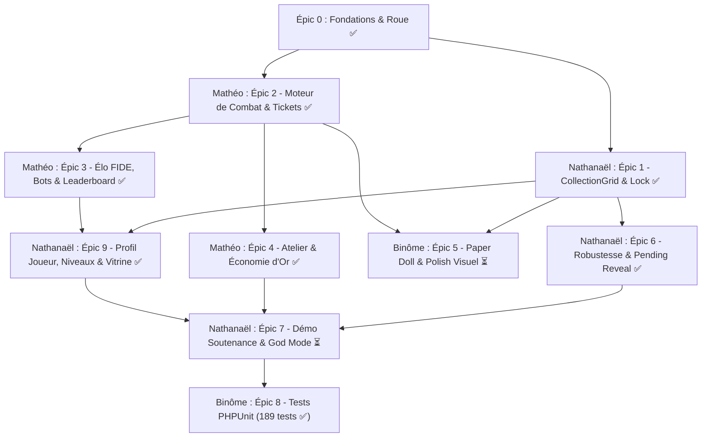

# 🎫 WHEELBORN — Carnet de Bord des Tickets & Backlog de Développement

> **Projet Universitaire Full-Stack** : Laravel 11 • Livewire 3 • Tailwind CSS • Alpine.js • SQLite  
> **Équipe de développement :** Nathanaël & Mathéo  
> **Dernière mise à jour :** Octobre 2026  
> **Suite de tests automatisés :** 189 tests, 784 assertions, 100% au vert ✅  
> 
> **Légende des priorités :**
> - 🔴 **P0 (Bloquant / MVP)** : Indispensable au fonctionnement du jeu ou exigé par la soutenance.
> - 🟡 **P1 (Majeur)** : Fonctionnalité clé de la boucle de gameplay (rétention, équilibrage).
> - 🟢 **P2 (Confort & Polish)** : Finitions visuelles, animations avancées, QoL (Quality of Life).
> 
> **Répartition générale des rôles :**
> - 🧑‍💻 **Nathanaël** : Collection, Inventaire, Sécurité/Concurrence BDD, Profil Joueur, Outils Admin & Démo soutenance.
> - 🧑‍💻 **Mathéo** : Moteur de Combat, Système d'Élo FIDE, Matchmaking/Bots, Atelier & Économie d'or.
> - 👥 **Binôme** : Rendu graphique (Paper Doll), Game Feel, Codex & Intégration globale.

---

## 📊 Tableau Récapitulatif de l'Avancement

| Épic / Jalon | Priorité | Responsable | Tickets | Statut | Fichier Détaillé |
| :--- | :---: | :---: | :---: | :---: | :--- |
| **Épic 0 : Fondations, Roue & Équilibrage** | 🔴 P0 | 👥 Binôme | 5 | ⏳ Partiel (4/5) | [epic-00-fondations-roue.md](file:///c:/Users/natha/Documents/PROJET/WHEELBORN_PROJECT/WHEELBORN/tickets/done/epic-00-fondations-roue.md) |
| **Épic 1 : Collection & Gestion d'Inventaire** | 🔴 P0 | 🧑‍💻 Nathanaël | 5 | ✅ Terminé (100%) | [epic-01-collection-inventaire.md](file:///c:/Users/natha/Documents/PROJET/WHEELBORN_PROJECT/WHEELBORN/tickets/done/epic-01-collection-inventaire.md) |
| **Épic 2 : Moteur de Combat & Arène 1v1** | 🔴 P0 | 🧑‍💻 Mathéo | 6 | ✅ Terminé (100%) | [epic-02-moteur-combat-arene.md](file:///c:/Users/natha/Documents/PROJET/WHEELBORN_PROJECT/WHEELBORN/tickets/done/epic-02-moteur-combat-arene.md) |
| **Épic 3 : Système d'Élo FIDE & Classement** | 🔴 P0 | 🧑‍💻 Mathéo | 6 | ✅ Terminé (100%) | [epic-03-elo-fide-matchmaking.md](file:///c:/Users/natha/Documents/PROJET/WHEELBORN_PROJECT/WHEELBORN/tickets/done/epic-03-elo-fide-matchmaking.md) |
| **Épic 4 : Atelier & Économie Circulaire** | 🟡 P1 | 🧑‍💻 Mathéo | 5 | ✅ Terminé (100%) | [epic-04-atelier-economie-circulaire.md](file:///c:/Users/natha/Documents/PROJET/WHEELBORN_PROJECT/WHEELBORN/tickets/done/epic-04-atelier-economie-circulaire.md) |
| **Épic 5 : Game Feel, Rendu Visuel & Paper Doll** | 🟡 P1 | 👥 Binôme | 5 | ⏳ En cours (2/5) | [epic-05-paperdoll-et-da-cosmique.md](file:///c:/Users/natha/Documents/PROJET/WHEELBORN_PROJECT/WHEELBORN/tickets/done/epic-05-paperdoll-et-da-cosmique.md) |
| **Épic 6 : Robustesse, Concurrence & Sécurité** | 🔴 P0 | 🧑‍💻 Nathanaël | 6 | ✅ Terminé (100%) | [epic-06-robustesse-concurrence-securite.md](file:///c:/Users/natha/Documents/PROJET/WHEELBORN_PROJECT/WHEELBORN/tickets/done/epic-06-robustesse-concurrence-securite.md) |
| **Épic 7 : Outils Soutenance, Admin & Démo** | 🔴 P0 | 🧑‍💻 Nathanaël | 3 | ⏳ Partiel (2/3) | [epic-07-outils-admin-godmode-seeder.md](file:///c:/Users/natha/Documents/PROJET/WHEELBORN_PROJECT/WHEELBORN/tickets/done/epic-07-outils-admin-godmode-seeder.md) |
| **Épic 8 : Tests Automatisés & QA** | 🟡 P1 | 👥 Binôme | 5 | ⏳ Partiel (4/5) | [epic-08-tests-qa-phpunit.md](file:///c:/Users/natha/Documents/PROJET/WHEELBORN_PROJECT/WHEELBORN/tickets/done/epic-08-tests-qa-phpunit.md) |
| **Épic 9 : Profil Joueur, Niveaux & Vitrine** | 🔴 P0 | 🧑‍💻 Nathanaël | 5 | ✅ Terminé (100%) | [epic-09-profil-joueur-vitrine-social.md](file:///c:/Users/natha/Documents/PROJET/WHEELBORN_PROJECT/WHEELBORN/tickets/done/epic-09-profil-joueur-vitrine-social.md) |

---

## 🎯 Backlog Actif — Tickets Restants à Réaliser (6)

Les spécifications complètes de chaque ticket en cours sont consultables dans le sous-dossier [tickets/todo/](file:///c:/Users/natha/Documents/PROJET/WHEELBORN_PROJECT/WHEELBORN/tickets/todo) :

| Réf | Priorité | Titre du Ticket | Attribué à | Fichiers Cibles | Fiche Détaillée |
| :---: | :---: | :--- | :---: | :--- | :---: |
| **T7.1** | 🔴 P0 | **Commande Artisan de Démo Clé en Main** (`php artisan game:demo-setup`) | 🧑‍💻 Nathanaël | `GameDemoSetupCommand.php` | [Ouvrir T7.1](file:///c:/Users/natha/Documents/PROJET/WHEELBORN_PROJECT/WHEELBORN/tickets/todo/T7.1-commande-demo-setup-soutenance.md) |
| **T0.5** | 🟡 P1 | **Élimination du Paradoxe "Commun > Légendaire" & Scaling Rareté** | 👥 Binôme | `CharacterGeneratorService.php`, `GameConfig.php` | [Ouvrir T0.5](file:///c:/Users/natha/Documents/PROJET/WHEELBORN_PROJECT/WHEELBORN/tickets/todo/T0.5-scaling-rarete-et-stat-floors.md) |
| **T8.2** | 🟡 P1 | **Tests Unitaires du Moteur de Génération & Raretés** | 🧑‍💻 Mathéo | `tests/Unit/CharacterGeneratorServiceTest.php` | [Ouvrir T8.2](file:///c:/Users/natha/Documents/PROJET/WHEELBORN_PROJECT/WHEELBORN/tickets/todo/T8.2-tests-unitaires-generation-raretes.md) |
| **T5.3** | 🟡 P1 | **Micro-animations Alpine.js (Screen Shake & Confettis)** | 👥 Binôme | `battle-arena.blade.php`, `character-wheel.blade.php` | [Ouvrir T5.3](file:///c:/Users/natha/Documents/PROJET/WHEELBORN_PROJECT/WHEELBORN/tickets/todo/T5.3-micro-animations-et-confettis.md) |
| **T5.2** | 🟢 P2 | **Ambiance Sonore & Haptique (SFX optionnels)** | 👥 Binôme | `audio-manager.js`, `public/audio/sfx/*` | [Ouvrir T5.2](file:///c:/Users/natha/Documents/PROJET/WHEELBORN_PROJECT/WHEELBORN/tickets/todo/T5.2-sfx-audio-et-ambiance.md) |
| **T5.4** | 🟢 P2 | **Le Codex / Compendium des Connaissances (`/codex`)** | 👥 Binôme | `Codex.php`, `resources/views/livewire/codex.blade.php` | [Ouvrir T5.4](file:///c:/Users/natha/Documents/PROJET/WHEELBORN_PROJECT/WHEELBORN/tickets/todo/T5.4-codex-compendium-connaissances.md) |

---

## 📦 Archives des Épics Terminés

L'historique complet, les critères d'acceptation validés et les tests associés sont documentés dans [tickets/done/](file:///c:/Users/natha/Documents/PROJET/WHEELBORN_PROJECT/WHEELBORN/tickets/done) :

- 🏛️ [Épic 0 : Fondations, Roue & Architecture (T0.1 à T0.4)](file:///c:/Users/natha/Documents/PROJET/WHEELBORN_PROJECT/WHEELBORN/tickets/done/epic-00-fondations-roue.md)
- 🗃️ [Épic 1 : Collection & Gestion d'Inventaire (T1.1 à T1.5)](file:///c:/Users/natha/Documents/PROJET/WHEELBORN_PROJECT/WHEELBORN/tickets/done/epic-01-collection-inventaire.md)
- ⚔️ [Épic 2 : Moteur de Combat & Arène 1v1 (T2.1 à T2.6)](file:///c:/Users/natha/Documents/PROJET/WHEELBORN_PROJECT/WHEELBORN/tickets/done/epic-02-moteur-combat-arene.md)
- 🏆 [Épic 3 : Système d'Élo FIDE & Classement (T3.1 à T3.6)](file:///c:/Users/natha/Documents/PROJET/WHEELBORN_PROJECT/WHEELBORN/tickets/done/epic-03-elo-fide-matchmaking.md)
- 🏛️ [Épic 4 : Atelier & Économie Circulaire (T4.1 à T4.5)](file:///c:/Users/natha/Documents/PROJET/WHEELBORN_PROJECT/WHEELBORN/tickets/done/epic-04-atelier-economie-circulaire.md)
- 🎨 [Épic 5 : Paper Doll V2 & Direction Artistique Cosmique (T5.1 & T5.5)](file:///c:/Users/natha/Documents/PROJET/WHEELBORN_PROJECT/WHEELBORN/tickets/done/epic-05-paperdoll-et-da-cosmique.md)
- 🛡️ [Épic 6 : Robustesse, Concurrence & Sécurité (T6.1 à T6.6)](file:///c:/Users/natha/Documents/PROJET/WHEELBORN_PROJECT/WHEELBORN/tickets/done/epic-06-robustesse-concurrence-securite.md)
- 🎓 [Épic 7 : Outils Admin, God Mode & Seeder Démo (T7.2 & T7.3)](file:///c:/Users/natha/Documents/PROJET/WHEELBORN_PROJECT/WHEELBORN/tickets/done/epic-07-outils-admin-godmode-seeder.md)
- 🧪 [Épic 8 : Tests Automatisés & Assurance Qualité PHPUnit (T8.1, T8.3, T8.4, T8.5)](file:///c:/Users/natha/Documents/PROJET/WHEELBORN_PROJECT/WHEELBORN/tickets/done/epic-08-tests-qa-phpunit.md)
- 🛡️ [Épic 9 : Profil Joueur, Niveaux, Vitrine & Social (T9.1 à T9.5)](file:///c:/Users/natha/Documents/PROJET/WHEELBORN_PROJECT/WHEELBORN/tickets/done/epic-09-profil-joueur-vitrine-social.md)

---

## 🗺️ Feuille de Route Globale (Roadmap)

