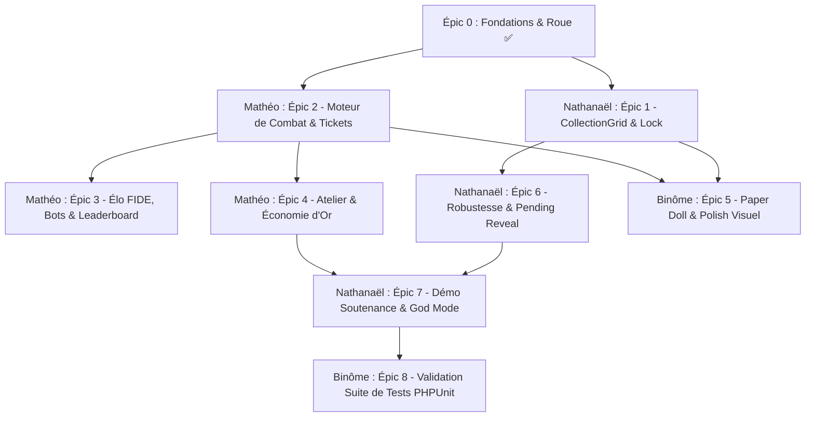

# 🎫 WHEELBORN — Carnet de Bord des Tickets & Backlog de Développement

> **Projet Universitaire Full-Stack** : Laravel 11 • Livewire 3 • Tailwind CSS • Alpine.js • SQLite  
> **Équipe de développement :** Nathanaël & Mathéo  
> **Dernière mise à jour :** Octobre 2026  
> 
> **Légende des priorités :**
> - 🔴 **P0 (Bloquant / MVP)** : Indispensable au fonctionnement du jeu ou exigé par la soutenance.
> - 🟡 **P1 (Majeur)** : Fonctionnalité clé de la boucle de gameplay (rétention, équilibrage).
> - 🟢 **P2 (Confort & Polish)** : Finitions visuelles, animations avancées, QoL (Quality of Life).
> 
> **Répartition générale des rôles :**
> - 🧑‍💻 **Nathanaël** : Collection, Inventaire, Sécurité/Concurrence BDD, Outils Admin & Démo soutenance.
> - 🧑‍💻 **Mathéo** : Moteur de Combat, Système d'Élo FIDE, Matchmaking/Bots, Atelier & Économie d'or.
> - 👥 **Binôme** : Rendu graphique (Paper Doll), Game Feel, Codex & Intégration globale.

---

## 📊 Tableau Récapitulatif de l'Avancement

| Épic / Jalon | Priorité | Responsable Principal | Tickets | Statut |
| :--- | :---: | :---: | :---: | :---: |
| **Épic 0 : Fondations & Roue de Tirage** | 🔴 P0 | 👥 Binôme | 4 | ✅ Terminé (100%) |
| **Épic 1 : Collection & Gestion d'Inventaire** | 🔴 P0 | 🧑‍💻 Nathanaël | 5 | ✅ Terminé (100%) |
| **Épic 2 : Moteur de Combat & Arène 1v1** | 🔴 P0 | 🧑‍💻 Mathéo | 6 | ⏳ À démarrer (0/6) |
| **Épic 3 : Système d'Élo FIDE & Classement** | 🔴 P0 | 🧑‍💻 Mathéo | 6 | ⏳ À démarrer (0/6) |
| **Épic 4 : Atelier & Économie Circulaire** | 🟡 P1 | 🧑‍💻 Mathéo | 5 | ⏳ À démarrer (0/5) |
| **Épic 5 : Game Feel, Rendu Visuel & Paper Doll** | 🟡 P1 | 👥 Binôme | 4 | ⏳ À démarrer (0/4) |
| **Épic 6 : Robustesse, Concurrence & Edge Cases** | 🔴 P0 | 🧑‍💻 Nathanaël | 5 | ⏳ En cours (3/5) |
| **Épic 7 : Outils Soutenance, Admin & Démo** | 🔴 P0 | 🧑‍💻 Nathanaël | 2 | ⏳ À démarrer (0/2) |
| **Épic 8 : Tests Automatisés & QA** | 🟡 P1 | 👥 Binôme (réparti) | 4 | ⏳ Partiel (1/4) |

---

## ✅ Épic 0 — Fondations & Roue de Tirage (Déjà réalisé)

- [x] **T0.1 [Architecture] Mise en place des fondations Laravel 11 + Livewire 3 + Breeze**
  - *Responsable :* 👥 Binôme
  - *Fichiers :* `composer.json`, `routes/web.php`, `resources/views/layouts/app.blade.php`
  - *Détails :* Auth fonctionnelle, layout sombre néon, support Livewire 3 et Alpine.js.
- [x] **T0.2 [Données & Modèles] Schéma BDD, Enums et Données Statiques**
  - *Responsable :* 👥 Binôme
  - *Fichiers :* `app/Models/*`, `app/Enums/*`, `app/Data/*`, `database/migrations/*`
  - *Détails :* 8 races, 8 armes, 8 pouvoirs, 16 synergies, raretés, tables `characters`, `battles`, etc.
- [x] **T0.3 [Génération] Services de génération procédurale et de recyclage**
  - *Responsable :* 👥 Binôme
  - *Fichiers :* `app/Services/CharacterGeneratorService.php`, `app/Services/RecycleService.php`, `app/Services/EnergyManagerService.php`
  - *Détails :* Tirage pondéré, stats dérivées, calcul de la valeur de recyclage en or.
- [x] **T0.4 [UI] Composant Livewire `CharacterWheel` et Jauge de Pity 10/10**
  - *Responsable :* 👥 Binôme
  - *Fichiers :* `app/Livewire/CharacterWheel.php`, `resources/views/livewire/character-wheel.blade.php`
  - *Détails :* Animation de spin, modale de révélation avec boutons Garder/Recycler, outils Admin de test.

---

## 🗃️ Épic 1 — Collection & Inventaire (`CollectionGrid`)
> **Responsable principal :** 🧑‍💻 Nathanaël

### [x] T1.1 — Création du composant Livewire `CollectionGrid`
- **Priorité :** 🔴 P0 (MVP)
- **Attribué à :** 🧑‍💻 Nathanaël
- **Cible :** `app/Livewire/CollectionGrid.php`, `resources/views/livewire/collection-grid.blade.php`, `routes/web.php`
- **Description :** Permettre au joueur connecté de consulter l'ensemble de ses cartes de combattants sous forme d'une grille réactive (cartes néon).
- **Critères d'acceptation :**
  - [x] Affichage en grille responsive (1 col mobile, 2 cols tablette, 3-4 cols desktop).
  - [x] Pagination propre (ex: 12 cartes par page) pour éviter de saturer le DOM.
  - [x] Compteur total de cartes possédées et indicateur de capacité.
  - [x] État vide élégant ("Aucun combattant — Fais tourner la Roue !").

### [x] T1.2 — Filtres multi-critères et Tri dynamique
- **Priorité :** 🟡 P1
- **Attribué à :** 🧑‍💻 Nathanaël
- **Cible :** `app/Livewire/CollectionGrid.php`, `resources/views/livewire/collection-grid.blade.php`, `tests/Feature/CollectionGridTest.php`
- **Description :** Ajouter une barre d'outils réactive permettant de filtrer et trier rapidement les cartes de sa collection.
- **Critères d'acceptation :**
  - [x] Recherche textuelle en direct (`wire:model.live.debounce`) par nom de héros avec bouton d'effacement rapide.
  - [x] Filtre rapide par rareté (badges cliquables du HUD & boutons de filtrage pour Commune, Rare, Épique, Légendaire).
  - [x] Filtre déroulant par race (8 races) et par arme principale (8 armes).
  - [x] Filtre rapide "Avec Synergie active uniquement" avec indicateur visuel pulsé.
  - [x] Tri dynamique par : Score Power (décroissant/croissant), Rareté (Légendaire -> Commun), Date d'obtention, Victoires en Arène.
  - [x] Mise à jour instantanée sans rechargement de page (Livewire `wire:model.live` + réinitialisation automatique de la pagination).
  - [x] Bouton d'action "Effacer les filtres" et état vide informatif en cas de recherche sans résultat.

### [x] T1.3 — Système de Verrouillage de Carte (Favori / Lock)
- **Priorité :** 🔴 P0 (Sécurité Joueur)
- **Attribué à :** 🧑‍💻 Nathanaël
- **Cible :** `database/migrations/2026_10_19_140000_add_is_locked_to_characters_table.php`, `app/Models/Character.php`, `app/Services/RecycleService.php`, `app/Livewire/CollectionGrid.php`, `resources/views/livewire/collection-grid.blade.php`, `tests/Feature/CollectionGridTest.php`
- **Description :** Empêcher la destruction accidentelle d'une carte précieuse lors des sessions de recyclage.
- **Critères d'acceptation :**
  - [x] Champ booléen `is_locked` (défaut `false`) avec index SQL sur le modèle `Character`.
  - [x] Icône de cadenas interactive (🔒/🔓) sur chaque carte pour basculer l'état verrouillé en un clic avec notification.
  - [x] Le bouton "Recycler" individuel est désactivé et transformé en badge sécurisé "🔒 Protégé" si la carte est verrouillée.
  - [x] Le `RecycleService` bloque avec une exception (`DomainException`) toute tentative de recyclage d'une carte verrouillée (sécurité backend).
  - [x] Filtre rapide "🔒 Verrouillés uniquement" dans la barre d'outils de collection.

### [x] T1.4 — Recyclage en Masse Avancé (Multi-critères & Modale Dédiée)
- **Priorité :** 🟡 P1 (Confort de jeu / Économie circulaire)
- **Attribué à :** 🧑‍💻 Nathanaël
- **Cible :** `app/Services/RecycleService.php`, `app/Livewire/CollectionGrid.php`, `resources/views/livewire/collection-grid.blade.php`, `tests/Feature/CollectionGridTest.php`
- **Description :** Modale de suppression de masse ultra-complète permettant de filtrer les combattants à recycler par rareté, score de puissance, race, arme et préservation des synergies.
- **Critères d'acceptation :**
  - [x] Bouton d'action "♻️ Recyclage en masse" dans le bandeau de collection.
  - [x] Filtrage modulaire par raretés (cases à cocher Communs, Rares, Épiques, Légendaires).
  - [x] Filtrage par plafond de score de puissance (Power Score Max : saisie libre ou raccourcis ≤ 50, ≤ 65, ≤ 80).
  - [x] Ciblage par race spécifique (8 races au choix ou toutes) et arme spécifique (8 armes au choix ou toutes).
  - [x] Protection des synergies : toggle pour exclure automatiquement les héros dotés d'une synergie élémentaire active.
  - [x] Aperçu visuel en direct : liste scrollable affichant chaque héros ciblé (icône de race, nom, rareté, puissance, valeur en or).
  - [x] Calcul prévisionnel instantané du total de pièces d'or 🪙 et du nombre de héros sélectionnés.
  - [x] Protection absolue : exclusion inviolable des héros verrouillés (`is_locked`) et des combattants déployés en arène.
  - [x] Transaction SQL atomique (`DB::transaction` avec `lockForUpdate`) et mise à jour dynamique du solde dans le HUD (`stats-updated`).

### [x] T1.5 — Cartes Recto/Verso (Flip Hover) & Modale Inspecteur « Fiche Détaillée »
- **Priorité :** 🟢 P2 (Game Feel & Immersion Collection)
- **Attribué à :** 🧑‍💻 Nathanaël
- **Cible :** `app/Livewire/CollectionGrid.php`, `resources/views/livewire/collection-grid.blade.php`, `app/Models/Character.php`, `tests/Feature/CollectionGridTest.php`
- **Description :** Cartes double-face immersives (Recto visuel collector par défaut, Verso au survol/hover avec stats et actions) et modale d'inspection grand format détaillant les passifs et synergies de combat.
- **Critères d'acceptation :**
  - [x] **Parité Dimensionnelle Recto/Verso :** Hauteur et largeur strictement identiques (`height: 490px; min-height: 490px; w-full`) éliminant tout écrasement ou décalage vertical entre les deux faces.
  - [x] **Face Recto (Par défaut) épurée avec Artwork Placeholder :** Carte collector graphique et aérée (sans texte tutoriel superflu) avec vitrine centrale encadrée en pointillé ("🖼️ Artwork Placeholder"), avatar de race géant, badges d'arme et pouvoir, étoiles de rareté, score de puissance et rareté.
  - [x] **Face Verso (Au survol / Hover) :** Transition fluide dévoilant la composition tri-slot, les barres de statistiques colorées, les badges de synergies actives (ou mention d'absence), le palmarès d'arène et les actions rapides (cadenas, recyclage, bouton inspecter).
  - [x] **Modale Inspecteur Grand Format :**
    - [x] Panneau de prestige gauche : avatar XXL, étoiles, rareté, historique d'arène (duels, victoires, défaites, winrate %), actions cadenas et recyclage.
    - [x] Fiche technique droite : statistiques de combat complètes (PV, Force, Vitesse, Défense).
    - [x] Explication textuelle complète des 3 passifs : passif inné de race, passif d'arme, et effet élémentaire du pouvoir.
    - [x] Section synergies détaillée : liste des bonus de combat actifs avec mention explicite des synergies instables.
  - [x] Suite de tests automatisés validant l'ouverture/fermeture de l'inspecteur et les actions associées (51 tests passants).

---

## ⚔️ Épic 2 — Moteur de Combat & Arène 1v1 (`BattleArena`)
> **Responsable principal :** 🧑‍💻 Mathéo

### [ ] T2.1 — Implémentation du moteur de combat `BattleEngineService`
- **Priorité :** 🔴 P0 (Cœur de jeu)
- **Attribué à :** 🧑‍💻 Mathéo
- **Cible :** `app/Services/BattleEngineService.php`
- **Description :** Développer le service PHP pur simulant l'affrontement tour par tour entre deux combattants de manière déterministe.
- **Critères d'acceptation :**
  - [ ] Phase 1 (Initiative) : Le combattant avec la plus haute Vitesse frappe en premier (avec tirage au sort si égalité).
  - [ ] Phase 2 (Échange de coups) : Calcul des dégâts bruts atténués par la défense ennemie.
  - [ ] Prise en compte des effets d'armes (saignement, coup contondant) et des pouvoirs (brûlure DoT, gel, régénération).
  - [ ] Application des synergies (ex: Pyro-Lame, Tempête Électrique, Instabilités).
  - [ ] Calcul des coups critiques et esquives basés sur la stat Chance.
  - [ ] Sécurité anti-boucle infinie (limite fixée à 25 tours max).

### [ ] T2.2 — Déterminisme, Seed aléatoire et Audit Log (`turns_log`)
- **Priorité :** 🔴 P0 (Anti-triche & Replay)
- **Attribué à :** 🧑‍💻 Mathéo
- **Cible :** `app/Models/Battle.php`, `database/migrations/xxxx_create_battles_table.php`
- **Description :** Assurer la reproductibilité absolue de chaque combat pour permettre le replay et éliminer toute triche côté client.
- **Critères d'acceptation :**
  - [ ] Utilisation d'un générateur pseudo-aléatoire seedé (`mt_srand($seed)`).
  - [ ] Enregistrement du déroulement complet dans un champ JSON `turns_log` (qui a frappé, dégâts, PV restants, effet déclenché).
  - [ ] Possibilité de recalculer le combat à partir de la seed et d'obtenir un résultat 100% identique.

### [ ] T2.3 — Gestion des Tickets d'Arène & Régénération
- **Priorité :** 🔴 P0 (Économie & Cadence de session)
- **Attribué à :** 🧑‍💻 Mathéo
- **Cible :** `app/Services/EnergyManagerService.php`, `app/Models/User.php`
- **Description :** Réguler les combats via un stock limité de tickets (anti-farm compulsif).
- **Critères d'acceptation :**
  - [ ] Stock maximum : 5 tickets d'arène.
  - [ ] Vitesse de recharge : 1 ticket toutes les 5 minutes (avec calcul de rattrapage hors-ligne).
  - [ ] Déduction atomique d'un ticket au lancement d'un duel.
  - [ ] Message explicite si tentative de combat avec 0 ticket.

### [ ] T2.4 — Interface de Combat Face-à-Face Livewire (`BattleArena`)
- **Priorité :** 🔴 P0 (Expérience Utilisateur)
- **Attribué à :** 🧑‍💻 Mathéo
- **Cible :** `app/Livewire/BattleArena.php`, `resources/views/livewire/battle-arena.blade.php`
- **Description :** Interface interactive de préparation et de visualisation du combat.
- **Critères d'acceptation :**
  - [ ] Écran 1 (Sélection) : Le joueur choisit sa carte combattante parmi sa collection.
  - [ ] Écran 2 (Face-à-face) : Affichage des deux cartes côte à côte avec badges de stats.
  - [ ] Écran 3 (Affrontement animé) : Défilement des tours avec barres de vie qui diminuent via Alpine.js.
  - [ ] Écran 4 (Bilan) : Affichage Victoire/Défaite, gain/perte d'Élo et butin de pièces récoltées.

### [ ] T2.5 — Bouton Fast-Forward ("Passer le combat / Résultat direct")
- **Priorité :** 🟡 P1 (QoL)
- **Attribué à :** 🧑‍💻 Mathéo
- **Cible :** `resources/views/livewire/battle-arena.blade.php`
- **Description :** Permettre aux joueurs réguliers de passer l'animation pour aller directement à l'écran de résultat.
- **Critères d'acceptation :**
  - [ ] Bouton bien visible "Passer l'animation ⏭️".
  - [ ] Interrompt le timing Alpine.js et affiche instantanément les barres de PV finales et le bilan.
  - [ ] Le calcul serveur restant identique, l'issue ne dépend pas de l'animation front.

### [ ] T2.6 — Gestion des Cas Limites : Égalités & Double K.O.
- **Priorité :** 🟡 P1 (Edge case)
- **Attribué à :** 🧑‍💻 Mathéo
- **Cible :** `app/Services/BattleEngineService.php`
- **Description :** Traiter proprement les scénarios où les deux combattants tombent à 0 PV au même tour (ex: dégâts de poison mutuels).
- **Critères d'acceptation :**
  - [ ] Règle définie : Si double K.O., le joueur ayant porté le coup initial conserve l'avantage ou match déclaré "Match Nul".
  - [ ] En cas de Match Nul : aucun gain/perte d'Élo ($\Delta \text{Élo} = 0$), mais remboursement partiel du ticket ou petit lot de consolation (ex: 20 pièces).
  - [ ] Feedback visuel adapté ("Égalité sanglante !").

---

## 🏆 Épic 3 — Système d'Élo FIDE & Matchmaking (`Leaderboard`)
> **Responsable principal :** 🧑‍💻 Mathéo

### [ ] T3.1 — Service Mathématique d'Élo Standard FIDE
- **Priorité :** 🔴 P0 (Équilibrage)
- **Attribué à :** 🧑‍💻 Mathéo
- **Cible :** `app/Services/EloService.php`
- **Description :** Implémenter la formule officielle d'Élo d'échecs (FIDE) avec facteur $K=32$.
- **Critères d'acceptation :**
  - [ ] Calcul de la probabilité attendue : $E_A = \frac{1}{1 + 10^{(R_B - R_A)/400}}$.
  - [ ] Calcul du delta : $\Delta = \text{round}(K \times (Score - E_A))$.
  - [ ] Test des cas limites : victoire contre plus fort (+ fort gain), défaite contre plus faible (- forte perte).
  - [ ] Plancher d'Élo fixé à 0 (l'Élo ne peut pas être négatif).

### [ ] T3.2 — Système de Ligues dynamiques par Paliers
- **Priorité :** 🔴 P0 (Visuel & Rétention)
- **Attribué à :** 🧑‍💻 Mathéo
- **Cible :** `app/Enums/League.php`, `app/Models/User.php`
- **Description :** Catégoriser les joueurs selon leur score d'Élo avec badge et couleur associés.
- **Critères d'acceptation :**
  - [ ] Paliers : Bronze (0-999), Argent (1000-1399), Or (1400-1799), Platine (1800-2199), Maître (2200+).
  - [ ] Méthode sur `User` : `$user->getLeague()`.
  - [ ] Déclenchement d'une alerte/notification festive lors d'une promotion de ligue.

### [ ] T3.3 — Matchmaking équilibré par Plage d'Élo
- **Priorité :** 🔴 P0 (Fair-play)
- **Attribué à :** 🧑‍💻 Mathéo
- **Cible :** `app/Services/EloService.php`
- **Description :** Trouver un adversaire réel dont l'Élo est proche de celui du joueur pour des duels équilibrés.
- **Critères d'acceptation :**
  - [ ] Recherche en priorité dans une fenêtre de $\pm 100$ Élo.
  - [ ] Élargissement progressif à $\pm 250$ Élo si aucun joueur disponible.
  - [ ] Exclusion des propres personnages du joueur connecté.

### [ ] T3.4 — Système de Combattants Fantômes / Bots (Anti-Cold Start)
- **Priorité :** 🔴 P0 (Indispensable pour la soutenance)
- **Attribué à :** 🧑‍💻 Mathéo
- **Cible :** `app/Services/BotGeneratorService.php` ou Seeder
- **Description :** Permettre de jouer même si la BDD est vierge de vrais utilisateurs.
- **Critères d'acceptation :**
  - [ ] Si aucun joueur réel n'est trouvé dans la plage d'Élo, génération à la volée d'un "Fantôme d'Arène" adapté à la ligue actuelle.
  - [ ] Nom procédural évocateur ("Gladiateur de l'Ombre", "Garde de Fer", etc.).
  - [ ] Le calcul d'Élo s'applique normalement pour le joueur.

### [ ] T3.5 — Composant Livewire `Leaderboard`
- **Priorité :** 🟡 P1
- **Attribué à :** 🧑‍💻 Mathéo
- **Cible :** `app/Livewire/Leaderboard.php`, `resources/views/livewire/leaderboard.blade.php`
- **Description :** Tableau des meilleurs joueurs de l'arène avec filtres par ligue.
- **Critères d'acceptation :**
  - [ ] Podium stylisé pour le Top 3 (or, argent, bronze néon).
  - [ ] Ligne épinglée indiquant le rang, l'Élo et la ligue du joueur connecté.
  - [ ] Onglets de filtrage par ligue (Tous, Maître, Platine, etc.).
  - [ ] Cache Redis ou Cache Laravel (durée 60 secondes) pour préserver les perfs BDD.

### [ ] T3.6 — Historique & Replay des Duels
- **Priorité :** 🟢 P2
- **Attribué à :** 🧑‍💻 Mathéo
- **Cible :** `resources/views/livewire/battle-history.blade.php`
- **Description :** Historique des 10 derniers combats du joueur avec consultation du journal.
- **Critères d'acceptation :**
  - [ ] Liste des combats récents : V/D, adversaire, delta d'Élo, date relative ("il y a 5 min").
  - [ ] Bouton "Revoir le combat" qui recharge le `turns_log` dans l'arène.

---

## 🏛️ Épic 4 — Économie Circulaire & Atelier (`Workshop`)
> **Responsable principal :** 🧑‍💻 Mathéo

### [ ] T4.1 — Modèle, Migration & Service `WorkshopService`
- **Priorité :** 🔴 P0 (Boucle de rétention V2)
- **Attribué à :** 🧑‍💻 Mathéo
- **Cible :** `app/Services/WorkshopService.php`, `app/Models/WorkshopUpgrade.php`
- **Description :** Logique d'achat d'améliorations passives permanentes financées par l'or du recyclage et des victoires.
- **Critères d'acceptation :**
  - [ ] Définition des améliorations :
    1. *Aimant à Pouvoirs Rares* (Niveaux 1 à 5 : +3% par niveau de chance de pouvoirs épiques/mythiques).
    2. *Forge des Héros* (Niveaux 1 à 5 : +2 Force et +3 PV constants sur les futurs tirages).
    3. *Coffre de Guerre* (Niveaux 1 à 3 : +25%, +50%, +100% d'or par victoire d'arène).
  - [ ] Vérification stricte du solde de pièces avant achat et déduction sécurisée.
  - [ ] Sauvegarde du niveau de chaque amélioration par utilisateur.

### [ ] T4.2 — Intégration des bonus de l'Atelier dans le Moteur de Génération
- **Priorité :** 🔴 P0 (Cohérence Gameplay)
- **Attribué à :** 🧑‍💻 Mathéo
- **Cible :** `app/Services/CharacterGeneratorService.php`
- **Description :** Faire en sorte que les améliorations achetées affectent réellement les prochains tirages de roue.
- **Critères d'acceptation :**
  - [ ] Injection du niveau de l'Aimant à Pouvoirs pour modifier les probabilités de `PowerData`.
  - [ ] Injection du niveau de la Forge des Héros pour ajouter les points de stats bonus lors de la création du personnage.

### [ ] T4.3 — Ticket d'Urgence (Achat de tirage immédiat)
- **Priorité :** 🟡 P1
- **Attribué à :** 🧑‍💻 Mathéo
- **Cible :** `app/Services/WorkshopService.php`, `app/Livewire/CharacterWheel.php`
- **Description :** Donner une utilité immédiate à l'or quand le joueur a vidé ses charges de roue et veut continuer sa session.
- **Critères d'acceptation :**
  - [ ] Achat d'une charge de spin pour 120 pièces d'or.
  - [ ] Limitation : maximum 2 achats par tranche de 24 heures (ou prix croissant 120 🪙 $\rightarrow$ 250 🪙 $\rightarrow$ 500 🪙).

### [ ] T4.4 — Composant Livewire `Workshop`
- **Priorité :** 🟡 P1
- **Attribué à :** 🧑‍💻 Mathéo
- **Cible :** `app/Livewire/Workshop.php`, `resources/views/livewire/workshop.blade.php`
- **Description :** Interface moderne de l'Atelier avec arbre de cartes d'améliorations.
- **Critères d'acceptation :**
  - [ ] Cartes d'améliorations avec barres de progression de niveau (ex: Niv. 2/5).
  - [ ] Bouton d'achat dynamique affichant le coût du niveau suivant.
  - [ ] Feedback visuel en cas de fonds insuffisants.
  - [ ] Animation de déblocage avec notification de succès.

### [ ] T4.5 — Succès & Déblocages Spéciaux (`Achievements`)
- **Priorité :** 🟢 P2
- **Attribué à :** 🧑‍💻 Mathéo
- **Cible :** `app/Models/Achievement.php`, `app/Listeners/ProcessAchievements.php`
- **Description :** Récompenser les accomplissements des joueurs avec des titres et des bourses de pièces.
- **Critères d'acceptation :**
  - [ ] Succès "Premier Sang" (1ère victoire en arène).
  - [ ] Succès "Maître Alchimiste" (Recycler 10 cartes).
  - [ ] Succès "Bénédiction Divine" (Obtenir une carte Légendaire).
  - [ ] Succès "Combinaison Instable" (Tirer une synergie à risque).

---

## 🎨 Épic 5 — Game Feel, Rendu Visuel & Paper Doll
> **Responsables :** 👥 Binôme (Nathanaël & Mathéo)

### [ ] T5.1 — Système de Rendu Composite "Paper Doll" (Avatar Procédural)
- **Priorité :** 🟡 P1 (Immersion & Note Soutenance)
- **Attribué à :** 👥 Binôme
- **Cible :** `resources/views/components/character-avatar.blade.php`
- **Description :** Générer une représentation graphique unique de chaque héros par superposition de calques SVG/CSS.
- **Critères d'acceptation :**
  - [ ] Calque 1 : Silhouette / Corps selon la Race (Elfe, Nain, Démon, Cyborg...).
  - [ ] Calque 2 : Arme équipée dans la main (Épée, Marteau, Dagues, Arc...).
  - [ ] Calque 3 : Aura de particules ou lueur de couleur selon le Pouvoir Élémentaire (Feu, Foudre, Glace...).
  - [ ] Calque 4 : Cadre néon orné selon la Rareté (Gris, Bleu, Violet, Doré animé).

### [ ] T5.2 — Ambiance Sonore & Haptique (SFX optionnels)
- **Priorité :** 🟢 P2 (Polish)
- **Attribué à :** 👥 Binôme
- **Cible :** `resources/js/audio-manager.js`
- **Description :** Ajouter des feedbacks sonores discrets et désactivables pour amplifier les moments forts.
- **Critères d'acceptation :**
  - [ ] Bruit de cliquetis mécanique lors de la rotation de la roue.
  - [ ] Fanfare d'impact différente selon la rareté lors de la révélation.
  - [ ] Bruit de pièces métalliques lors du recyclage.
  - [ ] Bouton toggle "Mute / Son On" persistant dans le `localStorage`.

### [ ] T5.3 — Micro-animations Alpine.js (Screen Shake & Confettis)
- **Priorité :** 🟡 P1
- **Attribué à :** 👥 Binôme
- **Cible :** `resources/views/livewire/character-wheel.blade.php`, `resources/views/livewire/battle-arena.blade.php`
- **Description :** Donner du punch à l'interface lors des événements critiques.
- **Critères d'acceptation :**
  - [ ] Secousse d'écran (`screen-shake`) sur les coups critiques en arène.
  - [ ] Éclatement de confettis dorés légers lors du déclenchement du Super Spin 10/10.
  - [ ] Animation de pulsation rouge lors des coups portés.

### [ ] T5.4 — Le Codex / Compendium des Connaissances
- **Priorité :** 🟢 P2 (Clarté académique)
- **Attribué à :** 👥 Binôme
- **Cible :** `resources/views/codex.blade.php`, `routes/web.php`
- **Description :** Une encyclopédie intégrée au jeu listant toutes les règles, races, armes, pouvoirs et combinaisons de synergies.
- **Critères d'acceptation :**
  - [ ] Fiches des 8 races avec modificateurs de stats.
  - [ ] Fiches des 8 armes avec types de dégâts.
  - [ ] Fiches des 8 pouvoirs classés par rareté.
  - [ ] Tableau des 16 synergies (dont les 4 combinaisons instables) avec statut "Découvert" ou "Mystère".

---

## 🛡️ Épic 6 — Robustesse, Concurrence & Edge Cases
> **Responsable principal :** 🧑‍💻 Nathanaël

### [ ] T6.1 — Reprise automatique d'un tirage non finalisé (`pending_reveal`)
- **Priorité :** 🔴 P0 (Bug Critique / Expérience Utilisateur)
- **Attribué à :** 🧑‍💻 Nathanaël
- **Cible :** `app/Livewire/CharacterWheel.php`
- **Description :** Si l'utilisateur quitte la page après avoir cliqué sur "Spin" mais avant d'avoir choisi "Garder" ou "Recycler", le tirage ne doit pas être perdu.
- **Critères d'acceptation :**
  - [ ] Lors du `mount()`, vérification en BDD si un personnage de l'utilisateur a `pending_reveal = true`.
  - [ ] Si oui, chargement immédiat de ce personnage dans `$revealedCharacter` et réouverture automatique de la modale.
  - [ ] Empêchement de relancer un nouveau spin tant que le précédent n'a pas été validé ou recyclé.

### [ ] T6.2 — Transactions Atomiques et Protection Multi-clic
- **Priorité :** 🔴 P0 (Sécurité & Intégrité des données)
- **Attribué à :** 🧑‍💻 Nathanaël
- **Cible :** `app/Services/RecycleService.php`, `app/Livewire/CharacterWheel.php`, `app/Services/WorkshopService.php`
- **Description :** Éviter les failles de duplication d'or ou de cartes en cas de clics frénétiques.
- **Critères d'acceptation :**
  - [ ] Encapsuler le spin, le recyclage et les achats dans `DB::transaction(...)`.
  - [ ] Utiliser `lockForUpdate()` sur la ligne de l'utilisateur pour bloquer les requêtes concurrentes.
  - [ ] Attributs Blade `wire:loading.attr="disabled"` sur tous les boutons d'action monétaire.

### [x] T6.3 — Calcul précis du rattrapage temporel (Catch-Up Time) & Correction Carbon 3
- **Priorité :** 🔴 P0 (Énergie)
- **Attribué à :** 🧑‍💻 Nathanaël
- **Cible :** `app/Services/EnergyManagerService.php`, `tests/Feature/EnergyManagerTest.php`
- **Description :** Assurer que la régénération de charges s'effectue sans décalage ni blocage même après plusieurs jours (résolution du bug de différence négative Carbon 3).
- **Critères d'acceptation :**
  - [x] Calcul mathématique par timestamp : `elapsed = max(0, now()->timestamp - last_regen->timestamp)`.
  - [x] Plafonnement strict au maximum légal (`max_charges = 3`).
  - [x] Mise à jour correcte du timestamp pour ne pas perdre les secondes résiduelles (`addSeconds`).
  - [x] Initialisation propre si le joueur a moins de 3 charges sans timestamp posé.

### [x] T6.4 — Compte à rebours dynamique de recharge & synchronisation Livewire
- **Priorité :** 🔴 P0 (UX / Feedback)
- **Attribué à :** 🧑‍💻 Nathanaël
- **Cible :** `app/Livewire/CharacterWheel.php`, `resources/views/livewire/character-wheel.blade.php`, `resources/js/app.js`
- **Description :** Affichage d'un timer précis (mm:ss) uniquement dans la carte des charges avec mise à jour automatique en temps réel.
- **Critères d'acceptation :**
  - [x] Pré-rendu direct en PHP (`sprintf('%02d:%02d', ...)`) pour garantir zéro texte vide ou `NaN` avant l'exécution JS.
  - [x] Compte à rebours animé fluide côté client via Alpine.js (`wire:key` isolé, sans `$watch` défaillant) dans la carte des charges.
  - [x] Suppression de l'instance manuelle `Alpine.start()` dans `resources/js/app.js` pour éliminer le conflit de double instance avec Livewire 3.
  - [x] Suppression des doublons d'affichage pour une interface épurée.
  - [x] Déblocage immédiat du bouton dès qu'une charge devient disponible.

### [x] T6.5 — Composant Livewire réactif `PlayerHud` (Synchronisation temps réel du solde de pièces)
- **Priorité :** 🔴 P0 (Économie & UI réactive)
- **Attribué à :** 🧑‍💻 Nathanaël
- **Cible :** `app/Livewire/PlayerHud.php`, `resources/views/livewire/player-hud.blade.php`, `resources/views/layouts/navigation.blade.php`, `tests/Feature/PlayerHudTest.php`
- **Description :** Rendre la barre HUD de navigation réactive en temps réel via des événements Livewire (`stats-updated`) pour refléter immédiatement les gains de pièces (recyclage), les dépenses et les variations d'Élo sans recharger la page.
- **Critères d'acceptation :**
  - [x] Extraction du HUD statique de `navigation.blade.php` vers un composant Livewire `PlayerHud`.
  - [x] Double réactivité instantanée : gestion polyvalente du payload d'événement (`array` ou `object`) + écouteur Livewire `#[On('stats-updated')]`.
  - [x] Animation visuelle (bump / scale doré) lors de la mise à jour des pièces pour un feedback clair et immédiat au joueur.
  - [x] Émission automatique avec payload complet (`coins`, `spinCharges`, `elo`) depuis `CharacterWheel` et `CollectionGrid` lors de chaque recyclage ou spin.
  - [x] Affichage formaté des pièces (`Intl.NumberFormat`) et icône dynamique de ligue.

---

## 🎓 Épic 7 — Outils Soutenance, Admin & Démo Universitaire
> **Responsable principal :** 🧑‍💻 Nathanaël

### [ ] T7.1 — Commande Artisan de Démo Clé en Main (`php artisan game:demo-setup`)
- **Priorité :** 🔴 P0 (Soutenance)
- **Attribué à :** 🧑‍💻 Nathanaël
- **Cible :** `app/Console/Commands/GameDemoSetupCommand.php`
- **Description :** Commande unique permettant de préparer le projet en 5 secondes avant le passage devant le jury.
- **Critères d'acceptation :**
  - [ ] Réinitialise et peuple la base avec un environnement vivant.
  - [ ] Crée 3 comptes de démonstration :
    - `bronze@wheelborn.test` (Débutant, 950 Élo, 2 cartes).
    - `argent@wheelborn.test` (Joueur intermédiaire, 1250 Élo, 8 cartes).
    - `admin@wheelborn.test` (Compte Maître, 2300 Élo, atelier maxé, ressources illimitées).
  - [ ] Génère 40 cartes dans l'arène pour avoir un classement complet et des adversaires immédiats.

### [ ] T7.2 — Panneau de Débogage / God Mode dans l'Interface
- **Priorité :** 🟡 P1 (Soutenance)
- **Attribué à :** 🧑‍💻 Nathanaël
- **Cible :** `resources/views/livewire/partials/admin-cheat-bar.blade.php`, `app/Livewire/CharacterWheel.php`
- **Description :** Barre flottante réservée à l'administrateur pour forcer n'importe quel cas de figure en direct.
- **Critères d'acceptation :**
  - [ ] Visible uniquement si `$isAdmin === true`.
  - [ ] Bouton "Forcer Super Spin 10/10" (pour montrer l'animation dorée au jury).
  - [ ] Bouton "+50 000 🪙" (pour tester les achats dans l'Atelier).
  - [ ] Bouton "Recharger instantanément Tickets & Énergie".
  - [ ] Bouton "Générer une Synergie Instable garantie" (démonstration du game design).

---

## 🧪 Épic 8 — Tests Automatisés & Assurance Qualité (PHPUnit)
> **Responsables :** 👥 Répartition selon les modules

### [x] T8.1 — Tests du Composant Livewire `CharacterWheel`
- **Priorité :** 🔴 P0
- **Attribué à :** 🧑‍💻 Nathanaël
- **Cible :** `tests/Feature/Livewire/CharacterWheelTest.php`
- **Statut :** ✅ Déjà implémenté.

### [ ] T8.2 — Tests Unitaires du Moteur de Génération & Raretés
- **Priorité :** 🟡 P1
- **Attribué à :** 🧑‍💻 Mathéo
- **Cible :** `tests/Unit/CharacterGeneratorServiceTest.php`
- **Critères d'acceptation :**
  - [ ] Vérifier que le 10ème spin (Super Spin) ne produit JAMAIS de carte Commune.
  - [ ] Tester que le score Power calculé correspond bien à la formule du GDD.
  - [ ] Valider la détection des synergies selon la table de correspondance.

### [ ] T8.3 — Tests Unitaires de la Formule d'Élo FIDE
- **Priorité :** 🔴 P0
- **Attribué à :** 🧑‍💻 Mathéo
- **Cible :** `tests/Unit/EloServiceTest.php`
- **Critères d'acceptation :**
  - [ ] Élo égal (1000 vs 1000) : gain de +16 en victoire, perte de -16 en défaite.
  - [ ] Victoire outsider (1000 vs 1300) : gain élevé (> +24).
  - [ ] L'Élo ne descend jamais en dessous de zéro.

### [ ] T8.4 — Tests de Robustesse des Transactions de Recyclage
- **Priorité :** 🟡 P1
- **Attribué à :** 🧑‍💻 Nathanaël
- **Cible :** `tests/Feature/RecycleServiceTest.php`
- **Critères d'acceptation :**
  - [ ] Recycler une carte supprime bien l'enregistrement ou le marque recyclé et crédite le montant exact d'or.
  - [ ] Impossible de recycler la carte d'un autre joueur (sécurité d'appartenance `user_id`).
  - [ ] Impossible de recycler une carte verrouillée (`is_locked = true`).

---

## 🗺️ Ordre de Développement Conseillé (Roadmap Étape par Étape)

